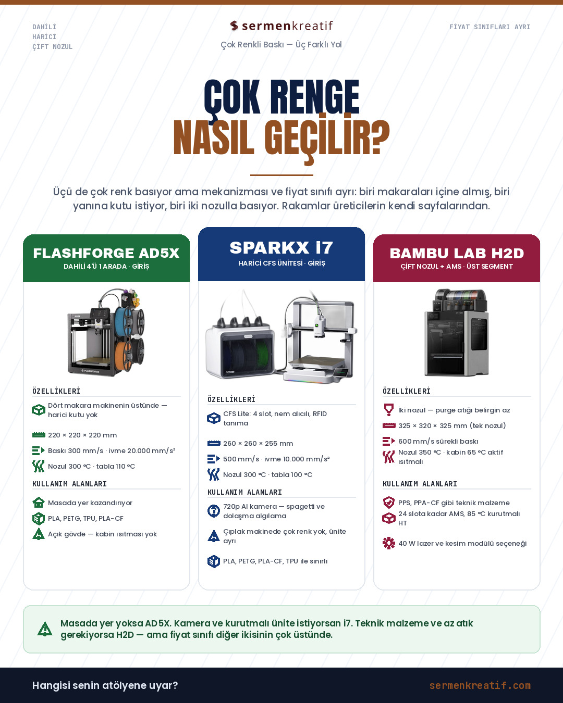
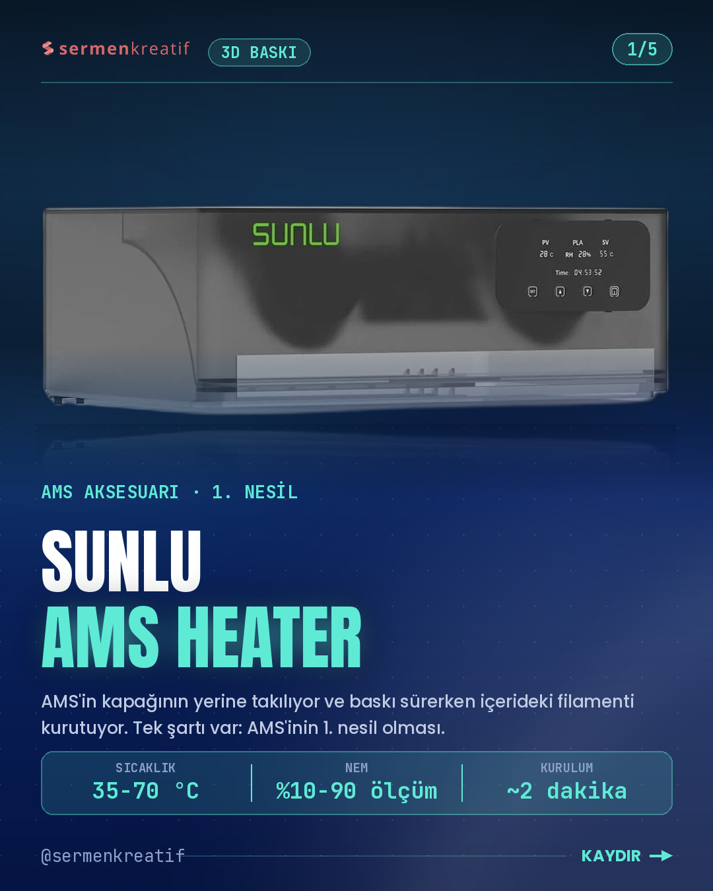
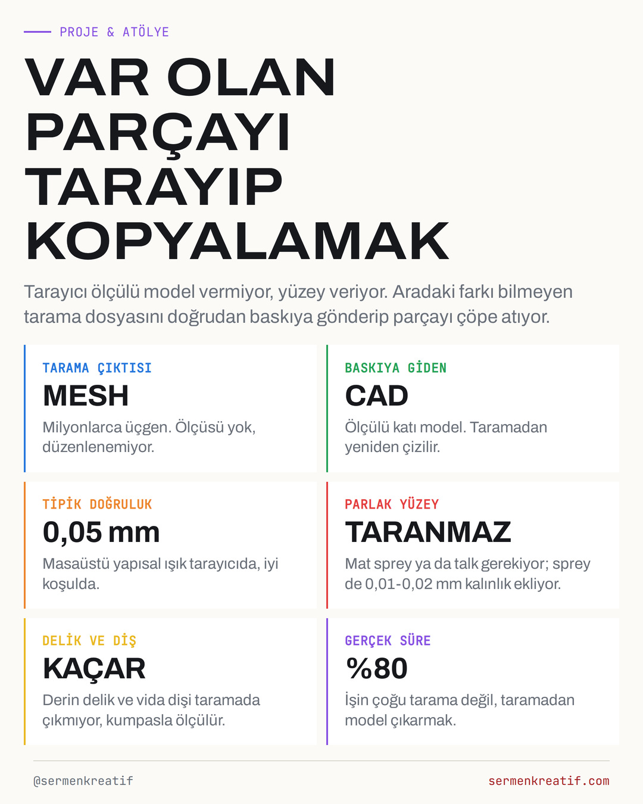

# YAYIN PAKETİ

Her gönderinin kapağı, klasörü ve metni burada. Metin kutusunun sağ üstündeki kopyala düğmesine basıp Instagram'a yapıştır; başlığa dokununca klasör açılıyor.

Hikaye gönderiden 40 dakika sonra, aynı klasörde `hikaye.jpg`.

Bu dosya `sira.py` tarafından üretiliyor, elle düzenleme.

---

# 2026-11-03 · Salı

## 09:10 · AYAR & REHBER

<a href="https://github.com/sedatisc/instagram-gorseller/tree/main/2026-10-17-cok-renkli-yazici-pano"></a>

**[2026-10-17-cok-renkli-yazici-pano](https://github.com/sedatisc/instagram-gorseller/tree/main/2026-10-17-cok-renkli-yazici-pano)** · 1 kare · hikaye 09:50

```
Çok renkli baskıya geçmenin üç yolu var ve üçü ayrı mekanizma — fiyat sınıfları da ayrı.

**Flashforge AD5X · dahili dört makara** » 220 × 220 × 220 mm, baskı hızı 300 mm/s (boşta hareket 600 mm/s), ivme 20.000 mm/s², nozul 300 °C, tabla 110 °C. Dört makara makinenin üstünde duruyor, harici kutu yok — masada yer kazandırıyor. PLA, PETG, TPU ve PLA-CF basıyor. Açık gövde, kabin ısıtması yok.

**Creality SPARKX i7 · harici CFS ünitesi** » 260 × 260 × 255 mm, 500 mm/s, ivme 10.000 mm/s², nozul 300 °C, tabla 100 °C. Çok renk için yanına CFS Lite ünitesi gerekiyor: 4 slot, nem alıcıyla kurutma, RFID ile filament tanıma, otomatik takviye. 720p AI kamerası spagetti ve dolaşma algılıyor.

Dikkat » çıplak i7'de çok renk yok, ünite ayrı satılıyor. CFS Mini adlı sürüm çok renkli baskı yapmıyor, paketleri karıştırma.

**Bambu Lab H2D · çift nozul + AMS** » 325 × 320 × 325 mm (tek nozulla), 600 mm/s sürekli baskı, nozul 350 °C, kabin 65 °C'ye kadar aktif ısıtmalı. İki ayrı nozul olduğu için renk değişiminde atılan purge malzemesi belirgin az. 24 slota kadar AMS bağlanıyor, AMS HT 85 °C'ye kadar kurutuyor. İsteğe bağlı 40 W lazer ve kesim modülü var.

**Fiyat sınıfını söylemeden karşılaştırma eksik kalır:** AD5X ve i7 giriş seviyesi, açık gövdeli, PLA/PETG ağırlıklı makineler. H2D kapalı ve aktif ısıtmalı kabiniyle PPS ve PPA-CF gibi teknik malzeme basan, üstüne lazer ve kesim yapan bir üst segment makine — etiketi diğer ikisinin çok üstünde.

Karar: masada yer yoksa AD5X. Kamera ve kurutmalı ünite istiyorsan i7. Teknik malzeme basacaksan ve purge atığı seni rahatsız ediyorsa H2D.

Çok renkli baskıya geçmek isteyip hangi sistemi alacağına karar veremeyen bir arkadaşın varsa bu gönderiyi ona yolla.

#sermenkreatif #3dbaski #cokrenklibaski #3dyazici #makerturkiye
```

## 12:38 · BASKI ÜRÜNLERİ

<a href="https://github.com/sedatisc/instagram-gorseller/tree/main/urun/3-katli-kalpli-sunum-standi-cupcake-kurabiye-ve-tatli-standi"></a>

**[urun/3-katli-kalpli-sunum-standi-cupcake-kurabiye-ve-tatli-standi](https://github.com/sedatisc/instagram-gorseller/tree/main/urun/3-katli-kalpli-sunum-standi-cupcake-kurabiye-ve-tatli-standi)** · 4 kare · hikaye 13:18

```
3 Katlı Kalpli Sunum Standı - Cupcake, Kurabiye ve Tatlı Standı

Nervürlü kenarlı üç tablalı, tepesi kalp tutamaklı sunum standı.

Atölyemizde PLA filament ile basılıyor. Katman dokusu 3D baskının kendi dokusu; renk seçenekleri için yazabilirsin.

Faturalı satış, Samsun'dan kargo. 999,90 ₺.

Ürün sayfası: sermenkreatif.com/urun/3-katli-kalpli-sunum-standi-cupcake-kurabiye-ve-tatli-standi

Pasta yapan arkadaşına yolla.

#sermenkreatif #3dbaski #sunumstandi #pastastandi
```

## 17:24 · BASKI ÜRÜNLERİ

<a href="https://github.com/sedatisc/instagram-gorseller/tree/main/urun/dalgali-desenli-kagit-mendil-kutusu-kapakli"></a>

**[urun/dalgali-desenli-kagit-mendil-kutusu-kapakli](https://github.com/sedatisc/instagram-gorseller/tree/main/urun/dalgali-desenli-kagit-mendil-kutusu-kapakli)** · 4 kare · hikaye 18:04

```
Dalgalı Desenli Kağıt Mendil Kutusu - Kapaklı

Dalga dokulu gövdeli, standart kutu mendillere uygun dekoratif mendil kutusu.

Atölyemizde PLA filament ile basılıyor. Katman dokusu 3D baskının kendi dokusu; renk seçenekleri için yazabilirsin.

Faturalı satış, Samsun'dan kargo. 829,90 ₺.

Ürün sayfası: sermenkreatif.com/urun/dalgali-desenli-kagit-mendil-kutusu-kapakli

Masasını toplamayı seven birine yolla.

#sermenkreatif #3dbaski #pecetelik #masadekoru
```

---

# 2026-11-04 · Çarşamba

## 09:10 · ÜRÜN & MAĞAZA

<a href="https://github.com/sedatisc/instagram-gorseller/tree/main/2026-10-15-sunlu-ams-heater"></a>

**[2026-10-15-sunlu-ams-heater](https://github.com/sedatisc/instagram-gorseller/tree/main/2026-10-15-sunlu-ams-heater)** · 5 kare · hikaye 09:50

```
SUNLU AMS Heater, Bambu Lab AMS'in üst kapağının yerine takılan bir ısıtıcı kapak. Yaptığı iş tek cümlede: baskı sürerken AMS'in içindeki filamenti kuru tutuyor.

Normalde makarayı AMS'ten çıkarıp kurutucuya koyman, kuruyunca geri takman gerekiyor. Bu kapak o adımı tamamen kaldırıyor.

Rakamlar → 35-70 °C aralığı, 20 dakikada 70 °C'ye çıkıyor. Nem göstergesi gerçek ölçüm yapıyor, %10-90 arası gösteriyor. Otomatik modda %50 nemin üstünde devreye girip %20'de kesiyor; başlangıç eşiğini %25-50 arasında kendin ayarlıyorsun. Zamanlayıcı 0-99 saat.

Kurulum → AMS'in altına girmiyor, kapağının yerine geçiyor. Gevşet, çıkar, sıkıştır; üretici iki dakika diyor. Kalıcı bir değişiklik değil, orijinal kapak geri takılabiliyor.

En kritik nokta → bu ürün yalnız AMS 1. nesil için. AMS Lite'ın ayrı bir modeli var, bu değil. AMS 2 Pro ve AMS HT için SUNLU'nun şu an ürünü yok. Sipariş vermeden önce AMS'inin hangi nesil olduğuna bak; bu üründeki tek iade sebebi bu.

Bilinmesi gerekenler → makara başına ayrı sıcaklık kontrolü yok, dört makara birlikte ısınıyor, yani farklı malzemeleri aynı anda farklı sıcaklıkta kurutamıyorsun. Anma gücü 220 W, ısınma anında 390 W'a çıkıyor. Üretici 10 °C altı ortamda ekrandaki sıcaklığın gerçeğin biraz üstünde kalabileceğini kendisi yazıyor.

AMS'inden nemli filament yüzünden sürekli bozuk baskı alan bir arkadaşın varsa bu gönderiyi ona yolla.

#sermenkreatif #3dbaski #bambulab #ams #sunlu #makerturkiye
```

## 12:10 · BASKI ÜRÜNLERİ

<a href="https://github.com/sedatisc/instagram-gorseller/tree/main/urun/dalgali-kenarli-ayakli-dekoratif-tepsi-25-cm"></a>

**[urun/dalgali-kenarli-ayakli-dekoratif-tepsi-25-cm](https://github.com/sedatisc/instagram-gorseller/tree/main/urun/dalgali-kenarli-ayakli-dekoratif-tepsi-25-cm)** · 4 kare · hikaye 12:50

```
Dalgalı Kenarlı Ayaklı Dekoratif Tepsi - 25 cm

Dalgalı kenarlı, top ayaklı yuvarlak dekoratif tepsi.

Atölyemizde PLA filament ile basılıyor. Katman dokusu 3D baskının kendi dokusu; renk seçenekleri için yazabilirsin.

Faturalı satış, Samsun'dan kargo. 419,90 ₺.

Ürün sayfası: sermenkreatif.com/urun/dalgali-kenarli-ayakli-dekoratif-tepsi-25-cm

Evini toplamayı seven bir arkadaşına bu gönderiyi yolla.

#sermenkreatif #3dbaski #dekoratiftepsi #evdekorasyonu
```

## 17:24 · BASKI ÜRÜNLERİ

<a href="https://github.com/sedatisc/instagram-gorseller/tree/main/urun/dalgali-kenarli-pasta-ve-tatli-sunum-tabagi-24-cm"></a>

**[urun/dalgali-kenarli-pasta-ve-tatli-sunum-tabagi-24-cm](https://github.com/sedatisc/instagram-gorseller/tree/main/urun/dalgali-kenarli-pasta-ve-tatli-sunum-tabagi-24-cm)** · 4 kare · hikaye 18:04

```
Dalgalı Kenarlı Pasta ve Tatlı Sunum Tabağı - 24 cm

Fırfırlı dalga kenarlı, 24 cm çaplı pasta ve tatlı sunum tabağı.

Atölyemizde PLA filament ile basılıyor. Katman dokusu 3D baskının kendi dokusu; renk seçenekleri için yazabilirsin.

Faturalı satış, Samsun'dan kargo. 559,90 ₺.

Ürün sayfası: sermenkreatif.com/urun/dalgali-kenarli-pasta-ve-tatli-sunum-tabagi-24-cm

Misafir ağırlamayı seven birine yolla.

#sermenkreatif #3dbaski #sunumtabagi #dekoratifkase
```

## 19:40 · REELS — [2026-10-15-sunlu-ams-heater/reels.mp4](https://github.com/sedatisc/instagram-gorseller/tree/main/2026-10-15-sunlu-ams-heater)

Açıklama gönderi metniyle aynı.

---

# 2026-11-05 · Perşembe

## 09:05 · PROJE & ATÖLYE

<a href="https://github.com/sedatisc/instagram-gorseller/tree/main/2026-10-15-3d-tarayici"></a>

**[2026-10-15-3d-tarayici](https://github.com/sedatisc/instagram-gorseller/tree/main/2026-10-15-3d-tarayici)** · 5 kare · hikaye 09:45

```
3D tarayıcı ölçülü model vermiyor, yüzey veriyor. Aradaki farkı bilmeyen tarama dosyasını doğrudan baskıya gönderip parçayı çöpe atıyor.

Taramadan çıkan şey **mesh**: milyonlarca üçgen. Üstünde "çap 20 mm" diye bir bilgi yok, bir yüzeyi 0,5 mm kaydıramıyorsun. Kopyalanacak parça için mesh referans alınıyor, model CAD'de yeniden çiziliyor. İşin %80'i burada; tarama kısmı on dakika.

**Taramadan önce parçayı hazırla.** Parlak ya da şeffaf yüzey taranmıyor — mat sprey ya da talk gerekiyor, ama sprey de 0,01-0,02 mm kalınlık ekliyor; geçme ölçüde bu fark önemli. Derin delik ve vida dişi taramada çıkmıyor, kumpasla ölçülüyor.

**Doğruluk rakamına dikkat.** Masaüstü yapısal ışık tarayıcıda iyi koşulda 0,05 mm civarı. "İyi koşul" demek: sabit ışık, hareketsiz parça, yeterli örtüşme. Elde gezdirilen taramada bu rakam birkaç katına çıkıyor.

**Kritik ölçüyü kumpasla doğrula.** Taramadaki sapma geniş yüzeye dağılıyor ve göze batmıyor, ama montaj deliklerinde toplanıyor. Geçme yapacak her ölçü ayrıca ölçülüyor; dişli ve vida dişi zaten standart tablodan çiziliyor.

Ne zaman tarama gereksiz: düz yüzey, delik ve pahtan ibaret bir parçayı kumpasla ölçüp çizmek taramadan hızlı. Tarama serbest form yüzeyde — kalıp, gövde, organik şekil — kazanıyor.

Bir uyarı » taranan parça başkasının ürünüyse kopyalamadan önce tasarım hakkına bak. Birebir kopya satışa çıkmıyor.

Tarama dosyasını doğrudan slicer'a atıp sonucu beğenmeyen bir arkadaşın varsa bu gönderiyi ona yolla.

#sermenkreatif #maker #3dtarayici #3dbaski #makerturkiye
```

## 12:38 · BASKI ÜRÜNLERİ

<a href="https://github.com/sedatisc/instagram-gorseller/tree/main/urun/elmas-desenli-dekoratif-vazo-15-cm"></a>

**[urun/elmas-desenli-dekoratif-vazo-15-cm](https://github.com/sedatisc/instagram-gorseller/tree/main/urun/elmas-desenli-dekoratif-vazo-15-cm)** · 4 kare · hikaye 13:18

```
Elmas Desenli Dekoratif Vazo - 15 cm

Geometrik elmas dokulu, ışıkla parlayan dekoratif vazo.

Atölyemizde PLA filament ile basılıyor. Katman dokusu 3D baskının kendi dokusu; renk seçenekleri için yazabilirsin.

Faturalı satış, Samsun'dan kargo. 239,90 ₺.

Ürün sayfası: sermenkreatif.com/urun/elmas-desenli-dekoratif-vazo-15-cm

Evini toplamayı seven bir arkadaşına bu gönderiyi yolla.

#sermenkreatif #3dbaski #dekoratifvazo #evdekorasyonu
```

## 17:24 · BASKI ÜRÜNLERİ

<a href="https://github.com/sedatisc/instagram-gorseller/tree/main/urun/gizli-montajli-minimal-duvar-rafi-yuvarlak-uclu"></a>

**[urun/gizli-montajli-minimal-duvar-rafi-yuvarlak-uclu](https://github.com/sedatisc/instagram-gorseller/tree/main/urun/gizli-montajli-minimal-duvar-rafi-yuvarlak-uclu)** · 4 kare · hikaye 18:04

```
Gizli Montajlı Minimal Duvar Rafı - Yuvarlak Uçlu

Uçları yumuşakça kıvrılan, vidası görünmeyen sade yüzer duvar rafı.

Atölyemizde PLA filament ile basılıyor. Katman dokusu 3D baskının kendi dokusu; renk seçenekleri için yazabilirsin.

Faturalı satış, Samsun'dan kargo. 299,90 ₺.

Ürün sayfası: sermenkreatif.com/urun/gizli-montajli-minimal-duvar-rafi-yuvarlak-uclu

Evini toplamayı seven bir arkadaşına bu gönderiyi yolla.

#sermenkreatif #3dbaski #duvarrafi #evdekorasyonu
```

---

# 2026-11-06 · Cuma

## 09:10 · AYAR & REHBER

<a href="https://github.com/sedatisc/instagram-gorseller/tree/main/2026-10-18-bambu-h-serisi-pano"></a>

**[2026-10-18-bambu-h-serisi-pano](https://github.com/sedatisc/instagram-gorseller/tree/main/2026-10-18-bambu-h-serisi-pano)** · 1 kare · hikaye 09:50

```
Bambu'nun H serisinde üç makine var ve adları birbirine çok benziyor. Şunu baştan söyleyeyim: **sıcaklık ve hız üçünde de aynı.** 350 °C nozul, 120 °C tabla, 65 °C'ye kadar aktif ısıtmalı kapalı kabin, 1.000 mm/s kafa hızı, 20.000 mm/s² ivme. Yani "hangisi daha güçlü" diye bakmak yanlış soru.

Gerçek ayrım kafa mimarisi ile baskı alanı arasındaki takasta.

**H2S » tek nozul, en büyük hacim.** 340 × 320 × 340 mm — serinin en büyüğü. Tek nozul, hızlı değişen uç. Bambu bunu "daha büyük bir X1C" diye konumluyor: H2D'nin çift nozul karmaşıklığı olmadan daha çok hacim. Lazer tarafında sınırı var, yalnız 10 W destekliyor; 40 W lazer takılmıyor. Serinin en uygun fiyatlısı.

Kime: tek malzemeyle büyük parça basan.

**H2C » Vortek, atıksız çok malzeme.** Sağ kafasında 6 hotend'li otomatik değiştirici karusel var. Combo kutusunda 8 hotend geliyor, önerilen kurulumla tek işte 7 malzemeye kadar **purge atığı olmadan** basıyor. Çok renkli baskıda çöpe giden malzeme derdini ortadan kaldıran kısım burası. AMS ile 24 filamente kadar çıkıyor.

Karşılığı: serinin en küçük baskı alanı (330 × 320 × 325 mm, iki nozul toplamı) ve en yüksek fiyatı.

Kime: çok renkli/çok malzemeli iş yapan ve atıktan rahatsız olan.

**H2D » çift nozul, lazer ve kesim.** 350 × 320 × 325 mm, çift nozul, 600 mm/s sürekli baskı. Tek farkı baskı değil: 10 W ya da 40 W lazer modülü takılıyor, 40 W ile 15 mm kontrplak kesiyor. Üstüne dijital kesim ve kalem çizim modülleri var. 12 AMS ünitesine, 25 renge kadar çıkıyor.

Kime: masasına baskı + lazer + kesim atölyesini birlikte kuracak olan.

Karar kısaca: tek malzemeyle büyük parça basıyorsan H2S. Çok renkte atık istemiyorsan H2C. Lazer ve kesim de lazımsa H2D.

Bir not » H2D Pro adında kurumsal bir model daha var; tungsten karbür nozullar ve kurumsal ağ desteğiyle ayrı bir sınıf, bu karşılaştırmaya girmiyor.

H serisinde hangisini alacağına karar veremeyen bir arkadaşın varsa bu gönderiyi ona yolla.

#sermenkreatif #3dbaski #bambulab #3dyazici
```

## 12:38 · BASKI ÜRÜNLERİ

<a href="https://github.com/sedatisc/instagram-gorseller/tree/main/urun/iki-katli-dalgali-kenarli-sunum-standi-25-cm"></a>

**[urun/iki-katli-dalgali-kenarli-sunum-standi-25-cm](https://github.com/sedatisc/instagram-gorseller/tree/main/urun/iki-katli-dalgali-kenarli-sunum-standi-25-cm)** · 4 kare · hikaye 13:18

```
İki Katlı Dalgalı Kenarlı Sunum Standı - 25 cm

Dalgalı kenarlı iki tablalı cupcake, kurabiye ve tatlı sunum standı.

Atölyemizde PLA filament ile basılıyor. Katman dokusu 3D baskının kendi dokusu; renk seçenekleri için yazabilirsin.

Faturalı satış, Samsun'dan kargo. 759,90 ₺.

Ürün sayfası: sermenkreatif.com/urun/iki-katli-dalgali-kenarli-sunum-standi-25-cm

Pasta yapan arkadaşına yolla.

#sermenkreatif #3dbaski #sunumstandi #pastastandi
```

## 16:40 · BASKI ÜRÜNLERİ

<a href="https://github.com/sedatisc/instagram-gorseller/tree/main/urun/japandi-kedi-kopek-mama-kabi-isim-plakali"></a>

**[urun/japandi-kedi-kopek-mama-kabi-isim-plakali](https://github.com/sedatisc/instagram-gorseller/tree/main/urun/japandi-kedi-kopek-mama-kabi-isim-plakali)** · 4 kare · hikaye 17:20

```
Japandi Kedi Köpek Mama Kabı - İsim Plakalı

Nervürlü gövdeli, isim plakalı, çelik kase yuvalı mama kabı tutucu.

Atölyemizde PLA filament ile basılıyor. Katman dokusu 3D baskının kendi dokusu; renk seçenekleri için yazabilirsin.

Faturalı satış, Samsun'dan kargo. 839,90 ₺.

Ürün sayfası: sermenkreatif.com/urun/japandi-kedi-kopek-mama-kabi-isim-plakali

Kedisi ya da köpeği olan birine yolla.

#sermenkreatif #3dbaski #mamakabi #kedikopek
```

## 19:20 · REELS — [2026-10-18-bambu-h-serisi-pano/reels.mp4](https://github.com/sedatisc/instagram-gorseller/tree/main/2026-10-18-bambu-h-serisi-pano)

Açıklama gönderi metniyle aynı.

---

# 2026-11-07 · Cumartesi

## 11:10 · ÜRÜN & MAĞAZA

<a href="https://github.com/sedatisc/instagram-gorseller/tree/main/2026-10-16-phaetus-liber-u1"></a>

**[2026-10-16-phaetus-liber-u1](https://github.com/sedatisc/instagram-gorseller/tree/main/2026-10-16-phaetus-liber-u1)** · 5 kare · hikaye 11:50

```
Snapmaker ile Phaetus'un U1 için birlikte çıkardığı Liber hotend geldi. Ne yaptığını ve ne YAPMADIĞINI birlikte yazıyorum, çünkü ikincisi daha çok yanlış biliniyor.

Ne yapıyor → nozul içindeki eriyiği birden fazla kanala bölüyor. Eriyiğin yüzey/hacim oranı arttığı için aynı enerjiyle birim zamanda daha fazla filament eriyor. Üreticinin eşit enerji koşulundaki testinde PLA'da %66, ABS'de %87, PETG HF'de %43 daha yüksek hacimsel akış.

Dikkat → bu hız garantisi değil, akış kapasitesi. Snapmaker'ın kendisi de bunun doğrudan baskı süresine yansımadığını, kazancın baskının ne kadarının eritme kapasitesiyle sınırlı olduğuna bağlı olduğunu yazıyor. Uzun ve kesintisiz ekstrüzyon yollu büyük parçalarda fark açılıyor; bol kıvrımlı, sık yön değiştiren küçük modelde kayboluyor.

Ne YAPMIYOR → sertleştirilmiş çelik gövdeli diye karbon fiber çözümü sanılıyor. Üretici bu hotend'i karbon ve cam elyaf takviyeli filamentler, ahşap dolgulu filament ve TPU için ÖNERMİYOR; o malzemeler için standart hotend'e yönlendiriyor. Aşındırıcı filament basıyorsan senin alman gereken Snapmaker'ın kendi sertleştirilmiş çelik hotend seti.

Bir şey daha → maksimum sıcaklık 300 °C, yani U1'in standart hotend'iyle birebir aynı. Liber yüksek sıcaklık malzemelerinin kapısını açmıyor.

Pratik not → U1 dört başlıklı bir makine, gerçekte dört adet gerekiyor. Tek tek almak yerine dörtlü set almak hem daha ucuz hem de dört kafa aynı davranıyor. Tek çap var: 0,4 mm.

Fiyat ve stok için sermenkreatif.com.

U1'ine hotend arayan bir arkadaşın varsa bu gönderiyi ona yolla — özellikle karbon fiber basacaksa.

#sermenkreatif #3dbaski #snapmaker #phaetus #hotend
```

## 13:20 · BASKI ÜRÜNLERİ

<a href="https://github.com/sedatisc/instagram-gorseller/tree/main/urun/kedi-kumu-kuregi-3-delik-boyutlu-petek-elek"></a>

**[urun/kedi-kumu-kuregi-3-delik-boyutlu-petek-elek](https://github.com/sedatisc/instagram-gorseller/tree/main/urun/kedi-kumu-kuregi-3-delik-boyutlu-petek-elek)** · 4 kare · hikaye 14:00

```
Kedi Kumu Küreği - 3 Delik Boyutlu Petek Elek

Küçük, orta ve büyük petek delikli, uzun saplı kedi kumu küreği.

Atölyemizde PLA filament ile basılıyor. Katman dokusu 3D baskının kendi dokusu; renk seçenekleri için yazabilirsin.

Faturalı satış, Samsun'dan kargo. 289,90 ₺.

Ürün sayfası: sermenkreatif.com/urun/kedi-kumu-kuregi-3-delik-boyutlu-petek-elek

Kedisi olan bir arkadaşına yolla.

#sermenkreatif #3dbaski #kediaksesuari #kedili
```

## 17:10 · BASKI ÜRÜNLERİ

<a href="https://github.com/sedatisc/instagram-gorseller/tree/main/urun/kelebek-duvar-rafi-cocuk-odasi-dekoratif-raf"></a>

**[urun/kelebek-duvar-rafi-cocuk-odasi-dekoratif-raf](https://github.com/sedatisc/instagram-gorseller/tree/main/urun/kelebek-duvar-rafi-cocuk-odasi-dekoratif-raf)** · 4 kare · hikaye 17:50

```
Kelebek Duvar Rafı - Çocuk Odası Dekoratif Raf

Kelebek formunda, duvara asılan dekoratif mini raf.

Atölyemizde PLA filament ile basılıyor. Katman dokusu 3D baskının kendi dokusu; renk seçenekleri için yazabilirsin.

Faturalı satış, Samsun'dan kargo. 469,90 ₺.

Ürün sayfası: sermenkreatif.com/urun/kelebek-duvar-rafi-cocuk-odasi-dekoratif-raf

Evini toplamayı seven bir arkadaşına bu gönderiyi yolla.

#sermenkreatif #3dbaski #duvarrafi #evdekorasyonu
```

## 19:20 · REELS — [2026-10-16-phaetus-liber-u1/reels.mp4](https://github.com/sedatisc/instagram-gorseller/tree/main/2026-10-16-phaetus-liber-u1)

Açıklama gönderi metniyle aynı.

---

# 2026-11-08 · Pazar

## 11:10 · PROJE & ATÖLYE

<a href="https://github.com/sedatisc/instagram-gorseller/tree/main/2026-10-16-tavan-arasi-kamera-robotu"></a>

**[2026-10-16-tavan-arasi-kamera-robotu](https://github.com/sedatisc/instagram-gorseller/tree/main/2026-10-16-tavan-arasi-kamera-robotu)** · 5 kare · hikaye 11:50

```
Tavan arası kamera robotu yapmanın asıl zorluğu robotu sürmek değil, geri getirmek. Tasarım kararlarının yarısı bu yüzden alınıyor.

Ölçüyü boşluk belirliyor. Tavan arasında yol yok; mertek arası boşluk var, tipik 40-60 cm. Gövde ve kamera dahil 12 cm'nin altında kalmayan robot bir yerde takılıyor. Tekerlek cam yününe gömüldüğü için paletli ve geniş gövde kazanıyor, ağırlık 1 kg altında tutuluyor.

Yazın tavan arası fırın gibi. Kiremit altı sıcaklık 50-60 °C'yi buluyor; PLA gövde bu sıcaklıkta kendi ağırlığıyla sarkıyor. Gövde PETG ya da ASA basılıyor, LiPo paket 45 °C üstünde şişme riskine girdiği için gölgede kalan yüze yerleşiyor ve tur kısa tutuluyor.

Işık çözünürlükten önemli. Tavan arası zifiri karanlık: 2 × 3 W beyaz LED, 4K kameradan daha çok iş görüyor. IR aydınlatma görüntüyü yalnız siyah-beyaz veriyor, nem lekesiyle küf lekesini ayırt edemiyorsun.

Telsizi yalıtım seçiyor. Cam yünü ve folyo kaplı şilte 5 GHz'i birkaç metrede kesiyor; 2,4 GHz hem daha çok geçiyor hem daha uzun menzil veriyor. Paket gelmeyince motor duracak — 500 ms zaman aşımı yoksa sinyalsiz robot yoluna devam edip iyice uzaklaşıyor.

En ucuz sigorta 5 metrelik ip. Gövdeye iki noktadan bağlanıp ucu kapakta bırakılıyor; takılan robot elle geri çekiliyor. Tavan arasında kaybolan robot tavan arasında kalıyor.

Evinin tavan arasına bakmak isteyip de kafasını sokamayan bir arkadaşın varsa bu gönderiyi ona yolla.

#sermenkreatif #maker #robotik #kamerarobotu
```

## 13:20 · BASKI ÜRÜNLERİ

<a href="https://github.com/sedatisc/instagram-gorseller/tree/main/urun/lumina-modern-vazo-keskin-nervurlu-dekoratif-vazo"></a>

**[urun/lumina-modern-vazo-keskin-nervurlu-dekoratif-vazo](https://github.com/sedatisc/instagram-gorseller/tree/main/urun/lumina-modern-vazo-keskin-nervurlu-dekoratif-vazo)** · 4 kare · hikaye 14:00

```
Lumina Modern Vazo - Keskin Nervürlü Dekoratif Vazo

Keskin dikey nervürleriyle ışık ve gölge oyunu yaratan şişe formlu modern vazo.

Atölyemizde PLA filament ile basılıyor. Katman dokusu 3D baskının kendi dokusu; renk seçenekleri için yazabilirsin.

Faturalı satış, Samsun'dan kargo. 369,90 ₺.

Ürün sayfası: sermenkreatif.com/urun/lumina-modern-vazo-keskin-nervurlu-dekoratif-vazo

Evini toplamayı seven bir arkadaşına bu gönderiyi yolla.

#sermenkreatif #3dbaski #dekoratifvazo #evdekorasyonu
```

## 17:10 · BASKI ÜRÜNLERİ

<a href="https://github.com/sedatisc/instagram-gorseller/tree/main/urun/minimal-duvar-askisi-yapistirmali-2-li-kanca"></a>

**[urun/minimal-duvar-askisi-yapistirmali-2-li-kanca](https://github.com/sedatisc/instagram-gorseller/tree/main/urun/minimal-duvar-askisi-yapistirmali-2-li-kanca)** · 4 kare · hikaye 17:50

```
Minimal Duvar Askısı - Yapıştırmalı 2'li Kanca

Delmeden, güçlü çift taraflı bantla yapıştırılan sade duvar kancası (2 adet).

Atölyemizde PLA filament ile basılıyor. Katman dokusu 3D baskının kendi dokusu; renk seçenekleri için yazabilirsin.

Faturalı satış, Samsun'dan kargo. 279,90 ₺.

Ürün sayfası: sermenkreatif.com/urun/minimal-duvar-askisi-yapistirmali-2-li-kanca

Evini toplamayı seven bir arkadaşına bu gönderiyi yolla.

#sermenkreatif #3dbaski #duvaraskisi #portmanto
```

---

# 2026-11-09 · Pazartesi

## 09:10 · AYAR & REHBER

<a href="https://github.com/sedatisc/instagram-gorseller/tree/main/2026-10-18-sert-nozul"></a>

**[2026-10-18-sert-nozul](https://github.com/sedatisc/instagram-gorseller/tree/main/2026-10-18-sert-nozul)** · 5 kare · hikaye 09:50

```
Karbon elyaflı filamente geçtikten sonra baskıların bozulmaya başladıysa önce ayarları kurcalama, nozula bak.

Pirinç yumuşak bir malzeme. Isıyı çok iyi ilettiği için standart uç pirinçten yapılıyor, PLA ve PETG'de yıllarca sorun çıkarmıyor. Ama içinden karbon elyaf, cam elyaf, ahşap tozu, metal tozu ya da karanlıkta parlayan filamentin fosfor taneleri geçmeye başladığında delik yavaşça büyüyor.

Sorun şu: dilimleyici hâlâ 0,4 mm varsayıp malzeme hesaplıyor. Delik 0,45 olduğunda duvar inceliyor, köşelerde boşluk açılıyor, üst yüzey kapanmıyor. Sen sıcaklıkla, akışla, retraction'la uğraşıyorsun; sebep eline aldığın parçada değil, ucun içinde.

Aşındıranlar: karbon elyaf, cam elyaf, ahşap dolgulu, metal dolgulu, karanlıkta parlayan filamentler.
Aşındırmayanlar: düz PLA, PETG, ABS, ASA, TPU. Bunlarda pirinç uç yeterli.

Sert uca geçerken bilmen gereken bir ayrıntı var: sertleştirilmiş çelik pirinç kadar iyi ısı iletmiyor. Aynı sıcaklık ayarıyla basınca malzeme yeterince erimeyebiliyor. Nozul sıcaklığını 5-10 °C yükselt, ilk baskıda akışı gözle. Pirinç kadar iyi ileten sert seçenek arıyorsan tungsten karbür ya da yakut uçlu modellere bakacaksın.

Elyaflı filamente geçmeyi düşünüyorsan ucu önceden değiştir. Uç ucuz, bozuk baskı pahalı.

Karbon katkılı filamente geçmeyi düşünen bir arkadaşına yolla.

#sermenkreatif #3dbaski #nozzle #karbonfiber #filament
```

## 12:38 · BASKI ÜRÜNLERİ

<a href="https://github.com/sedatisc/instagram-gorseller/tree/main/urun/modern-tealight-mumluk-seti-3-lu"></a>

**[urun/modern-tealight-mumluk-seti-3-lu](https://github.com/sedatisc/instagram-gorseller/tree/main/urun/modern-tealight-mumluk-seti-3-lu)** · 4 kare · hikaye 13:18

```
Modern Tealight Mumluk Seti - 3'lü

Minimal formlu, tealight mumlara uygun 3'lü mumluk seti.

Atölyemizde PLA filament ile basılıyor. Katman dokusu 3D baskının kendi dokusu; renk seçenekleri için yazabilirsin.

Faturalı satış, Samsun'dan kargo. 279,90 ₺.

Ürün sayfası: sermenkreatif.com/urun/modern-tealight-mumluk-seti-3-lu

Evini toplamayı seven bir arkadaşına bu gönderiyi yolla.

#sermenkreatif #3dbaski #mumluk #evdekorasyonu
```

## 17:24 · BASKI ÜRÜNLERİ

<a href="https://github.com/sedatisc/instagram-gorseller/tree/main/urun/nervurlu-dekoratif-kalp-biblo-japandi-15-cm"></a>

**[urun/nervurlu-dekoratif-kalp-biblo-japandi-15-cm](https://github.com/sedatisc/instagram-gorseller/tree/main/urun/nervurlu-dekoratif-kalp-biblo-japandi-15-cm)** · 4 kare · hikaye 18:04

```
Nervürlü Dekoratif Kalp Biblo - Japandi, 15 cm

Dikey nervür dokulu, ayakta duran Japandi tarzı dekoratif kalp.

Atölyemizde PLA filament ile basılıyor. Katman dokusu 3D baskının kendi dokusu; renk seçenekleri için yazabilirsin.

Faturalı satış, Samsun'dan kargo. 779,90 ₺.

Ürün sayfası: sermenkreatif.com/urun/nervurlu-dekoratif-kalp-biblo-japandi-15-cm

Evini toplamayı seven bir arkadaşına bu gönderiyi yolla.

#sermenkreatif #3dbaski #dekoratifobje #evdekorasyonu
```

---

# 2026-11-10 · Salı

## 09:10 · ÜRÜN & MAĞAZA

<a href="https://github.com/sedatisc/instagram-gorseller/tree/main/2026-10-17-polymaker-ht-pla"></a>

**[2026-10-17-polymaker-ht-pla](https://github.com/sedatisc/instagram-gorseller/tree/main/2026-10-17-polymaker-ht-pla)** · 5 kare · hikaye 09:50

```
Polymaker HT-PLA serisi yüksek sıcaklığa dayanıklı PLA diye satılıyor ve bu doğru — ama bir şartı var, onu söylemeyen satıcıdan almayın.

Isı dayanımı kutudan çıkmıyor, tavlamayla geliyor.

Rakamlar, Polymaker'ın kendi teknik veri sayfasından, tavlama öncesi → sonrası:

HT-PLA, 0,45 MPa yük altında 61,4 → 107,2 °C. Aynı malzeme 1,8 MPa altında 58,6 → 71,7 °C.
HT-PLA-GF, 0,45 MPa altında 75,5 → 114,7 °C. 1,8 MPa altında 59,7 → 84 °C.

Tavlamadan basarsan elinde normal PLA'dan belirgin farkı olmayan, daha pahalı bir makara kalıyor. 58 °C ile 61 °C arasındaki fark için para vermeye değmez.

İyi haber → tavlama zor değil. 80-90 °C'de 3 dakika. Fırın, kurutucu ya da ısıtmalı tabla yeter. İnce cidarlı parçalarda aralığın alt ucunu kullanın, yoksa çarpılıyor.

Üç çeşit, üç ayrı iş → HT-PLA düz sürüm, fonksiyonel parçanın geneli için. HT-PLA Gradient aynı ısı dayanımını renk geçişiyle veriyor, dekoratif iş için. HT-PLA-GF cam elyaf takviyeli; ailenin en yüksek HDT'si ve en rijit olanı, araç içinde kalacak parça varsa bu.

Baskı ayarı üçünde de aynı: nozul 230 °C, tabla 50 °C.

Yazın araçta bıraktığı telefon tutucusu eğilen bir arkadaşın varsa bu gönderiyi ona yolla.

#sermenkreatif #3dbaski #polymaker #htpla #filament
```

## 12:38 · BASKI ÜRÜNLERİ

<a href="https://github.com/sedatisc/instagram-gorseller/tree/main/urun/spiral-dekoratif-yilbasi-agaci-yildizli-15-cm"></a>

**[urun/spiral-dekoratif-yilbasi-agaci-yildizli-15-cm](https://github.com/sedatisc/instagram-gorseller/tree/main/urun/spiral-dekoratif-yilbasi-agaci-yildizli-15-cm)** · 4 kare · hikaye 13:18

```
Spiral Dekoratif Yılbaşı Ağacı - Yıldızlı, 15 cm

Dalgalı spiral katmanlı, tepesi yıldızlı modern masaüstü yılbaşı ağacı.

Atölyemizde PLA filament ile basılıyor. Katman dokusu 3D baskının kendi dokusu; renk seçenekleri için yazabilirsin.

Faturalı satış, Samsun'dan kargo. 229,90 ₺.

Ürün sayfası: sermenkreatif.com/urun/spiral-dekoratif-yilbasi-agaci-yildizli-15-cm

Yılbaşı hazırlığına başlayan arkadaşına yolla.

#sermenkreatif #3dbaski #yilbasiagaci #yilbasi
```

## 17:24 · BASKI ÜRÜNLERİ

<a href="https://github.com/sedatisc/instagram-gorseller/tree/main/urun/telefon-tutuculu-masaustu-duzenleyici-kalemlikli"></a>

**[urun/telefon-tutuculu-masaustu-duzenleyici-kalemlikli](https://github.com/sedatisc/instagram-gorseller/tree/main/urun/telefon-tutuculu-masaustu-duzenleyici-kalemlikli)** · 4 kare · hikaye 18:04

```
Telefon Tutuculu Masaüstü Düzenleyici - Kalemlikli

Kalemlik, telefon tutucu ve iki bölmeli masaüstü organizer.

Atölyemizde PLA filament ile basılıyor. Katman dokusu 3D baskının kendi dokusu; renk seçenekleri için yazabilirsin.

Faturalı satış, Samsun'dan kargo. 949,90 ₺.

Ürün sayfası: sermenkreatif.com/urun/telefon-tutuculu-masaustu-duzenleyici-kalemlikli

Masası dağınık olan arkadaşına yolla.

#sermenkreatif #3dbaski #masaustuduzenleyici #masaduzeni
```

## 19:40 · REELS — [2026-10-17-polymaker-ht-pla/reels.mp4](https://github.com/sedatisc/instagram-gorseller/tree/main/2026-10-17-polymaker-ht-pla)

Açıklama gönderi metniyle aynı.

---

# 2026-11-11 · Çarşamba

## 09:10 · PROJE & ATÖLYE

<a href="https://github.com/sedatisc/instagram-gorseller/tree/main/2026-10-17-rc-tank"></a>

**[2026-10-17-rc-tank](https://github.com/sedatisc/instagram-gorseller/tree/main/2026-10-17-rc-tank)** · 6 kare · hikaye 09:50

```
RC tank gibi büyük bir baskı projesinde işi bitiren şey baskı değil, parçaya bölme ve birleştirme kararları. Tabladan büyük parça basılmıyor; bölünüyor.

Bölme hattı düz yüzeyden ve görünmeyen kenardan geçiyor. Yük taşıyan kesit bölünmüyor — oradaki kayıp sonradan yapıştırmayla geri gelmiyor. Hizalama için pim yuvası modeldeyken açılıyor, geçme 0,2-0,4 mm boşlukla çiziliyor. Parça sökülecekse vida ve heat-set insert, kalıcı birleşecekse epoksi; CA yapıştırıcı bu boyutta kırılgan kalıyor.

Dayanımı duvar veriyor, dolgu değil. Büyük gövdede 3-4 duvar sırası, %10-15 dolgu ve 5 üst-alt katman yetiyor. Dolguyu yükseltmek süreyi ve ağırlığı büyütüyor, burulmayı çözmüyor. 0,6 mm nozul ve 0,24-0,28 mm katman bu ölçekte günler kazandırıyor.

En çok zorlanan parça palet. Sürekli esniyor ve aşınıyor; tek parça basılan palet koptuğunda iş bitiyor, segmentli palet tamir edilebiliyor. Segmentler pimle birleşiyor, %10 fazla basılıyor, gergi tekerleği ayarlanabilir olacak şekilde çiziliyor.

Ağırlık motoru seçiyor. Gövde ağırlaştıkça redüktör oranı büyüyor, paletli araçta dönüş torku düz gitmenin 2-3 katı. Motoru en sona bırakırsan tank yürümüyor.

Fire payını baştan yaz. Büyük parçada %10 başarısızlık normal; kritik parça iki kez basılıyor, kuyruk sıraya koyuluyor.

Masasında yarım kalmış büyük bir baskı projesi olan bir arkadaşın varsa bu gönderiyi ona yolla.

#sermenkreatif #maker #3dbaski #rctank
```

## 12:10 · BASKI ÜRÜNLERİ

<a href="https://github.com/sedatisc/instagram-gorseller/tree/main/urun/yedek-rulo-hazneli-ayakli-tuvalet-kagitligi-nervurlu"></a>

**[urun/yedek-rulo-hazneli-ayakli-tuvalet-kagitligi-nervurlu](https://github.com/sedatisc/instagram-gorseller/tree/main/urun/yedek-rulo-hazneli-ayakli-tuvalet-kagitligi-nervurlu)** · 4 kare · hikaye 12:50

```
Yedek Rulo Hazneli Ayaklı Tuvalet Kağıtlığı - Nervürlü

Yedek ruloları gövdesinde saklayan, vidasız kurulan ayaklı tuvalet kağıtlığı.

Atölyemizde PLA filament ile basılıyor. Katman dokusu 3D baskının kendi dokusu; renk seçenekleri için yazabilirsin.

Faturalı satış, Samsun'dan kargo. 1.939,90 ₺.

Ürün sayfası: sermenkreatif.com/urun/yedek-rulo-hazneli-ayakli-tuvalet-kagitligi-nervurlu

Evini toplamayı seven bir arkadaşına bu gönderiyi yolla.

#sermenkreatif #3dbaski #tuvaletkagitligi #banyoduzeni
```

## 17:24 · BASKI ÜRÜNLERİ

<a href="https://github.com/sedatisc/instagram-gorseller/tree/main/urun/yukseltilmis-kedi-kopek-mama-kabi-standi-isimli"></a>

**[urun/yukseltilmis-kedi-kopek-mama-kabi-standi-isimli](https://github.com/sedatisc/instagram-gorseller/tree/main/urun/yukseltilmis-kedi-kopek-mama-kabi-standi-isimli)** · 4 kare · hikaye 18:04

```
Yükseltilmiş Kedi Köpek Mama Kabı Standı - İsimli

10 cm yükseltilmiş, dalga desenli, isim yazılabilen mama kabı standı.

Atölyemizde PLA filament ile basılıyor. Katman dokusu 3D baskının kendi dokusu; renk seçenekleri için yazabilirsin.

Faturalı satış, Samsun'dan kargo. 659,90 ₺.

Ürün sayfası: sermenkreatif.com/urun/yukseltilmis-kedi-kopek-mama-kabi-standi-isimli

Kedisi ya da köpeği olan birine yolla.

#sermenkreatif #3dbaski #mamakabi #kedikopek
```

---

# 2026-11-12 · Perşembe

## 09:05 · AYAR & REHBER

<a href="https://github.com/sedatisc/instagram-gorseller/tree/main/2026-10-19-bambu-a-serisi-pano"></a>

**[2026-10-19-bambu-a-serisi-pano](https://github.com/sedatisc/instagram-gorseller/tree/main/2026-10-19-bambu-a-serisi-pano)** · 1 kare · hikaye 09:45

```
A serisinde üç makine var ve üçü de aynı temeli paylaşıyor: açık gövdeli bed-slinger, 300 °C nozul, Combo paketinde AMS Lite ile dört renk. Karar iki şeye iniyor — ne kadar hacim istediğin ve tablanın kaç dereceye çıktığı.

**A1 mini » 180 × 180 × 180 mm.** Nozul 300 °C, tabla 80 °C. Tek AMS Lite alıyor, dört renkle sınırlı ve genişlemiyor. Otomatik tabla tesviyesi var, elle ayar gerekmiyor.

Kime: minyatür ve küçük parça basan, masasında yer kısıtlı olan.

**A1 » 256 × 256 × 256 mm.** Nozul 300 °C, **tabla 100 °C** — serinin tek 100 °C'lik tablası, asıl fark burada. Bambu A1 için TPU ve PVA'yı ideal malzeme sayıyor; diğer ikisi 80 °C'de kalıyor. 500 mm/s, 10.000 mm/s². Her baskı öncesi otomatik titreşim kompanzasyonu yapıyor, kayış gerginliğini titreşim frekansından denetleyip gevşekse uyarıyor. Akış ve basınç kalibrasyonu da otomatik.

Kime: esnek (TPU) ya da suda çözünen (PVA) filamentle çalışacak olan.

**A2L » 330 × 320 × 325 mm.** Serinin en büyüğü, Haziran 2026'da çıktı. 500 mm/s, 10.000 mm/s², tabla 80 °C. Gövdesinde iki granül damper ve çok noktalı uyarlanabilir titreşim telafisi var; Bambu bunu "aslında bir H2S Lite" diye tanımlıyor. Genişlemede önde: 4 AMS + 1 AMS Lite ile 19 renge kadar çıkıyor.

Dikkat » A2L açık gövdeli ve Bambu onu "PLA, PETG ve diğer mühendislik dışı filamentler" için konumluyor. Güvenlik gerekçesiyle lazer modülü desteklemiyor. Büyük hacmi 80 °C tablayı kabul ederek alıyorsun.

A2L, A1'in yerine geçmedi — seriye eklenen büyük formatlı model, diğer ikisi satışta.

Karar kısaca: masada yer yoksa A1 mini. Esnek ya da çözünür filament basacaksan A1. Büyük parça basacaksan A2L.

Hangi Bambu'yu alacağına karar veremeyen bir arkadaşın varsa bu gönderiyi ona yolla.

#sermenkreatif #3dbaski #bambulab #3dyazici
```

## 12:38 · BASKI ÜRÜNLERİ

<a href="https://github.com/sedatisc/instagram-gorseller/tree/main/urun/5-li-geometrik-duvar-askiligi-fasetli-kancali-portmanto"></a>

**[urun/5-li-geometrik-duvar-askiligi-fasetli-kancali-portmanto](https://github.com/sedatisc/instagram-gorseller/tree/main/urun/5-li-geometrik-duvar-askiligi-fasetli-kancali-portmanto)** · 4 kare · hikaye 13:18

```
5'li Geometrik Duvar Askılığı - Fasetli Kancalı Portmanto

Tek parça ray üzerinde beş fasetli kanca bulunan modern duvar askılığı.

Atölyemizde PLA filament ile basılıyor. Katman dokusu 3D baskının kendi dokusu; renk seçenekleri için yazabilirsin.

Faturalı satış, Samsun'dan kargo. 399,90 ₺.

Ürün sayfası: sermenkreatif.com/urun/5-li-geometrik-duvar-askiligi-fasetli-kancali-portmanto

Evini toplamayı seven bir arkadaşına bu gönderiyi yolla.

#sermenkreatif #3dbaski #duvaraskisi #portmanto
```

## 17:24 · BASKI ÜRÜNLERİ

<a href="https://github.com/sedatisc/instagram-gorseller/tree/main/urun/ahsap-dokulu-yuvarlak-tepsi-seti-3-lu-ic-ice"></a>

**[urun/ahsap-dokulu-yuvarlak-tepsi-seti-3-lu-ic-ice](https://github.com/sedatisc/instagram-gorseller/tree/main/urun/ahsap-dokulu-yuvarlak-tepsi-seti-3-lu-ic-ice)** · 4 kare · hikaye 18:04

```
Ahşap Dokulu Yuvarlak Tepsi Seti - 3'lü İç İçe

Ahşap damar ve yıllık halka dokulu, iç içe geçen 3'lü yuvarlak tepsi seti.

Atölyemizde PLA filament ile basılıyor. Katman dokusu 3D baskının kendi dokusu; renk seçenekleri için yazabilirsin.

Faturalı satış, Samsun'dan kargo. 1.139,90 ₺.

Ürün sayfası: sermenkreatif.com/urun/ahsap-dokulu-yuvarlak-tepsi-seti-3-lu-ic-ice

Evini toplamayı seven bir arkadaşına bu gönderiyi yolla.

#sermenkreatif #3dbaski #dekoratiftepsi #evdekorasyonu
```

---

# 2026-11-13 · Cuma

## 09:10 · ÜRÜN & MAĞAZA

<a href="https://github.com/sedatisc/instagram-gorseller/tree/main/2026-10-18-ender-3-v4-combo"></a>

**[2026-10-18-ender-3-v4-combo](https://github.com/sedatisc/instagram-gorseller/tree/main/2026-10-18-ender-3-v4-combo)** · 5 kare · hikaye 09:50

```
Ender serisi, hobi masasındaki en bilinen isim. Bu kuşakta artık rakamlar da ona göre: 500 mm/s azami hız, 12.000 mm/s² ivme, 300 °C nozul.

Baskı alanı 220 × 220 × 235 mm. Bu sınıf, ilk ciddi makine arayan için doğru yer: küçük parça, fonksiyonel parça, oyuncak, aparat, yedek parça. 220 mm küpü aşan işler basıyorsan bu makine dar gelir, onu baştan söyleyelim.

Combo adı CFS'li paketi anlatıyor. CFS dört makara taşıyor, dört CFS'e kadar bağlanabiliyor — Creality üst sınırı 16 renk diye veriyor. Makara bitince sıradakine kendisi geçiyor, dolaşma algılaması CFS ile birlikte çalışıyor.

Zamanı yiyen iki işi de kısaltmışlar: tabla ayarı tam otomatik, nozul kapağı mıknatıslı — elle çekip alıyorsun. Titreşim tarafında input shaping var, hızı yükseltince köşelerde iz bırakmasın diye.

Bağlantı: USB bellek, Wi-Fi ve Creality Cloud. Birden fazla makineyi Creality Print üzerinden aynı ağdan yönetebiliyorsun.

Kapalı kabini yok. PLA, PETG ve TPU tarafında rahat; ABS ve ASA basacaksan bu makine o iş için değil.

Ender-3 V4 Combo sermenkreatif.com'da.

İlk yazıcısını arayan bir arkadaşın varsa bu gönderiyi ona yolla.

#sermenkreatif #3dbaski #creality #ender3 #cokrenklibaski
```

## 12:38 · BASKI ÜRÜNLERİ

<a href="https://github.com/sedatisc/instagram-gorseller/tree/main/urun/cicek-formlu-cerezlik-sunum-tabagi-6-bolmeli-orta-kaseli"></a>

**[urun/cicek-formlu-cerezlik-sunum-tabagi-6-bolmeli-orta-kaseli](https://github.com/sedatisc/instagram-gorseller/tree/main/urun/cicek-formlu-cerezlik-sunum-tabagi-6-bolmeli-orta-kaseli)** · 4 kare · hikaye 13:18

```
Çiçek Formlu Çerezlik Sunum Tabağı - 6 Bölmeli, Orta Kaseli

Altı bölmeli çiçek formlu çerezlik; ortadaki kasesiyle çerez, kuruyemiş ve meze sunumu için.

Atölyemizde PLA filament ile basılıyor. Katman dokusu 3D baskının kendi dokusu; renk seçenekleri için yazabilirsin.

Faturalı satış, Samsun'dan kargo. 679,90 ₺.

Ürün sayfası: sermenkreatif.com/urun/cicek-formlu-cerezlik-sunum-tabagi-6-bolmeli-orta-kaseli

Misafir ağırlamayı seven birine yolla.

#sermenkreatif #3dbaski #sunumtabagi #dekoratifkase
```

## 16:40 · BASKI ÜRÜNLERİ

<a href="https://github.com/sedatisc/instagram-gorseller/tree/main/urun/dekoratif-kozalak-figuru-yilbasi-ve-kis-dekoru-12-cm"></a>

**[urun/dekoratif-kozalak-figuru-yilbasi-ve-kis-dekoru-12-cm](https://github.com/sedatisc/instagram-gorseller/tree/main/urun/dekoratif-kozalak-figuru-yilbasi-ve-kis-dekoru-12-cm)** · 4 kare · hikaye 17:20

```
Dekoratif Kozalak Figürü - Yılbaşı ve Kış Dekoru, 12 cm

Üst üste binen pul detaylı, ayakta duran dekoratif kozalak.

Atölyemizde PLA filament ile basılıyor. Katman dokusu 3D baskının kendi dokusu; renk seçenekleri için yazabilirsin.

Faturalı satış, Samsun'dan kargo. 289,90 ₺.

Ürün sayfası: sermenkreatif.com/urun/dekoratif-kozalak-figuru-yilbasi-ve-kis-dekoru-12-cm

Yılbaşı hazırlığına başlayan arkadaşına yolla.

#sermenkreatif #3dbaski #yilbasisusu #yilbasi
```

## 19:20 · REELS — [2026-10-18-ender-3-v4-combo/reels.mp4](https://github.com/sedatisc/instagram-gorseller/tree/main/2026-10-18-ender-3-v4-combo)

Açıklama gönderi metniyle aynı.

---

# 2026-11-14 · Cumartesi

## 11:10 · PROJE & ATÖLYE

<a href="https://github.com/sedatisc/instagram-gorseller/tree/main/2026-10-18-toplulukta-ariza"></a>

**[2026-10-18-toplulukta-ariza](https://github.com/sedatisc/instagram-gorseller/tree/main/2026-10-18-toplulukta-ariza)** · 5 kare · hikaye 11:50

```
Baskı bozuk çıktığında çoğu kişi saatlerce tek başına ayar kurcalıyor. Oysa aynı arıza o gün başka birinin de başına gelmiş ve çözülmüş oluyor.

SK 3D Topluluğu bunun için var: ücretsiz, herkese açık bir WhatsApp grubu.

Grupta işleyiş basit. "Baskım bozuk çıkıyor" cümlesi kimseye bir şey anlatmıyor; parçanın fotoğrafını atıyorsun. Fotoğraf bir bakışta söylüyor — stringing mi, katman ayrışması mı, ilk katman mı.

En çok gelen beş arıza hep aynı: ilk katmanın tutmaması, stringing, katmanların ayrışması, ölçünün tutmaması, ortada tıkanma. İlk üçünün cevabı belli. Son ikisi daha sinsi: sebep çoğu zaman ayar değil, büzülme payı, aşınmış nozul ya da nem çekmiş filament oluyor. Bunlar deneyimle ayıklanıyor.

Arıza dışında da işliyor: çizdiğin parçayı paylaşıyorsun, başkasının denediği ayarı öğreniyorsun, yazıcı ya da filament lazımsa aynı yerden hallediliyor.

Katılmak için profildeki linke dokunman yeterli. Ücretsiz, istediğin an çıkabilirsin.

#sermenkreatif #3dbaski #3dbaskiturkiye #topluluk
```

## 13:20 · BASKI ÜRÜNLERİ

<a href="https://github.com/sedatisc/instagram-gorseller/tree/main/urun/japandi-ayakli-havlu-pecetelik-kulplu"></a>

**[urun/japandi-ayakli-havlu-pecetelik-kulplu](https://github.com/sedatisc/instagram-gorseller/tree/main/urun/japandi-ayakli-havlu-pecetelik-kulplu)** · 4 kare · hikaye 14:00

```
Japandi Ayaklı Havlu Peçetelik - Kulplu

Üst tutamaklı, rulonun rahat döndüğü ayaklı kağıt havluluk.

Atölyemizde PLA filament ile basılıyor. Katman dokusu 3D baskının kendi dokusu; renk seçenekleri için yazabilirsin.

Faturalı satış, Samsun'dan kargo. 779,90 ₺.

Ürün sayfası: sermenkreatif.com/urun/japandi-ayakli-havlu-pecetelik-kulplu

Masasını toplamayı seven birine yolla.

#sermenkreatif #3dbaski #pecetelik #masadekoru
```

## 17:10 · BASKI ÜRÜNLERİ

<a href="https://github.com/sedatisc/instagram-gorseller/tree/main/urun/japandi-dalgali-yilbasi-agaci-minimal-masa-dekoru-15-cm"></a>

**[urun/japandi-dalgali-yilbasi-agaci-minimal-masa-dekoru-15-cm](https://github.com/sedatisc/instagram-gorseller/tree/main/urun/japandi-dalgali-yilbasi-agaci-minimal-masa-dekoru-15-cm)** · 4 kare · hikaye 17:50

```
Japandi Dalgalı Yılbaşı Ağacı - Minimal Masa Dekoru, 15 cm

Burgu dalga katmanlı, sivri uçlu Japandi tarzı minimal yılbaşı ağacı.

Atölyemizde PLA filament ile basılıyor. Katman dokusu 3D baskının kendi dokusu; renk seçenekleri için yazabilirsin.

Faturalı satış, Samsun'dan kargo. 389,90 ₺.

Ürün sayfası: sermenkreatif.com/urun/japandi-dalgali-yilbasi-agaci-minimal-masa-dekoru-15-cm

Yılbaşı hazırlığına başlayan arkadaşına yolla.

#sermenkreatif #3dbaski #yilbasiagaci #yilbasi
```

---

# 2026-11-15 · Pazar

## 11:10 · AYAR & REHBER

<a href="https://github.com/sedatisc/instagram-gorseller/tree/main/2026-10-19-heat-set-insert"></a>

**[2026-10-19-heat-set-insert](https://github.com/sedatisc/instagram-gorseller/tree/main/2026-10-19-heat-set-insert)** · 4 kare · hikaye 11:50

```
3D baskıda vidalı birleşim için heat-set insert kullanmak, plastiğe doğrudan vida atmaktan farklı bir iş. Doğrudan atılan vida üç-dört sökmede dişi sıyırıyor; pirinç insert aynı deliği kalıcı dişe çeviriyor. Ama işi bitiren şey insert değil, deliğin baştan doğru çizilmesi.

Delik çapı insert'in dış çapından küçük olacak. Eriyen plastiğin tırtılların arasına dolup kilitlenmesi buna bağlı. M3'te 4,0 mm, M4'te 5,6 mm yaygın ölçü — ama her markanın tırtıl çapı aynı değil, eldeki insert'i kumpasla ölçmek on saniye sürüyor. Derinlik insert boyundan 0,5 mm fazla olsun; taşan erimiş plastiğin gidecek yeri kalsın.

Havyayı ısıt, bastırma. PLA'da 200-220 °C, PETG ve ABS'de 230-250 °C iş görüyor. Insert kendi ağırlığıyla insin; kuvvet uygulamak onu yan yatırıyor ve eğik oturan insert'te vida dişi tutmuyor, parça sökülürken insert içeriden dönüyor. Gönye kaçtıysa plastik sıcakken geri çıkar, soğumasını bekleyip yeniden dene.

Çevresinde en az 2 mm malzeme kalsın. İnce cidarda sıcak pirinç duvarı şişiriyor ve dış yüzeyde kabarma çıkıyor. Oturma yüzeyin 0,2 mm altında bitsin — taşan insert iki parçayı birbirine oturtmuyor.

Her yere insert gerekmiyor: bir kez monte edilip bir daha sökülmeyecek bir yerde doğrudan vida ya da kendinden kılavuzlu plastik vida yeterli. Insert sökülüp takılacak kapaklarda, pil bölmelerinde ve montaj yüzeylerinde kazandırıyor.

Bastığı kutunun kapağını üçüncü açışta dişi sıyıran bir arkadaşın varsa bu gönderiyi ona yolla.

#sermenkreatif #3dbaski #3dprinting #heatsetinsert #3dbaskiturkiye
```

## 13:20 · BASKI ÜRÜNLERİ

<a href="https://github.com/sedatisc/instagram-gorseller/tree/main/urun/japandi-dekor-seti-vazo-mumluk-ve-tepsi"></a>

**[urun/japandi-dekor-seti-vazo-mumluk-ve-tepsi](https://github.com/sedatisc/instagram-gorseller/tree/main/urun/japandi-dekor-seti-vazo-mumluk-ve-tepsi)** · 4 kare · hikaye 14:00

```
Japandi Dekor Seti - Vazo, Mumluk ve Tepsi

Şişe vazo, tealight mumluk ve oval tepsiden oluşan minimal 3 parçalı set.

Atölyemizde PLA filament ile basılıyor. Katman dokusu 3D baskının kendi dokusu; renk seçenekleri için yazabilirsin.

Faturalı satış, Samsun'dan kargo. 399,90 ₺.

Ürün sayfası: sermenkreatif.com/urun/japandi-dekor-seti-vazo-mumluk-ve-tepsi

Evini toplamayı seven bir arkadaşına bu gönderiyi yolla.

#sermenkreatif #3dbaski #dekoratifobje #evdekorasyonu
```

## 17:10 · BASKI ÜRÜNLERİ

<a href="https://github.com/sedatisc/instagram-gorseller/tree/main/urun/japandi-geyik-figuru-yilbasi-dekoru-17-5-cm"></a>

**[urun/japandi-geyik-figuru-yilbasi-dekoru-17-5-cm](https://github.com/sedatisc/instagram-gorseller/tree/main/urun/japandi-geyik-figuru-yilbasi-dekoru-17-5-cm)** · 4 kare · hikaye 17:50

```
Japandi Geyik Figürü - Yılbaşı Dekoru, 17,5 cm

Sade hatlı, ayakta duran minimal geyik figürü.

Atölyemizde PLA filament ile basılıyor. Katman dokusu 3D baskının kendi dokusu; renk seçenekleri için yazabilirsin.

Faturalı satış, Samsun'dan kargo. 219,90 ₺.

Ürün sayfası: sermenkreatif.com/urun/japandi-geyik-figuru-yilbasi-dekoru-17-5-cm

Yılbaşı hazırlığına başlayan arkadaşına yolla.

#sermenkreatif #3dbaski #yilbasisusu #yilbasi
```

---

# 2026-11-16 · Pazartesi

## 09:10 · ÜRÜN & MAĞAZA

<a href="https://github.com/sedatisc/instagram-gorseller/tree/main/2026-10-20-sparkx-i7-i8-pano"></a>

**[2026-10-20-sparkx-i7-i8-pano](https://github.com/sedatisc/instagram-gorseller/tree/main/2026-10-20-sparkx-i7-i8-pano)** · 1 kare · hikaye 09:50

```
Creality tarafında iki SparkX aynı haberlerde dolaşıyor. Gövde ve hız aynı; ayrım çok renk mekanizmasında ve ikisi farklı yol tutuyor.

SPARKX i7 » bugün rafta. 260 × 260 × 255 mm, 500 mm/s, 10.000 mm/s², nozul 300 °C, tabla 100 °C. Çok renk için yanına harici CFS Lite ünitesi geliyor: 4 slot, nem alıcıyla kurutma, RFID tanıma. 720p AI kamerası spagetti ve dolaşma algılıyor. Açık gövde, kabin ısıtması yok. Desteklediği filament PLA, PETG, PLA-CF ve TPU ile sınırlı.

SPARKX i8 » kampanyası sürüyor. Teknik verisi yayınlandı: aynı 260 × 260 × 255 mm alan, 500 mm/s, 10.000 mm/s², 81 noktadan otomatik kalibrasyon. Çok renk sistemi QuarTeks — CFS değil, nozula gömülü 4 kanallı bir yapı; purge kulesi olmadan 4 renk basıyor ve kanal değişimi bir saniyenin altında.

i8 şu an Indiegogo kampanyasında; ön sipariş açıldığında buradan duyuracağız.

K3 bu karşılaştırmaya girmiyor: farklı sınıf, farklı mekanizma. Onu Snapmaker U1 ile karşılaştırdığım ayrı bir gönderide ele aldım.

Kısaca: bugün kurup basmaya başlamak istiyorsan i7. Purge kulesinden tamamen kurtulmak istiyorsan i8'i bekle — ikisinin de bayisiyiz, i8 çıktığında aynı yerde olacak.

Çok renkli baskıya geçmeyi düşünen bir arkadaşın varsa bu gönderiyi ona yolla.

#sermenkreatif #3dbaski #creality #3dyazici
```

## 12:38 · BASKI ÜRÜNLERİ

<a href="https://github.com/sedatisc/instagram-gorseller/tree/main/urun/ayakli-nervurlu-saksi-tabakli"></a>

**[urun/ayakli-nervurlu-saksi-tabakli](https://github.com/sedatisc/instagram-gorseller/tree/main/urun/ayakli-nervurlu-saksi-tabakli)** · 4 kare · hikaye 13:18

```
Ayaklı Nervürlü Saksı - Tabaklı

Dört ayak üzerinde duran, ince nervürlü silindir saksı.

Atölyemizde PLA filament ile basılıyor. Katman dokusu 3D baskının kendi dokusu; renk seçenekleri için yazabilirsin.

Faturalı satış, Samsun'dan kargo. 799,90 ₺.

Ürün sayfası: sermenkreatif.com/urun/ayakli-nervurlu-saksi-tabakli

Evi bitki dolu olan arkadaşına yolla.

#sermenkreatif #3dbaski #saksi #bitkisever
```

## 17:24 · BASKI ÜRÜNLERİ

<a href="https://github.com/sedatisc/instagram-gorseller/tree/main/urun/bitki-sulama-kuresi-yavas-sulama-aparati"></a>

**[urun/bitki-sulama-kuresi-yavas-sulama-aparati](https://github.com/sedatisc/instagram-gorseller/tree/main/urun/bitki-sulama-kuresi-yavas-sulama-aparati)** · 4 kare · hikaye 18:04

```
Bitki Sulama Küresi - Yavaş Sulama Aparatı

Toprağa batırılan, bitkiyi yavaşça sulayan küre hazneli sulama aparatı.

Atölyemizde PLA filament ile basılıyor. Katman dokusu 3D baskının kendi dokusu; renk seçenekleri için yazabilirsin.

Faturalı satış, Samsun'dan kargo. 389,90 ₺.

Ürün sayfası: sermenkreatif.com/urun/bitki-sulama-kuresi-yavas-sulama-aparati

Evi bitki dolu olan arkadaşına yolla.

#sermenkreatif #3dbaski #saksi #bitkisever
```

---

# 2026-11-17 · Salı

## 09:10 · PROJE & ATÖLYE

<a href="https://github.com/sedatisc/instagram-gorseller/tree/main/2026-10-19-oyuncak-yol-seti"></a>

**[2026-10-19-oyuncak-yol-seti](https://github.com/sedatisc/instagram-gorseller/tree/main/2026-10-19-oyuncak-yol-seti)** · 5 kare · hikaye 09:50

```
Modüler oyuncak yol seti tasarımında işi bitiren şey parçaların şekli değil; tek bir ızgara ölçüsü ve tek bir geçme boşluğu. Her parça her parçaya oturacaksa bu iki sayı baştan sabitleniyor.

Önce ızgara adımı seçiliyor. 80 mm seçildiyse düz yol 80, viraj 80, kavşak 160 mm oluyor; her parçanın kenarı aynı noktaya denk geldiği için aylar sonra eklenen parça da sete uyuyor. Adımı baskı tablasına göre seç — tablaya tam sığmayan modül bütün seti bölmeye zorluyor.

Geçme boşluğu bir kere belirleniyor. Elle takılıp çıkarılacak bir birleşimde kenar başına 0,3 mm iyi bir başlangıç, ama bu sayı yazıcıya, nozul çapına ve malzemeye göre kayıyor. 24 parçayı basmadan önce yalnız iki uçlu bir test parçası bas ve elinde dene: sıkıysa 0,05 mm adımlarla aç, gevşekse kapat. Oturan değer bütün sette aynı kalacak.

Bağlantı tek tip ve simetrik olacak. Her kenarda aynı pim çapı, aynı yuva, aynı konum dursun. Bir ucu erkek bir ucu dişi yaparsan kombinasyon sayısı yarıya düşüyor ve çocuk parçayı ters çevirince takamıyor. Pimi parçanın gövdesinden çıkarmak yerine ayrı basılan 6 mm pim kullanmak, kırılanı değiştirmeyi kolaylaştırıyor.

Oyuncak olduğunu tasarımda hatırla: keskin köşe bırakma, kenarlara 1 mm pah ver, üç yaş altı için kopup ağza girebilecek küçük parça ve ince pim tasarlama. Malzeme PLA ya da PETG; PETG düşmeye daha dayanıklı, PLA daha ölçülü çıkıyor. Yatay basılan ince plaka katman arasından kırılıyor — plakayı 4 mm'den ince yapma, dolguyu %25'in altına indirme.

Çocuğuna oyuncak basmak isteyip nereden başlayacağını bilmeyen bir arkadaşın varsa bu gönderiyi ona yolla.

#sermenkreatif #maker #3dbaski #oyuncaktasarimi
```

## 12:38 · BASKI ÜRÜNLERİ

<a href="https://github.com/sedatisc/instagram-gorseller/tree/main/urun/dis-macunu-standi-bas-asagi-tutucu"></a>

**[urun/dis-macunu-standi-bas-asagi-tutucu](https://github.com/sedatisc/instagram-gorseller/tree/main/urun/dis-macunu-standi-bas-asagi-tutucu)** · 4 kare · hikaye 13:18

```
Diş Macunu Standı - Baş Aşağı Tutucu

Diş macunu tüpünü kapağı aşağıda dik tutan pratik stand.

Atölyemizde PLA filament ile basılıyor. Katman dokusu 3D baskının kendi dokusu; renk seçenekleri için yazabilirsin.

Faturalı satış, Samsun'dan kargo. 219,90 ₺.

Ürün sayfası: sermenkreatif.com/urun/dis-macunu-standi-bas-asagi-tutucu

Evini toplamayı seven bir arkadaşına bu gönderiyi yolla.

#sermenkreatif #3dbaski #disfircaligi #banyoduzeni
```

## 17:24 · BASKI ÜRÜNLERİ

<a href="https://github.com/sedatisc/instagram-gorseller/tree/main/urun/eriyen-mum-gorunumlu-led-mumluk"></a>

**[urun/eriyen-mum-gorunumlu-led-mumluk](https://github.com/sedatisc/instagram-gorseller/tree/main/urun/eriyen-mum-gorunumlu-led-mumluk)** · 4 kare · hikaye 18:04

```
Eriyen Mum Görünümlü LED Mumluk

Erimiş mum damlası görünümlü, LED tealight için sütun mumluk.

Atölyemizde PLA filament ile basılıyor. Katman dokusu 3D baskının kendi dokusu; renk seçenekleri için yazabilirsin.

Faturalı satış, Samsun'dan kargo. 209,90 ₺.

Ürün sayfası: sermenkreatif.com/urun/eriyen-mum-gorunumlu-led-mumluk

Evini toplamayı seven bir arkadaşına bu gönderiyi yolla.

#sermenkreatif #3dbaski #mumluk #evdekorasyonu
```

---

# 2026-11-18 · Çarşamba

## 09:10 · AYAR & REHBER

<a href="https://github.com/sedatisc/instagram-gorseller/tree/main/2026-10-21-ams-israf"></a>

**[2026-10-21-ams-israf](https://github.com/sedatisc/instagram-gorseller/tree/main/2026-10-21-ams-israf)** · 4 kare · hikaye 09:50

```
AMS ve MMU'da renk değişimi israfı, çok renkli baskıda çoğu zaman parçanın kendisinden pahalıya geliyor.

Her renk geçişinde nozul boşaltılıyor: geçiş başına 0,3-1,5 g, dilimleyicinin varsayılan ayarıyla 280 mm³. 400 geçişli bir plakada 40-90 g temizlik atığı çıkıyor — parça 60 g ise çöpe giden ondan fazla.

Maliyeti belirleyen şey parça sayısı değil geçiş sayısı; aynı plakada dokuz kopya da bassan geçişler ortak.

Aynı renk ailesinde temizlik çarpanını 0,7'ye indirmek iz bırakmadan %20-30 kazandırıyor. Asıl kazanç ise atığı modelin içine basmakta: desteğe, dolguya ya da rengi görünmeyen bir nesneye. Üçü de temizlik kulesi açıkken çalışıyor.

Siyahtan beyaza geçişte ve saydam filamentte çarpana dokunma; eski renk yeni katmanda gri bir leke olarak çıkıyor.

@bambulab · @prusa3d

Temizlik kulesini çöpe atarken içi sızlayan bir arkadaşın varsa ona yolla.

#sermenkreatif #3dbaski #3dprinting #ams #3dbaskiturkiye
```

## 12:10 · BASKI ÜRÜNLERİ

<a href="https://github.com/sedatisc/instagram-gorseller/tree/main/urun/girdapli-meyve-sebze-yikama-kabi-ve-suzgec"></a>

**[urun/girdapli-meyve-sebze-yikama-kabi-ve-suzgec](https://github.com/sedatisc/instagram-gorseller/tree/main/urun/girdapli-meyve-sebze-yikama-kabi-ve-suzgec)** · 4 kare · hikaye 12:50

```
Girdaplı Meyve Sebze Yıkama Kabı ve Süzgeç

Musluk suyuyla girdap oluşturarak meyve ve sebzeleri yıkayan, ardından süzgeç olarak kullanılan kap.

Atölyemizde PLA filament ile basılıyor. Katman dokusu 3D baskının kendi dokusu; renk seçenekleri için yazabilirsin.

Faturalı satış, Samsun'dan kargo. 429,90 ₺.

Ürün sayfası: sermenkreatif.com/urun/girdapli-meyve-sebze-yikama-kabi-ve-suzgec

Evini toplamayı seven bir arkadaşına bu gönderiyi yolla.

#sermenkreatif #3dbaski #mutfakgereci #mutfakduzeni
```

## 17:24 · BASKI ÜRÜNLERİ

<a href="https://github.com/sedatisc/instagram-gorseller/tree/main/urun/japandi-sungerlik-ve-sabunluk-suzgecli"></a>

**[urun/japandi-sungerlik-ve-sabunluk-suzgecli](https://github.com/sedatisc/instagram-gorseller/tree/main/urun/japandi-sungerlik-ve-sabunluk-suzgecli)** · 4 kare · hikaye 18:04

```
Japandi Süngerlik ve Sabunluk - Süzgeçli

Eğimli nervürlü tabanıyla suyu süzen lavabo başı sünger tepsisi.

Atölyemizde PLA filament ile basılıyor. Katman dokusu 3D baskının kendi dokusu; renk seçenekleri için yazabilirsin.

Faturalı satış, Samsun'dan kargo. 289,90 ₺.

Ürün sayfası: sermenkreatif.com/urun/japandi-sungerlik-ve-sabunluk-suzgecli

Evini toplamayı seven bir arkadaşına bu gönderiyi yolla.

#sermenkreatif #3dbaski #mutfakduzenleyici #mutfakduzeni
```

## 19:40 · REELS — [2026-10-21-ams-israf/reels.mp4](https://github.com/sedatisc/instagram-gorseller/tree/main/2026-10-21-ams-israf)

Açıklama gönderi metniyle aynı.

---

# 2026-11-19 · Perşembe

## 09:05 · ÜRÜN & MAĞAZA

<a href="https://github.com/sedatisc/instagram-gorseller/tree/main/2026-10-21-filament-cesitleri"></a>

**[2026-10-21-filament-cesitleri](https://github.com/sedatisc/instagram-gorseller/tree/main/2026-10-21-filament-cesitleri)** · 8 kare · hikaye 09:45

```
"PLA aldım" demek artık tek bir şey anlatmıyor. Aynı rafta duran altı makara birbirinden bambaşka iş yapıyor.

CR-PLA Silk Rainbow » Tek makarada renk geçişi. Vazo modunda basılan parça boydan boya renk değiştiriyor; ikinci filamente gerek yok.

Hyper PLA Rainbow — Spring Lake » Uzun aralıklı renk geçişi, mat yüzey. Silk'in parlaklığını istemeyen ama tek renk de istemeyen için.

Hyper Luminous PLA — Yeşil » Karanlıkta parlıyor: gündüz ışığı topluyor, gece veriyor. Anahtarlık, gece lambası ve oyuncakta işe yarıyor.

Hyper PETG CF — Siyah » Karbon elyaf katkılı PETG: sert, az esneyen, mat dokulu parça. Sertleştirilmiş nozul şart, pirinç nozulu yiyor.

Hyper Foam PLA — Beyaz » Basarken köpürüyor: aynı hacimde çok daha hafif parça çıkıyor. Maket, uçak gövdesi ve taşınacak parçalar için.

Panchroma PLA Saten — Mavi » Saten yüzey: ne tam mat ne parlak. Katman izini yumuşatıyor, fotoğrafta en iyi çıkan seri bu.

Hepsi 1,75 mm ve 1 kg. Nozul ve tabla değerleri makaranın etiketinde yazıyor; seri değiştirince dilimleyicideki profili de değiştir.

Hepsi sermenkreatif.com'da; güncel fiyat ve renk seçenekleri orada.

Hangisini denedin, yoruma yaz.

Hangi filamenti alacağını soran arkadaşına bu gönderiyi yolla.

#sermenkreatif #3dbaski #filament #pla #petg
```

## 12:38 · BASKI ÜRÜNLERİ

<a href="https://github.com/sedatisc/instagram-gorseller/tree/main/urun/kapakli-saklama-kutusu-seti-2-kutu-ve-tepsi"></a>

**[urun/kapakli-saklama-kutusu-seti-2-kutu-ve-tepsi](https://github.com/sedatisc/instagram-gorseller/tree/main/urun/kapakli-saklama-kutusu-seti-2-kutu-ve-tepsi)** · 4 kare · hikaye 13:18

```
Kapaklı Saklama Kutusu Seti - 2 Kutu ve Tepsi

Pliseli iki kapaklı kutu ve tırtıllı oval tepsiden oluşan saklama seti.

Atölyemizde PLA filament ile basılıyor. Katman dokusu 3D baskının kendi dokusu; renk seçenekleri için yazabilirsin.

Faturalı satış, Samsun'dan kargo. 949,90 ₺.

Ürün sayfası: sermenkreatif.com/urun/kapakli-saklama-kutusu-seti-2-kutu-ve-tepsi

Evini toplamayı seven bir arkadaşına bu gönderiyi yolla.

#sermenkreatif #3dbaski #saklamakutusu #evduzeni
```

## 17:24 · BASKI ÜRÜNLERİ

<a href="https://github.com/sedatisc/instagram-gorseller/tree/main/urun/kasik-ve-tencere-kapagi-tutucu"></a>

**[urun/kasik-ve-tencere-kapagi-tutucu](https://github.com/sedatisc/instagram-gorseller/tree/main/urun/kasik-ve-tencere-kapagi-tutucu)** · 4 kare · hikaye 18:04

```
Kaşık ve Tencere Kapağı Tutucu

Ocak başında kaşık, kepçe ve tencere kapağını tutan tezgah aparatı.

Atölyemizde PLA filament ile basılıyor. Katman dokusu 3D baskının kendi dokusu; renk seçenekleri için yazabilirsin.

Faturalı satış, Samsun'dan kargo. 289,90 ₺.

Ürün sayfası: sermenkreatif.com/urun/kasik-ve-tencere-kapagi-tutucu

Evini toplamayı seven bir arkadaşına bu gönderiyi yolla.

#sermenkreatif #3dbaski #kasiklik #mutfakduzeni
```

---

# 2026-11-20 · Cuma

## 09:10 · PROJE & ATÖLYE

<a href="https://github.com/sedatisc/instagram-gorseller/tree/main/2026-10-20-fpv-drone-cinelog20"></a>

**[2026-10-20-fpv-drone-cinelog20](https://github.com/sedatisc/instagram-gorseller/tree/main/2026-10-20-fpv-drone-cinelog20)** · 5 kare · hikaye 09:50

```
FPV drone kurulumu GEPRC CineLog20'de üç ayrı işe bölünüyor: gövde uçmaya hazır geliyor, eksik olan batarya, alıcı ve gözlük eşleşmesi.

Gövde → 100 mm aks açıklığı, 2 inç dört kanatlı pervane, GR1303.5 5500KV motor. Taker G4 AIO kart 35 A ESC ile geliyor.

Alıcı → BNF sürümlerde ELRS 2,4 GHz, TBS Nano RX ya da R-XSR takılı. PNP sürümde alıcı yok, onu sen lehimliyorsun.

Video → DJI O3 Air Unit gözlükle kendi arasında eşleşiyor. Kumanda bağı ile video bağı ayrı kuruluyor; biri çalışırken diğeri kurulmamış olabiliyor.

Batarya hiçbir sürümde kutudan çıkmıyor: 4S LiHV, 450-660 mAh. 660 mAh ile uçuş süresi 4-6 dakika. LiHV hücre başına 4,35 V'a şarj oluyor, normal LiPo şarjında uçak eksik dolu kalkıyor.

İlk uçuştan önce failsafe'i pervaneler sökülüyken dene: kumandayı kapat, motorların kesildiğini gör. Batarya ile toplam ağırlığı da tart — kayıt ve izin şartı ağırlığa bağlı, güncelini SHGM'den doğrula.

FPV'ye yeni başlayan bir arkadaşın varsa bu gönderiyi ona yolla.

#sermenkreatif #maker #fpv #cinewhoop
```

## 12:38 · BASKI ÜRÜNLERİ

<a href="https://github.com/sedatisc/instagram-gorseller/tree/main/urun/kendinden-kilitli-havlu-askisi-nervurlu-duvar-kancasi"></a>

**[urun/kendinden-kilitli-havlu-askisi-nervurlu-duvar-kancasi](https://github.com/sedatisc/instagram-gorseller/tree/main/urun/kendinden-kilitli-havlu-askisi-nervurlu-duvar-kancasi)** · 4 kare · hikaye 13:18

```
Kendinden Kilitli Havlu Askısı - Nervürlü Duvar Kancası

Ağırlıkla kilitlenen, havluyu düşürmeyen nervürlü duvar askısı.

Atölyemizde PLA filament ile basılıyor. Katman dokusu 3D baskının kendi dokusu; renk seçenekleri için yazabilirsin.

Faturalı satış, Samsun'dan kargo. 209,90 ₺.

Ürün sayfası: sermenkreatif.com/urun/kendinden-kilitli-havlu-askisi-nervurlu-duvar-kancasi

Evini toplamayı seven bir arkadaşına bu gönderiyi yolla.

#sermenkreatif #3dbaski #havluaskisi #banyoduzeni
```

## 16:40 · BASKI ÜRÜNLERİ

<a href="https://github.com/sedatisc/instagram-gorseller/tree/main/urun/kendinden-suzgecli-sabunluk-akitmali"></a>

**[urun/kendinden-suzgecli-sabunluk-akitmali](https://github.com/sedatisc/instagram-gorseller/tree/main/urun/kendinden-suzgecli-sabunluk-akitmali)** · 4 kare · hikaye 17:20

```
Kendinden Süzgeçli Sabunluk - Akıtmalı

Eğimli tabanı ve akıtma ucuyla suyu lavaboya veren sabunluk.

Atölyemizde PLA filament ile basılıyor. Katman dokusu 3D baskının kendi dokusu; renk seçenekleri için yazabilirsin.

Faturalı satış, Samsun'dan kargo. 239,90 ₺.

Ürün sayfası: sermenkreatif.com/urun/kendinden-suzgecli-sabunluk-akitmali

Evini toplamayı seven bir arkadaşına bu gönderiyi yolla.

#sermenkreatif #3dbaski #sabunluk #banyoduzeni
```

## 19:20 · REELS — [2026-10-20-fpv-drone-cinelog20/reels.mp4](https://github.com/sedatisc/instagram-gorseller/tree/main/2026-10-20-fpv-drone-cinelog20)

Açıklama gönderi metniyle aynı.

---

# 2026-11-21 · Cumartesi

## 11:10 · AYAR & REHBER

<a href="https://github.com/sedatisc/instagram-gorseller/tree/main/2026-10-22-yuksek-akisli-nozzle"></a>

**[2026-10-22-yuksek-akisli-nozzle](https://github.com/sedatisc/instagram-gorseller/tree/main/2026-10-22-yuksek-akisli-nozzle)** · 4 kare · hikaye 11:50

```
Yüksek akışlı nozzle gerçekten hızlandırıyor mu? Hotend'i değiştirip dilimleyicide hızı 300 mm/s'ye çeken herkesin baskısı kısalmıyor, çünkü akış tek başına süreyi belirlemiyor.

Nozuldan saniyede çıkan hacim üç sayının çarpımı: hat genişliği × katman yüksekliği × hız. 0,42 mm hat, 0,2 mm katman ve 150 mm/s birlikte 12,6 mm³/s ediyor. Standart 0,4 pirinç hotend bu civarda, 10-12 mm³/s'de tıkanıyor; yüksek akışlı sürümler 25-35 mm³/s iddia ediyor. Sınırı koyan deliğin çapı değil, filamentin erimeye vakit bulduğu eriyik bölgesi.

Tavanı yükseltmenin ucuz yolu hotend değil: 0,4 nozul ve 0,2 mm katmandan 0,6 nozul ve 0,3 mm katmana geçmek kesiti %125 büyütüyor. Bedeli çözünürlük — 0,6 mm'den ince duvar artık basılmıyor.

Akış tavanı yükselince sıra bir sonraki darboğaza geliyor. Katman 8-10 saniyenin altına inerse soğutma yetişmiyor, köşeler sarkıyor; nozul sıcaklığı 10-15 °C yukarı çıkıyor. Küçük ve detaylı parçada ise kafa hiçbir doğruyu tam hızda gitmiyor: orada süreyi ivme belirliyor, akış hiç devreye girmiyor.

Kısacası kazanç dolgu ve duvarda, yani büyük yüzeylerde. Küçük parçada sıfır.

Hotend değiştirip "niye hızlanmadı" diyen bir arkadaşın varsa bu gönderiyi ona yolla.

#sermenkreatif #3dbaski #3dprinting #hotend #3dbaskiturkiye
```

## 13:20 · BASKI ÜRÜNLERİ

<a href="https://github.com/sedatisc/instagram-gorseller/tree/main/urun/kumanda-standi-egimli-bolmeli"></a>

**[urun/kumanda-standi-egimli-bolmeli](https://github.com/sedatisc/instagram-gorseller/tree/main/urun/kumanda-standi-egimli-bolmeli)** · 4 kare · hikaye 14:00

```
Kumanda Standı - Eğimli Bölmeli

TV kumandaları ve telefonlar için eğimli bölmeli masa standı.

Atölyemizde PLA filament ile basılıyor. Katman dokusu 3D baskının kendi dokusu; renk seçenekleri için yazabilirsin.

Faturalı satış, Samsun'dan kargo. 449,90 ₺.

Ürün sayfası: sermenkreatif.com/urun/kumanda-standi-egimli-bolmeli

Masası dağınık olan arkadaşına yolla.

#sermenkreatif #3dbaski #masaustuduzenleyici #masaduzeni
```

## 17:10 · BASKI ÜRÜNLERİ

<a href="https://github.com/sedatisc/instagram-gorseller/tree/main/urun/moduler-masa-rafi-monitor-yukseltici"></a>

**[urun/moduler-masa-rafi-monitor-yukseltici](https://github.com/sedatisc/instagram-gorseller/tree/main/urun/moduler-masa-rafi-monitor-yukseltici)** · 4 kare · hikaye 17:50

```
Modüler Masa Rafı - Monitör Yükseltici

Monitörü yükseltip altına klavye alanı açan modüler masa rafı.

Atölyemizde PLA filament ile basılıyor. Katman dokusu 3D baskının kendi dokusu; renk seçenekleri için yazabilirsin.

Faturalı satış, Samsun'dan kargo. 869,90 ₺.

Ürün sayfası: sermenkreatif.com/urun/moduler-masa-rafi-monitor-yukseltici

Evden çalışan bir arkadaşına yolla.

#sermenkreatif #3dbaski #monitoryukseltici #masaduzeni
```

---

# 2026-11-22 · Pazar

## 11:10 · ÜRÜN & MAĞAZA

<a href="https://github.com/sedatisc/instagram-gorseller/tree/main/2026-10-22-creality-k2-plus"></a>

**[2026-10-22-creality-k2-plus](https://github.com/sedatisc/instagram-gorseller/tree/main/2026-10-22-creality-k2-plus)** · 6 kare · hikaye 11:50

```
Creality K2 Plus Combo, 350 mm küp baskı alanı ve aktif ısıtmalı kapalı kabiniyle serinin amiral gemisi. Kapalı kabin çoğu makinede pasif, yani yalnız sıcağı içeride tutuyor; burada kabinin kendi ısıtıcısı var ve 60 °C'ye kadar çıkıyor.

Rakamlar » 350 × 350 × 350 mm alan, 600 mm/s hız, 30.000 mm/s² ivme, 40 mm³/s akış. Nozul 350 °C, tabla 120 °C. Apus çift dişli direct drive ve sertleştirilmiş çelik nozul standart geliyor. Hepsi üretici beyanı; bağımsız hız ve ivme testi henüz yayınlanmadı.

Ne işe yarıyor » ortam sıcaklığı düşmediği için ABS, ASA, PA-CF ve PPA-CF çekmeden basılıyor. CFS ile dört makara, dört üniteyle on altı renk. Kabin ve nozul kamerası akış kalibrasyonunu ve hatayı takip ediyor.

Dikkat » 33,5 kg ve 495 × 515 × 640 mm; iki kişi taşıyor, sağlam bir tezgâh şart. TPU önerilmiyor, esnek filament CFS'ten geçmiyor. CFS'te aktif kurutma yok, renk değişiminde purge atığı var. 300 mm/s üstünde köşelerde ringing bildiriliyor.

Kime uyar » mühendislik filamentiyle büyük parça basan atölye. Kime uymaz » TPU ağırlıklı ve küçük masa işi yapan.

Güncel durumu ve seçenekleri sermenkreatif.com'da görebilirsin. @creality3dofficial

Kapalı kabinli büyük bir makine arayan bir arkadaşın varsa bu gönderiyi ona yolla.

#sermenkreatif #3dbaski #creality #3dyazici
```

## 13:20 · BASKI ÜRÜNLERİ

<a href="https://github.com/sedatisc/instagram-gorseller/tree/main/urun/nervurlu-dis-fircaligi-seti-2-bardak-ve-tepsi"></a>

**[urun/nervurlu-dis-fircaligi-seti-2-bardak-ve-tepsi](https://github.com/sedatisc/instagram-gorseller/tree/main/urun/nervurlu-dis-fircaligi-seti-2-bardak-ve-tepsi)** · 4 kare · hikaye 14:00

```
Nervürlü Diş Fırçalığı Seti - 2 Bardak ve Tepsi

Nervürlü iki bardak ve uyumlu tepsiden oluşan banyo seti.

Atölyemizde PLA filament ile basılıyor. Katman dokusu 3D baskının kendi dokusu; renk seçenekleri için yazabilirsin.

Faturalı satış, Samsun'dan kargo. 459,90 ₺.

Ürün sayfası: sermenkreatif.com/urun/nervurlu-dis-fircaligi-seti-2-bardak-ve-tepsi

Evini toplamayı seven bir arkadaşına bu gönderiyi yolla.

#sermenkreatif #3dbaski #disfircaligi #banyoduzeni
```

## 17:10 · BASKI ÜRÜNLERİ

<a href="https://github.com/sedatisc/instagram-gorseller/tree/main/urun/nervurlu-modern-kalemlik-silindir"></a>

**[urun/nervurlu-modern-kalemlik-silindir](https://github.com/sedatisc/instagram-gorseller/tree/main/urun/nervurlu-modern-kalemlik-silindir)** · 4 kare · hikaye 17:50

```
Nervürlü Modern Kalemlik - Silindir

İnce düz nervürlü, silindir formlu modern kalemlik.

Atölyemizde PLA filament ile basılıyor. Katman dokusu 3D baskının kendi dokusu; renk seçenekleri için yazabilirsin.

Faturalı satış, Samsun'dan kargo. 339,90 ₺.

Ürün sayfası: sermenkreatif.com/urun/nervurlu-modern-kalemlik-silindir

Masası dağınık olan arkadaşına yolla.

#sermenkreatif #3dbaski #kalemlik #masaduzeni
```

## 19:50 · REELS — [2026-10-22-creality-k2-plus/reels.mp4](https://github.com/sedatisc/instagram-gorseller/tree/main/2026-10-22-creality-k2-plus)

Açıklama gönderi metniyle aynı.

---

# 2026-11-23 · Pazartesi

## 09:10 · PROJE & ATÖLYE

<a href="https://github.com/sedatisc/instagram-gorseller/tree/main/2026-10-21-pi5-ekran-standi"></a>

**[2026-10-21-pi5-ekran-standi](https://github.com/sedatisc/instagram-gorseller/tree/main/2026-10-21-pi5-ekran-standi)** · 4 kare · hikaye 09:50

```
Raspberry Pi 5 ekran standı tasarlarken model çizmeden önce ölçülerin kumpasla doğrulanması gerekiyor; kartı tutmayan standın sorunu tasarım değil, ölçü.

Pi 5 kartı 85 × 56 mm. Dört vida deliği 58 × 49 mm aralıkta ve delikler 2,9 mm, yani M2.5. Resmî Touch Display 2'nin dış ölçüsü 189 × 120 mm, aktif alanı 88 × 155 mm, çözünürlüğü 720 × 1280 ve kutudan dikey çıkıyor.

İkinci karar ısı: Pi 5 resmî beslemede 5,1 V 5 A, yani 27 W USB-C istiyor ve aktif soğutucuyla geliyor. Kapalı gövdede fan sıcak havayı kendi içinde dolaştırıyor — alt yüzeye giriş, üst arkaya çıkış aç.

Gövdeyi PLA'dan değil PETG'den bas; PLA güneş gören masada yumuşuyor.

Ekran karta tek DSI şeridi ve GPIO'dan besleme ile bağlanıyor, şeridi gerdirme. microSD yuvasını da kapatma — kart değiştirmek için standı sökmek istemezsin. Ekranı 60-70° eğimle oturt.

@raspberrypi

Pi'sini kitap yığınına yaslayarak kullanan bir arkadaşın varsa ona yolla.

#sermenkreatif #maker #raspberrypi #pi5
```

## 12:38 · BASKI ÜRÜNLERİ

<a href="https://github.com/sedatisc/instagram-gorseller/tree/main/urun/nervurlu-saksi-ve-vazo-modern-masaustu-saksi"></a>

**[urun/nervurlu-saksi-ve-vazo-modern-masaustu-saksi](https://github.com/sedatisc/instagram-gorseller/tree/main/urun/nervurlu-saksi-ve-vazo-modern-masaustu-saksi)** · 4 kare · hikaye 13:18

```
Nervürlü Saksı ve Vazo - Modern Masaüstü Saksı

Dikey nervür dokulu, modern yuvarlak saksı / vazo.

Atölyemizde PLA filament ile basılıyor. Katman dokusu 3D baskının kendi dokusu; renk seçenekleri için yazabilirsin.

Faturalı satış, Samsun'dan kargo. 379,90 ₺.

Ürün sayfası: sermenkreatif.com/urun/nervurlu-saksi-ve-vazo-modern-masaustu-saksi

Evini toplamayı seven bir arkadaşına bu gönderiyi yolla.

#sermenkreatif #3dbaski #dekoratifvazo #evdekorasyonu
```

## 17:24 · BASKI ÜRÜNLERİ

<a href="https://github.com/sedatisc/instagram-gorseller/tree/main/urun/pilili-ayakli-dekoratif-pasta-standi-23-cm"></a>

**[urun/pilili-ayakli-dekoratif-pasta-standi-23-cm](https://github.com/sedatisc/instagram-gorseller/tree/main/urun/pilili-ayakli-dekoratif-pasta-standi-23-cm)** · 4 kare · hikaye 18:04

```
Pilili Ayaklı Dekoratif Pasta Standı - 23 cm

Düz geniş tablalı, pilili ayaklı tek katlı pasta standı.

Atölyemizde PLA filament ile basılıyor. Katman dokusu 3D baskının kendi dokusu; renk seçenekleri için yazabilirsin.

Faturalı satış, Samsun'dan kargo. 609,90 ₺.

Ürün sayfası: sermenkreatif.com/urun/pilili-ayakli-dekoratif-pasta-standi-23-cm

Pasta yapan arkadaşına yolla.

#sermenkreatif #3dbaski #sunumstandi #pastastandi
```

---

# 2026-11-24 · Salı

## 09:10 · BASKI ÜRÜNLERİ

<a href="https://github.com/sedatisc/instagram-gorseller/tree/main/urun/ayakli-kopek-mama-kabi-standi-japandi-isim-plakali"></a>

**[urun/ayakli-kopek-mama-kabi-standi-japandi-isim-plakali](https://github.com/sedatisc/instagram-gorseller/tree/main/urun/ayakli-kopek-mama-kabi-standi-japandi-isim-plakali)** · 4 kare · hikaye 09:50

```
Ayaklı Köpek Mama Kabı Standı - Japandi, İsim Plakalı

Nervürlü gövdeli, konik ayaklı, 22,5 cm kase uyumlu yükseltilmiş mama standı.

Atölyemizde PLA filament ile basılıyor. Katman dokusu 3D baskının kendi dokusu; renk seçenekleri için yazabilirsin.

Faturalı satış, Samsun'dan kargo. 2.229,90 ₺.

Ürün sayfası: sermenkreatif.com/urun/ayakli-kopek-mama-kabi-standi-japandi-isim-plakali

Kedisi ya da köpeği olan birine yolla.

#sermenkreatif #3dbaski #mamakabi #kedikopek
```

## 12:38 · BASKI ÜRÜNLERİ

<a href="https://github.com/sedatisc/instagram-gorseller/tree/main/urun/bolmeli-antre-duzenleyici-rafli-5-askili-anahtarlik"></a>

**[urun/bolmeli-antre-duzenleyici-rafli-5-askili-anahtarlik](https://github.com/sedatisc/instagram-gorseller/tree/main/urun/bolmeli-antre-duzenleyici-rafli-5-askili-anahtarlik)** · 4 kare · hikaye 13:18

```
Bölmeli Antre Düzenleyici - Raflı 5 Askılı Anahtarlık

Geniş ön bölmesi, üst rafı ve 5 anahtar askısıyla kapı önü düzenleyici.

Atölyemizde PLA filament ile basılıyor. Katman dokusu 3D baskının kendi dokusu; renk seçenekleri için yazabilirsin.

Faturalı satış, Samsun'dan kargo. 949,90 ₺.

Ürün sayfası: sermenkreatif.com/urun/bolmeli-antre-duzenleyici-rafli-5-askili-anahtarlik

Evini toplamayı seven bir arkadaşına bu gönderiyi yolla.

#sermenkreatif #3dbaski #duvarrafi #evdekorasyonu
```

## 17:24 · BASKI ÜRÜNLERİ

<a href="https://github.com/sedatisc/instagram-gorseller/tree/main/urun/buzgulu-kese-vazo-dekoratif-kuru-cicek-vazosu"></a>

**[urun/buzgulu-kese-vazo-dekoratif-kuru-cicek-vazosu](https://github.com/sedatisc/instagram-gorseller/tree/main/urun/buzgulu-kese-vazo-dekoratif-kuru-cicek-vazosu)** · 4 kare · hikaye 18:04

```
Büzgülü Kese Vazo - Dekoratif Kuru Çiçek Vazosu

Büzgü ipli kese görünümlü, rustik tarzda dekoratif vazo.

Atölyemizde PLA filament ile basılıyor. Katman dokusu 3D baskının kendi dokusu; renk seçenekleri için yazabilirsin.

Faturalı satış, Samsun'dan kargo. 389,90 ₺.

Ürün sayfası: sermenkreatif.com/urun/buzgulu-kese-vazo-dekoratif-kuru-cicek-vazosu

Evini toplamayı seven bir arkadaşına bu gönderiyi yolla.

#sermenkreatif #3dbaski #dekoratifvazo #evdekorasyonu
```

---

# 2026-11-25 · Çarşamba

## 09:10 · BASKI ÜRÜNLERİ

<a href="https://github.com/sedatisc/instagram-gorseller/tree/main/urun/cicek-formlu-raf-cocuk-odasi-masaustu-ve-duvar-rafi"></a>

**[urun/cicek-formlu-raf-cocuk-odasi-masaustu-ve-duvar-rafi](https://github.com/sedatisc/instagram-gorseller/tree/main/urun/cicek-formlu-raf-cocuk-odasi-masaustu-ve-duvar-rafi)** · 4 kare · hikaye 09:50

```
Çiçek Formlu Raf - Çocuk Odası Masaüstü ve Duvar Rafı

Çiçek formunda, çok bölmeli dekoratif çocuk odası rafı.

Atölyemizde PLA filament ile basılıyor. Katman dokusu 3D baskının kendi dokusu; renk seçenekleri için yazabilirsin.

Faturalı satış, Samsun'dan kargo. 1.529,90 ₺.

Ürün sayfası: sermenkreatif.com/urun/cicek-formlu-raf-cocuk-odasi-masaustu-ve-duvar-rafi

Evini toplamayı seven bir arkadaşına bu gönderiyi yolla.

#sermenkreatif #3dbaski #duvarrafi #evdekorasyonu
```

## 12:10 · BASKI ÜRÜNLERİ

<a href="https://github.com/sedatisc/instagram-gorseller/tree/main/urun/dalgali-isimli-mama-kabi-tutucu-kedi-ve-kopek"></a>

**[urun/dalgali-isimli-mama-kabi-tutucu-kedi-ve-kopek](https://github.com/sedatisc/instagram-gorseller/tree/main/urun/dalgali-isimli-mama-kabi-tutucu-kedi-ve-kopek)** · 4 kare · hikaye 12:50

```
Dalgalı İsimli Mama Kabı Tutucu - Kedi ve Köpek

İki renkli dalga geçişli, tutma yerli, isim yazılı mama kabı tutucu.

Atölyemizde PLA filament ile basılıyor. Katman dokusu 3D baskının kendi dokusu; renk seçenekleri için yazabilirsin.

Faturalı satış, Samsun'dan kargo. 1.769,90 ₺.

Ürün sayfası: sermenkreatif.com/urun/dalgali-isimli-mama-kabi-tutucu-kedi-ve-kopek

Kedisi ya da köpeği olan birine yolla.

#sermenkreatif #3dbaski #mamakabi #kedikopek
```

## 17:24 · BASKI ÜRÜNLERİ

<a href="https://github.com/sedatisc/instagram-gorseller/tree/main/urun/isimli-kopek-tasma-askisi-pati-motifli-duvar-askisi"></a>

**[urun/isimli-kopek-tasma-askisi-pati-motifli-duvar-askisi](https://github.com/sedatisc/instagram-gorseller/tree/main/urun/isimli-kopek-tasma-askisi-pati-motifli-duvar-askisi)** · 4 kare · hikaye 18:04

```
İsimli Köpek Tasma Askısı - Pati Motifli Duvar Askısı

Pati motifli, isim yazılabilen, 3 kancalı tasma ve gezdirme askısı.

Atölyemizde PLA filament ile basılıyor. Katman dokusu 3D baskının kendi dokusu; renk seçenekleri için yazabilirsin.

Faturalı satış, Samsun'dan kargo. 289,90 ₺.

Ürün sayfası: sermenkreatif.com/urun/isimli-kopek-tasma-askisi-pati-motifli-duvar-askisi

Evini toplamayı seven bir arkadaşına bu gönderiyi yolla.

#sermenkreatif #3dbaski #duvaraskisi #portmanto
```

---

# 2026-11-26 · Perşembe

## 09:05 · BASKI ÜRÜNLERİ

<a href="https://github.com/sedatisc/instagram-gorseller/tree/main/urun/nervurlu-cift-duvar-askisi-minimal-kanca"></a>

**[urun/nervurlu-cift-duvar-askisi-minimal-kanca](https://github.com/sedatisc/instagram-gorseller/tree/main/urun/nervurlu-cift-duvar-askisi-minimal-kanca)** · 4 kare · hikaye 09:45

```
Nervürlü Çift Duvar Askısı - Minimal Kanca

Nervürlü taban plakasından çıkan iki kıvrık kancalı minimal askı.

Atölyemizde PLA filament ile basılıyor. Katman dokusu 3D baskının kendi dokusu; renk seçenekleri için yazabilirsin.

Faturalı satış, Samsun'dan kargo. 209,90 ₺.

Ürün sayfası: sermenkreatif.com/urun/nervurlu-cift-duvar-askisi-minimal-kanca

Evini toplamayı seven bir arkadaşına bu gönderiyi yolla.

#sermenkreatif #3dbaski #duvaraskisi #portmanto
```

## 12:38 · BASKI ÜRÜNLERİ

<a href="https://github.com/sedatisc/instagram-gorseller/tree/main/urun/yildiz-kenarli-ayakli-pasta-standi-25-cm"></a>

**[urun/yildiz-kenarli-ayakli-pasta-standi-25-cm](https://github.com/sedatisc/instagram-gorseller/tree/main/urun/yildiz-kenarli-ayakli-pasta-standi-25-cm)** · 4 kare · hikaye 13:18

```
Yıldız Kenarlı Ayaklı Pasta Standı - 25 cm

Yıldız desenli kenarlı, ayaklı pasta ve tatlı sunum standı.

Atölyemizde PLA filament ile basılıyor. Katman dokusu 3D baskının kendi dokusu; renk seçenekleri için yazabilirsin.

Faturalı satış, Samsun'dan kargo. 679,90 ₺.

Ürün sayfası: sermenkreatif.com/urun/yildiz-kenarli-ayakli-pasta-standi-25-cm

Pasta yapan arkadaşına yolla.

#sermenkreatif #3dbaski #sunumstandi #pastastandi
```

## 17:24 · BASKI ÜRÜNLERİ

<a href="https://github.com/sedatisc/instagram-gorseller/tree/main/urun/agac-siluetli-duvar-tablosu-3-parca-dekoratif-pano"></a>

**[urun/agac-siluetli-duvar-tablosu-3-parca-dekoratif-pano](https://github.com/sedatisc/instagram-gorseller/tree/main/urun/agac-siluetli-duvar-tablosu-3-parca-dekoratif-pano)** · 4 kare · hikaye 18:04

```
Ağaç Silüetli Duvar Tablosu - 3 Parça Dekoratif Pano

Üç panele yayılan ağaç silüetiyle modern duvar dekoru.

Atölyemizde PLA filament ile basılıyor. Katman dokusu 3D baskının kendi dokusu; renk seçenekleri için yazabilirsin.

Faturalı satış, Samsun'dan kargo. 389,90 ₺.

Ürün sayfası: sermenkreatif.com/urun/agac-siluetli-duvar-tablosu-3-parca-dekoratif-pano

Evini toplamayı seven bir arkadaşına bu gönderiyi yolla.

#sermenkreatif #3dbaski #dekoratifobje #evdekorasyonu
```

---

# 2026-11-27 · Cuma

## 09:10 · BASKI ÜRÜNLERİ

<a href="https://github.com/sedatisc/instagram-gorseller/tree/main/urun/balon-kopek-biblo-modern-pop-art-dekor"></a>

**[urun/balon-kopek-biblo-modern-pop-art-dekor](https://github.com/sedatisc/instagram-gorseller/tree/main/urun/balon-kopek-biblo-modern-pop-art-dekor)** · 4 kare · hikaye 09:50

```
Balon Köpek Biblo - Modern Pop Art Dekor

Şişirilmiş balon görünümlü, pop art tarzı modern köpek biblo.

Atölyemizde PLA filament ile basılıyor. Katman dokusu 3D baskının kendi dokusu; renk seçenekleri için yazabilirsin.

Faturalı satış, Samsun'dan kargo. 209,90 ₺.

Ürün sayfası: sermenkreatif.com/urun/balon-kopek-biblo-modern-pop-art-dekor

Evini toplamayı seven bir arkadaşına bu gönderiyi yolla.

#sermenkreatif #3dbaski #dekoratifobje #evdekorasyonu
```

## 12:38 · BASKI ÜRÜNLERİ

<a href="https://github.com/sedatisc/instagram-gorseller/tree/main/urun/filte-kapakli-dekoratif-kase-ag-dokulu"></a>

**[urun/filte-kapakli-dekoratif-kase-ag-dokulu](https://github.com/sedatisc/instagram-gorseller/tree/main/urun/filte-kapakli-dekoratif-kase-ag-dokulu)** · 4 kare · hikaye 13:18

```
Filte Kapaklı Dekoratif Kase - Ağ Dokulu

Ağ örgü desenli gövdeli, topuz kapaklı modern dekoratif kase.

Atölyemizde PLA filament ile basılıyor. Katman dokusu 3D baskının kendi dokusu; renk seçenekleri için yazabilirsin.

Faturalı satış, Samsun'dan kargo. 589,90 ₺.

Ürün sayfası: sermenkreatif.com/urun/filte-kapakli-dekoratif-kase-ag-dokulu

Misafir ağırlamayı seven birine yolla.

#sermenkreatif #3dbaski #sunumtabagi #dekoratifkase
```

## 16:40 · BASKI ÜRÜNLERİ

<a href="https://github.com/sedatisc/instagram-gorseller/tree/main/urun/fiyonklu-yilbasi-celengi-kapi-ve-masa-susu-17-cm"></a>

**[urun/fiyonklu-yilbasi-celengi-kapi-ve-masa-susu-17-cm](https://github.com/sedatisc/instagram-gorseller/tree/main/urun/fiyonklu-yilbasi-celengi-kapi-ve-masa-susu-17-cm)** · 4 kare · hikaye 17:20

```
Fiyonklu Yılbaşı Çelengi - Kapı ve Masa Süsü, 17 cm

Fiyonk detaylı, asılabilen ve masada ayakta durabilen yılbaşı çelengi.

Atölyemizde PLA filament ile basılıyor. Katman dokusu 3D baskının kendi dokusu; renk seçenekleri için yazabilirsin.

Faturalı satış, Samsun'dan kargo. 319,90 ₺.

Ürün sayfası: sermenkreatif.com/urun/fiyonklu-yilbasi-celengi-kapi-ve-masa-susu-17-cm

Yılbaşı hazırlığına başlayan arkadaşına yolla.

#sermenkreatif #3dbaski #yilbasisusu #yilbasi
```

---

# 2026-11-28 · Cumartesi

## 11:10 · BASKI ÜRÜNLERİ

<a href="https://github.com/sedatisc/instagram-gorseller/tree/main/urun/geyikli-dekoratif-samdan-4-mumluk-iskandinav-tarzi"></a>

**[urun/geyikli-dekoratif-samdan-4-mumluk-iskandinav-tarzi](https://github.com/sedatisc/instagram-gorseller/tree/main/urun/geyikli-dekoratif-samdan-4-mumluk-iskandinav-tarzi)** · 4 kare · hikaye 11:50

```
Geyikli Dekoratif Şamdan - 4 Mumluk İskandinav Tarzı

İki geyik figürü ve dört ince mum yuvası bulunan uzun tepsi şamdan.

Atölyemizde PLA filament ile basılıyor. Katman dokusu 3D baskının kendi dokusu; renk seçenekleri için yazabilirsin.

Faturalı satış, Samsun'dan kargo. 459,90 ₺.

Ürün sayfası: sermenkreatif.com/urun/geyikli-dekoratif-samdan-4-mumluk-iskandinav-tarzi

Evini toplamayı seven bir arkadaşına bu gönderiyi yolla.

#sermenkreatif #3dbaski #mumluk #evdekorasyonu
```

## 13:20 · BASKI ÜRÜNLERİ

<a href="https://github.com/sedatisc/instagram-gorseller/tree/main/urun/isikli-iskandinav-yilbasi-agaci-delik-desenli-led-mumluk"></a>

**[urun/isikli-iskandinav-yilbasi-agaci-delik-desenli-led-mumluk](https://github.com/sedatisc/instagram-gorseller/tree/main/urun/isikli-iskandinav-yilbasi-agaci-delik-desenli-led-mumluk)** · 4 kare · hikaye 14:00

```
Işıklı İskandinav Yılbaşı Ağacı - Delik Desenli LED Mumluk

Delik desenli gövdesinden ışık süzülen, çiçek tabanlı yılbaşı ağacı lambası.

Atölyemizde PLA filament ile basılıyor. Katman dokusu 3D baskının kendi dokusu; renk seçenekleri için yazabilirsin.

Faturalı satış, Samsun'dan kargo. 299,90 ₺.

Ürün sayfası: sermenkreatif.com/urun/isikli-iskandinav-yilbasi-agaci-delik-desenli-led-mumluk

Yılbaşı hazırlığına başlayan arkadaşına yolla.

#sermenkreatif #3dbaski #yilbasiagaci #yilbasi
```

## 17:10 · BASKI ÜRÜNLERİ

<a href="https://github.com/sedatisc/instagram-gorseller/tree/main/urun/japandi-cuce-figuru-yilbasi-gnome-dekoru-12-cm"></a>

**[urun/japandi-cuce-figuru-yilbasi-gnome-dekoru-12-cm](https://github.com/sedatisc/instagram-gorseller/tree/main/urun/japandi-cuce-figuru-yilbasi-gnome-dekoru-12-cm)** · 4 kare · hikaye 17:50

```
Japandi Cüce Figürü - Yılbaşı Gnome Dekoru, 12 cm

Sivri şapkalı, minimal Japandi tarzı cüce figürü.

Atölyemizde PLA filament ile basılıyor. Katman dokusu 3D baskının kendi dokusu; renk seçenekleri için yazabilirsin.

Faturalı satış, Samsun'dan kargo. 289,90 ₺.

Ürün sayfası: sermenkreatif.com/urun/japandi-cuce-figuru-yilbasi-gnome-dekoru-12-cm

Yılbaşı hazırlığına başlayan arkadaşına yolla.

#sermenkreatif #3dbaski #yilbasisusu #yilbasi
```

---

# 2026-11-29 · Pazar

## 11:10 · BASKI ÜRÜNLERİ

<a href="https://github.com/sedatisc/instagram-gorseller/tree/main/urun/japandi-oval-tepsi-minimal-duzenleyici"></a>

**[urun/japandi-oval-tepsi-minimal-duzenleyici](https://github.com/sedatisc/instagram-gorseller/tree/main/urun/japandi-oval-tepsi-minimal-duzenleyici)** · 4 kare · hikaye 11:50

```
Japandi Oval Tepsi - Minimal Düzenleyici

Yumuşak kenarlı, sade oval Japandi tepsi.

Atölyemizde PLA filament ile basılıyor. Katman dokusu 3D baskının kendi dokusu; renk seçenekleri için yazabilirsin.

Faturalı satış, Samsun'dan kargo. 289,90 ₺.

Ürün sayfası: sermenkreatif.com/urun/japandi-oval-tepsi-minimal-duzenleyici

Evini toplamayı seven bir arkadaşına bu gönderiyi yolla.

#sermenkreatif #3dbaski #dekoratiftepsi #evdekorasyonu
```

## 13:20 · BASKI ÜRÜNLERİ

<a href="https://github.com/sedatisc/instagram-gorseller/tree/main/urun/kalp-elli-saksi-sevimli-bitki-saksisi"></a>

**[urun/kalp-elli-saksi-sevimli-bitki-saksisi](https://github.com/sedatisc/instagram-gorseller/tree/main/urun/kalp-elli-saksi-sevimli-bitki-saksisi)** · 4 kare · hikaye 14:00

```
Kalp Elli Saksı - Sevimli Bitki Saksısı

Elleriyle kalp yapan sevimli karakter formunda mini saksı.

Atölyemizde PLA filament ile basılıyor. Katman dokusu 3D baskının kendi dokusu; renk seçenekleri için yazabilirsin.

Faturalı satış, Samsun'dan kargo. 299,90 ₺.

Ürün sayfası: sermenkreatif.com/urun/kalp-elli-saksi-sevimli-bitki-saksisi

Evi bitki dolu olan arkadaşına yolla.

#sermenkreatif #3dbaski #saksi #bitkisever
```

## 17:10 · BASKI ÜRÜNLERİ

<a href="https://github.com/sedatisc/instagram-gorseller/tree/main/urun/katmanli-yilbasi-agaci-led-mumluk-2-li"></a>

**[urun/katmanli-yilbasi-agaci-led-mumluk-2-li](https://github.com/sedatisc/instagram-gorseller/tree/main/urun/katmanli-yilbasi-agaci-led-mumluk-2-li)** · 4 kare · hikaye 17:50

```
Katmanlı Yılbaşı Ağacı LED Mumluk - 2'li

Katmanlı halka formlu, içine LED mum konan 2'li yılbaşı ağacı seti.

Atölyemizde PLA filament ile basılıyor. Katman dokusu 3D baskının kendi dokusu; renk seçenekleri için yazabilirsin.

Faturalı satış, Samsun'dan kargo. 429,90 ₺.

Ürün sayfası: sermenkreatif.com/urun/katmanli-yilbasi-agaci-led-mumluk-2-li

Yılbaşı hazırlığına başlayan arkadaşına yolla.

#sermenkreatif #3dbaski #yilbasiagaci #yilbasi
```

---

# 2026-11-30 · Pazartesi

## 09:10 · BASKI ÜRÜNLERİ

<a href="https://github.com/sedatisc/instagram-gorseller/tree/main/urun/kendinden-sulamali-saksi-su-seviye-gostergeli"></a>

**[urun/kendinden-sulamali-saksi-su-seviye-gostergeli](https://github.com/sedatisc/instagram-gorseller/tree/main/urun/kendinden-sulamali-saksi-su-seviye-gostergeli)** · 4 kare · hikaye 09:50

```
Kendinden Sulamalı Saksı - Su Seviye Göstergeli

Su haznesi ve seviye göstergesi olan nervürlü kendinden sulamalı saksı.

Atölyemizde PLA filament ile basılıyor. Katman dokusu 3D baskının kendi dokusu; renk seçenekleri için yazabilirsin.

Faturalı satış, Samsun'dan kargo. 599,90 ₺.

Ürün sayfası: sermenkreatif.com/urun/kendinden-sulamali-saksi-su-seviye-gostergeli

Evi bitki dolu olan arkadaşına yolla.

#sermenkreatif #3dbaski #saksi #bitkisever
```

## 12:38 · BASKI ÜRÜNLERİ

<a href="https://github.com/sedatisc/instagram-gorseller/tree/main/urun/kozalak-ev-tealight-mumluk-isikli-yilbasi-dekoru"></a>

**[urun/kozalak-ev-tealight-mumluk-isikli-yilbasi-dekoru](https://github.com/sedatisc/instagram-gorseller/tree/main/urun/kozalak-ev-tealight-mumluk-isikli-yilbasi-dekoru)** · 4 kare · hikaye 13:18

```
Kozalak Ev Tealight Mumluk - Işıklı Yılbaşı Dekoru

İçine tealight mum konan, bacası ve kapısından ışık saçan kozalak ev.

Atölyemizde PLA filament ile basılıyor. Katman dokusu 3D baskının kendi dokusu; renk seçenekleri için yazabilirsin.

Faturalı satış, Samsun'dan kargo. 299,90 ₺.

Ürün sayfası: sermenkreatif.com/urun/kozalak-ev-tealight-mumluk-isikli-yilbasi-dekoru

Evini toplamayı seven bir arkadaşına bu gönderiyi yolla.

#sermenkreatif #3dbaski #mumluk #evdekorasyonu
```

## 17:24 · BASKI ÜRÜNLERİ

<a href="https://github.com/sedatisc/instagram-gorseller/tree/main/urun/modern-anahtar-tepsisi-yuvarlak-koseli"></a>

**[urun/modern-anahtar-tepsisi-yuvarlak-koseli](https://github.com/sedatisc/instagram-gorseller/tree/main/urun/modern-anahtar-tepsisi-yuvarlak-koseli)** · 4 kare · hikaye 18:04

```
Modern Anahtar Tepsisi - Yuvarlak Köşeli

Yumuşak hatlı, alçak kenarlı dikdörtgen anahtar tepsisi.

Atölyemizde PLA filament ile basılıyor. Katman dokusu 3D baskının kendi dokusu; renk seçenekleri için yazabilirsin.

Faturalı satış, Samsun'dan kargo. 259,90 ₺.

Ürün sayfası: sermenkreatif.com/urun/modern-anahtar-tepsisi-yuvarlak-koseli

Evini toplamayı seven bir arkadaşına bu gönderiyi yolla.

#sermenkreatif #3dbaski #dekoratiftepsi #evdekorasyonu
```

---

# 2026-12-01 · Salı

## 09:10 · BASKI ÜRÜNLERİ

<a href="https://github.com/sedatisc/instagram-gorseller/tree/main/urun/nervurlu-duzenleyici-kutu-masaustu-organizer"></a>

**[urun/nervurlu-duzenleyici-kutu-masaustu-organizer](https://github.com/sedatisc/instagram-gorseller/tree/main/urun/nervurlu-duzenleyici-kutu-masaustu-organizer)** · 4 kare · hikaye 09:50

```
Nervürlü Düzenleyici Kutu - Masaüstü Organizer

Dışı ince nervürlü, tek bölmeli dikdörtgen düzenleyici kutu.

Atölyemizde PLA filament ile basılıyor. Katman dokusu 3D baskının kendi dokusu; renk seçenekleri için yazabilirsin.

Faturalı satış, Samsun'dan kargo. 389,90 ₺.

Ürün sayfası: sermenkreatif.com/urun/nervurlu-duzenleyici-kutu-masaustu-organizer

Masası dağınık olan arkadaşına yolla.

#sermenkreatif #3dbaski #masaustuduzenleyici #masaduzeni
```

## 12:38 · BASKI ÜRÜNLERİ

<a href="https://github.com/sedatisc/instagram-gorseller/tree/main/urun/orgu-desenli-kalp-kutu-gul-detayli"></a>

**[urun/orgu-desenli-kalp-kutu-gul-detayli](https://github.com/sedatisc/instagram-gorseller/tree/main/urun/orgu-desenli-kalp-kutu-gul-detayli)** · 4 kare · hikaye 13:18

```
Örgü Desenli Kalp Kutu - Gül Detaylı

Kapağında gül bulunan, örgü dokulu kalp şeklinde hediye kutusu.

Atölyemizde PLA filament ile basılıyor. Katman dokusu 3D baskının kendi dokusu; renk seçenekleri için yazabilirsin.

Faturalı satış, Samsun'dan kargo. 209,90 ₺.

Ürün sayfası: sermenkreatif.com/urun/orgu-desenli-kalp-kutu-gul-detayli

Evini toplamayı seven bir arkadaşına bu gönderiyi yolla.

#sermenkreatif #3dbaski #saklamakutusu #evduzeni
```

## 17:24 · BASKI ÜRÜNLERİ

<a href="https://github.com/sedatisc/instagram-gorseller/tree/main/urun/spiral-anahtarlik-donen-cekirdekli"></a>

**[urun/spiral-anahtarlik-donen-cekirdekli](https://github.com/sedatisc/instagram-gorseller/tree/main/urun/spiral-anahtarlik-donen-cekirdekli)** · 4 kare · hikaye 18:04

```
Spiral Anahtarlık - Dönen Çekirdekli

Ortasındaki spiral çekirdeği dönen, halkalı şık anahtarlık.

Atölyemizde PLA filament ile basılıyor. Katman dokusu 3D baskının kendi dokusu; renk seçenekleri için yazabilirsin.

Faturalı satış, Samsun'dan kargo. 209,90 ₺.

Ürün sayfası: sermenkreatif.com/urun/spiral-anahtarlik-donen-cekirdekli

Evini toplamayı seven bir arkadaşına bu gönderiyi yolla.

#sermenkreatif #3dbaski #anahtarlik #cantasusu
```

