# YAYIN PAKETİ

Her gönderinin kapağı, klasörü ve metni burada. Metin kutusunun sağ üstündeki kopyala düğmesine basıp Instagram'a yapıştır; başlığa dokununca klasör açılıyor.

Hikaye gönderiden 40 dakika sonra, aynı klasörde `hikaye.jpg`.

Bu dosya `sira.py` tarafından üretiliyor, elle düzenleme.

---

# 2026-11-04 · Çarşamba

## 09:10 · AYAR & REHBER

<a href="https://github.com/sedatisc/instagram-gorseller/tree/main/2026-10-18-bambu-h-serisi-pano">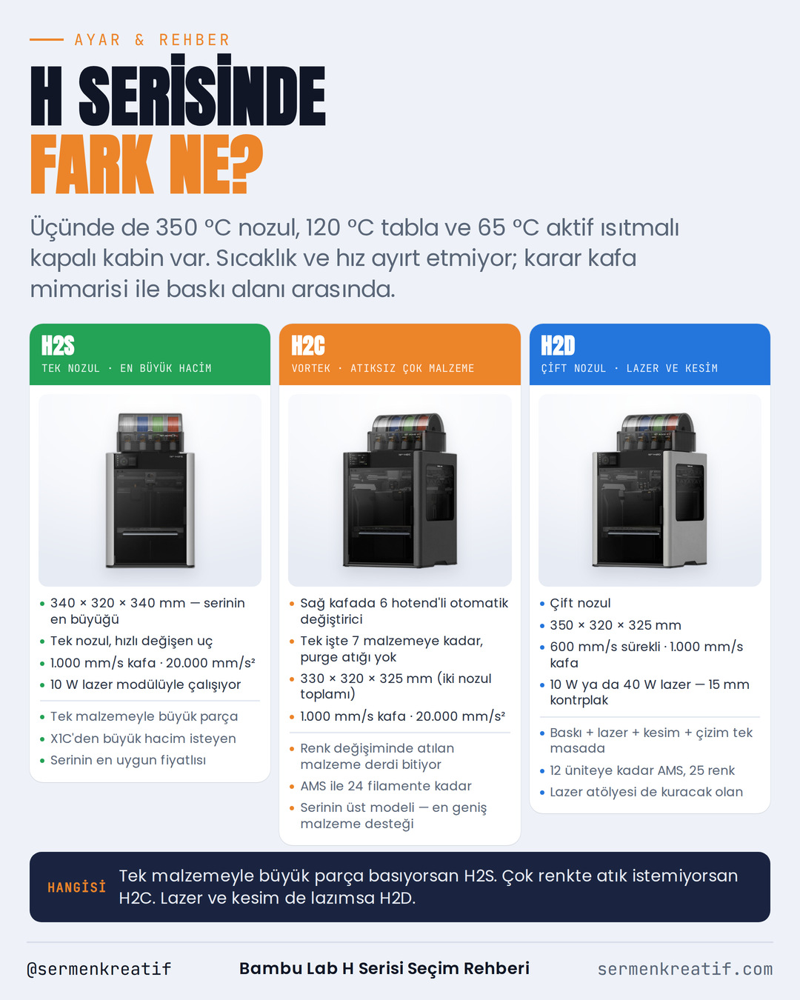</a>

**[2026-10-18-bambu-h-serisi-pano](https://github.com/sedatisc/instagram-gorseller/tree/main/2026-10-18-bambu-h-serisi-pano)** · 1 kare · hikaye 09:50

```
Bambu'nun H serisinde üç makine var ve adları birbirine çok benziyor. Şunu baştan söyleyeyim: **sıcaklık ve hız üçünde de aynı.** 350 °C nozul, 120 °C tabla, 65 °C'ye kadar aktif ısıtmalı kapalı kabin, 1.000 mm/s kafa hızı, 20.000 mm/s² ivme. Yani "hangisi daha güçlü" diye bakmak yanlış soru.

Gerçek ayrım kafa mimarisi ile baskı alanı arasındaki takasta.

**H2S » tek nozul, en büyük hacim.** 340 × 320 × 340 mm — serinin en büyüğü. Tek nozul, hızlı değişen uç. Bambu bunu "daha büyük bir X1C" diye konumluyor: H2D'nin çift nozul karmaşıklığı olmadan daha çok hacim. Lazer tarafında sınırı var, yalnız 10 W destekliyor; 40 W lazer takılmıyor. Serinin en uygun fiyatlısı.

Kime: tek malzemeyle büyük parça basan.

**H2C » Vortek, atıksız çok malzeme.** Sağ kafasında 6 hotend'li otomatik değiştirici karusel var. Combo kutusunda 8 hotend geliyor, önerilen kurulumla tek işte 7 malzemeye kadar **purge atığı olmadan** basıyor. Çok renkli baskıda çöpe giden malzeme derdini ortadan kaldıran kısım burası. AMS ile 24 filamente kadar çıkıyor.

Karşılığı: serinin en küçük baskı alanı (330 × 320 × 325 mm, iki nozul toplamı) ve en yüksek fiyatı.

Kime: çok renkli/çok malzemeli iş yapan ve atıktan rahatsız olan.

**H2D » çift nozul, lazer ve kesim.** 350 × 320 × 325 mm, çift nozul, 600 mm/s sürekli baskı. Tek farkı baskı değil: 10 W ya da 40 W lazer modülü takılıyor, 40 W ile 15 mm kontrplak kesiyor. Üstüne dijital kesim ve kalem çizim modülleri var. 12 AMS ünitesine, 25 renge kadar çıkıyor.

Kime: masasına baskı + lazer + kesim atölyesini birlikte kuracak olan.

Karar kısaca: tek malzemeyle büyük parça basıyorsan H2S. Çok renkte atık istemiyorsan H2C. Lazer ve kesim de lazımsa H2D.

Bir not » H2D Pro adında kurumsal bir model daha var; tungsten karbür nozullar ve kurumsal ağ desteğiyle ayrı bir sınıf, bu karşılaştırmaya girmiyor.

H serisinde hangisini alacağına karar veremeyen bir arkadaşın varsa bu gönderiyi ona yolla.

#sermenkreatif #3dbaski #bambulab #3dyazici
```

## 12:10 · BASKI ÜRÜNLERİ

<a href="https://github.com/sedatisc/instagram-gorseller/tree/main/2026-10-25-aktivite-tahtasi">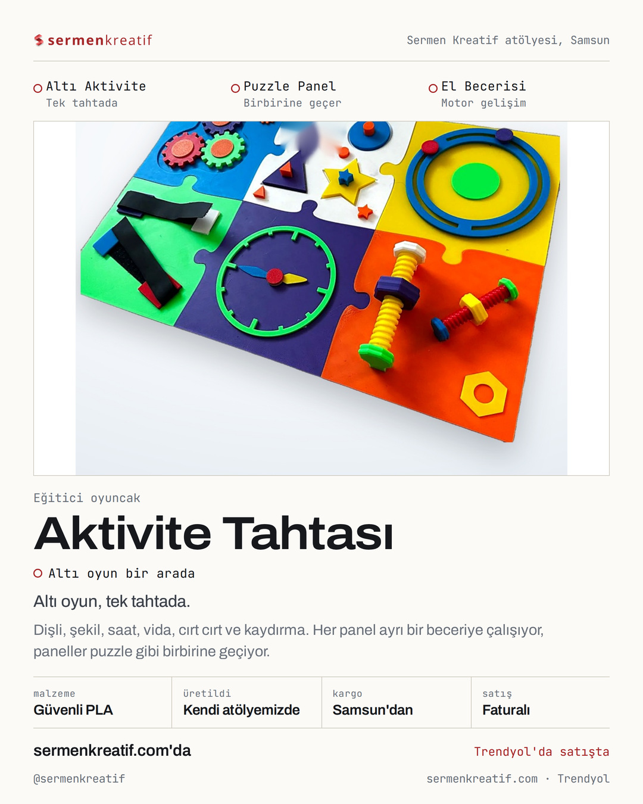</a>

**[2026-10-25-aktivite-tahtasi](https://github.com/sedatisc/instagram-gorseller/tree/main/2026-10-25-aktivite-tahtasi)** · 8 kare · hikaye 12:50

```
Aktivite tahtası. Altı ayrı oyun tek tablada: dönen dişliler, şekil eşleştirme, kaydırmalı halka, cırt cırt bantlar, saat ve vida-somun.

Paneller puzzle gibi birbirine geçiyor. İstersen hepsini birleştirip tek tahta yaparsın, istersen tek paneli ayırıp çocuğa verirsin.

Her panel ayrı bir beceriye çalışıyor » dişli ve halka el kontrolüne, şekil paneli eşleştirmeye, saat paneli zaman kavramına, vida ve cırt cırt parmak kaslarına.

Cırt cırt bölümü özellikle işe yarıyor: bant açıp kapatmak ayakkabı ve mont öncesi en iyi alıştırma.

Kendi atölyemizde, güvenli PLA ile basılıyor. Faturalı, Samsun'dan kargo.

Bağlantı ilk yorumda.

Küçük çocuğu olan bir arkadaşın varsa bu gönderiyi ona yolla.

#sermenkreatif #3dbaski #aktivitetahtasi #egiticioyuncak #cocukgelisimi
```

## 17:24 · BASKI ÜRÜNLERİ

<a href="https://github.com/sedatisc/instagram-gorseller/tree/main/2026-10-26-market-kasa-seti">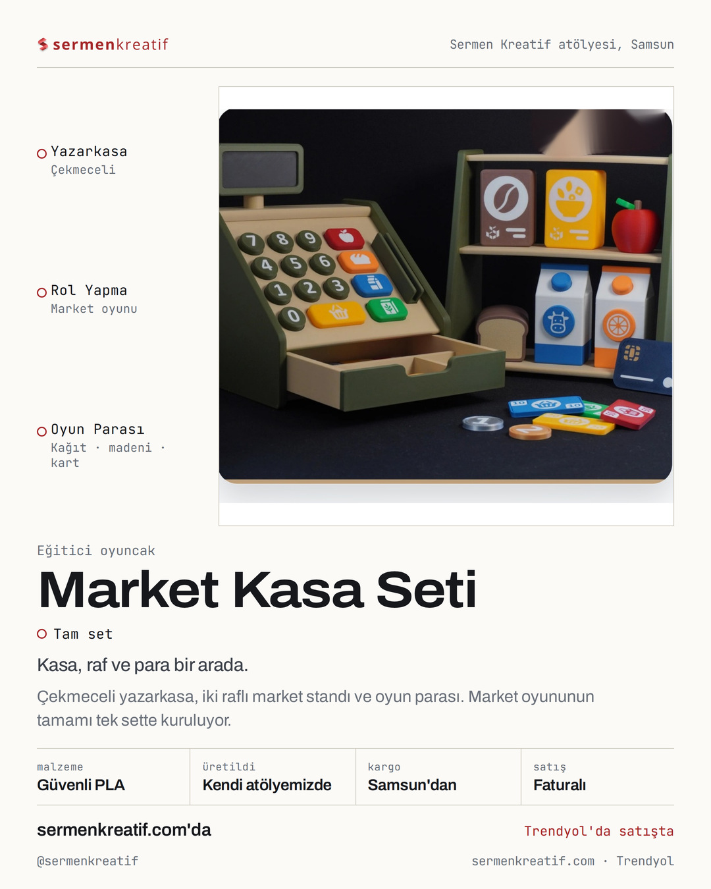</a>

**[2026-10-26-market-kasa-seti](https://github.com/sedatisc/instagram-gorseller/tree/main/2026-10-26-market-kasa-seti)** · 4 kare · hikaye 18:04

```
Oyuncak market kasa seti. Çekmeceli yazarkasa, iki raflı market standı ve oyun parası bir arada.

Kasanın rakam tuşları ve ürün tuşları var, çekmecesi açılıyor. Para çekmecenin içinde duruyor; alışveriş, ödeme ve para üstü gerçek sırayla işliyor.

Rafa süt, meyve suyu, ekmek, kahve, mısır gevreği ve elma diziliyor. Çocuk önce rafı kuruyor, sonra müşteri oluyor, sonra kasiyer.

Sayı saymayı, sıra beklemeyi ve alışveriş diyaloğunu aynı oyunda çalıştırıyor.

Kendi atölyemizde, güvenli PLA ile basılıyor. Faturalı, Samsun'dan kargo.

Bağlantı ilk yorumda.

Küçük çocuğu olan bir arkadaşın varsa bu gönderiyi ona yolla.

#sermenkreatif #3dbaski #oyuncakmarket #rolyapmaoyunu #egiticioyuncak
```

## 19:40 · REELS — [2026-10-18-bambu-h-serisi-pano/reels.mp4](https://github.com/sedatisc/instagram-gorseller/tree/main/2026-10-18-bambu-h-serisi-pano)

Açıklama gönderi metniyle aynı.

---

# 2026-11-05 · Perşembe

## 09:05 · ÜRÜN & MAĞAZA

<a href="https://github.com/sedatisc/instagram-gorseller/tree/main/2026-10-16-phaetus-liber-u1">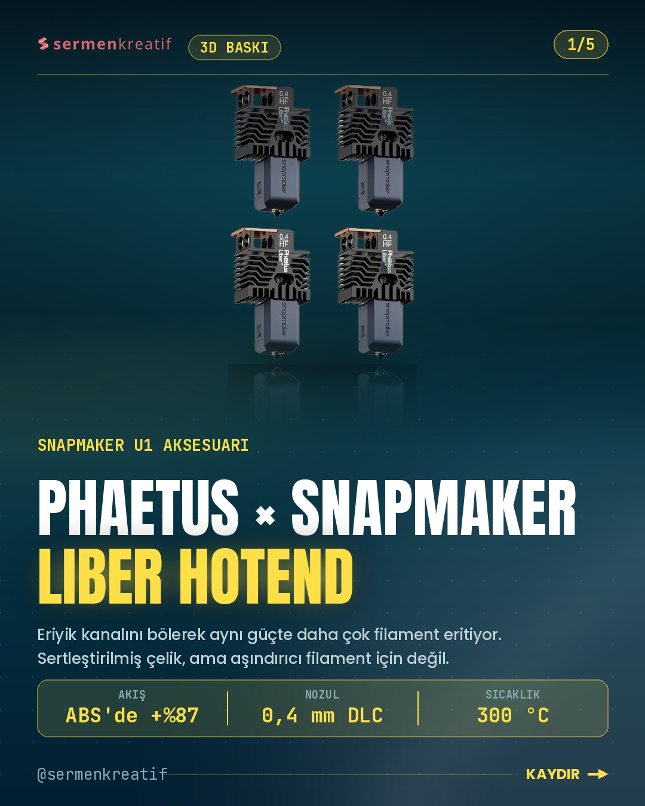</a>

**[2026-10-16-phaetus-liber-u1](https://github.com/sedatisc/instagram-gorseller/tree/main/2026-10-16-phaetus-liber-u1)** · 5 kare · hikaye 09:45

```
Snapmaker ile Phaetus'un U1 için birlikte çıkardığı Liber hotend geldi. Ne yaptığını ve ne YAPMADIĞINI birlikte yazıyorum, çünkü ikincisi daha çok yanlış biliniyor.

Ne yapıyor → nozul içindeki eriyiği birden fazla kanala bölüyor. Eriyiğin yüzey/hacim oranı arttığı için aynı enerjiyle birim zamanda daha fazla filament eriyor. Üreticinin eşit enerji koşulundaki testinde PLA'da %66, ABS'de %87, PETG HF'de %43 daha yüksek hacimsel akış.

Dikkat → bu hız garantisi değil, akış kapasitesi. Snapmaker'ın kendisi de bunun doğrudan baskı süresine yansımadığını, kazancın baskının ne kadarının eritme kapasitesiyle sınırlı olduğuna bağlı olduğunu yazıyor. Uzun ve kesintisiz ekstrüzyon yollu büyük parçalarda fark açılıyor; bol kıvrımlı, sık yön değiştiren küçük modelde kayboluyor.

Ne YAPMIYOR → sertleştirilmiş çelik gövdeli diye karbon fiber çözümü sanılıyor. Üretici bu hotend'i karbon ve cam elyaf takviyeli filamentler, ahşap dolgulu filament ve TPU için ÖNERMİYOR; o malzemeler için standart hotend'e yönlendiriyor. Aşındırıcı filament basıyorsan senin alman gereken Snapmaker'ın kendi sertleştirilmiş çelik hotend seti.

Bir şey daha → maksimum sıcaklık 300 °C, yani U1'in standart hotend'iyle birebir aynı. Liber yüksek sıcaklık malzemelerinin kapısını açmıyor.

Pratik not → U1 dört başlıklı bir makine, gerçekte dört adet gerekiyor. Tek tek almak yerine dörtlü set almak hem daha ucuz hem de dört kafa aynı davranıyor. Tek çap var: 0,4 mm.

Fiyat ve stok için sermenkreatif.com.

U1'ine hotend arayan bir arkadaşın varsa bu gönderiyi ona yolla — özellikle karbon fiber basacaksa.

#sermenkreatif #3dbaski #snapmaker #phaetus #hotend
```

## 12:38 · BASKI ÜRÜNLERİ

<a href="https://github.com/sedatisc/instagram-gorseller/tree/main/2026-10-27-meyve-sebze-seti">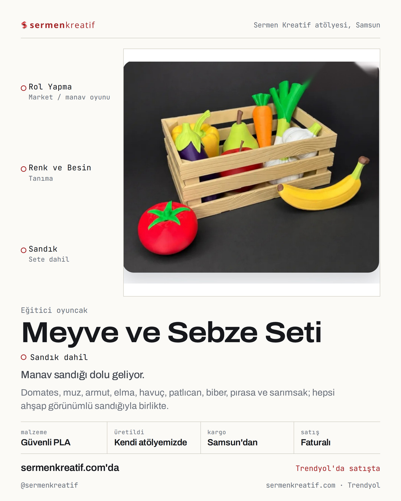</a>

**[2026-10-27-meyve-sebze-seti](https://github.com/sedatisc/instagram-gorseller/tree/main/2026-10-27-meyve-sebze-seti)** · 4 kare · hikaye 13:18

```
Oyuncak meyve ve sebze seti. Elma, armut, muz, domates, havuç, patlıcan, biber, pırasa ve sarımsak; hepsi ahşap görünümlü sandığıyla birlikte.

Sandık da sete dahil. Oyun bitince meyveler içine toplanıyor, odanın ortasında dağınık kalmıyor.

Sandığın ahşap dokusu baskıyla veriliyor » kıymık yok, çivi yok, tek parça.

Manav oyunu, mutfak oyunu, renk ve besin tanıma; aynı setle üçü birden.

Kendi atölyemizde, güvenli PLA ile basılıyor. Faturalı, Samsun'dan kargo.

Bağlantı ilk yorumda.

Küçük çocuğu olan bir arkadaşın varsa bu gönderiyi ona yolla.

#sermenkreatif #3dbaski #oyuncakmeyve #manavoyunu #egiticioyuncak
```

## 17:24 · BASKI ÜRÜNLERİ

<a href="https://github.com/sedatisc/instagram-gorseller/tree/main/2026-10-28-vidali-tren">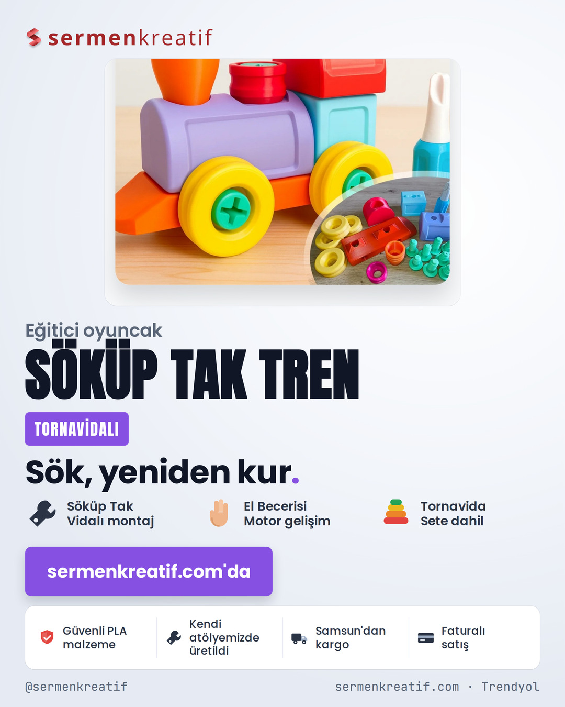</a>

**[2026-10-28-vidali-tren](https://github.com/sedatisc/instagram-gorseller/tree/main/2026-10-28-vidali-tren)** · 4 kare · hikaye 18:04

```
Vidalı söküp tak tren. Gövde, baca, kabin ve tekerlekler vidayla birleşiyor; tornavida sete dahil.

Vidaların başı iri, çocuk eli rahat çeviriyor. Bir kere kurduktan sonra iş bitmiyor: söküp baştan kurmak oyunun kendisi.

Parçalar birbirine geçtiği için her seferinde aynı treni kurmak zorunda da değil; blokları değiştirip kendi aracını yapıyor.

Tornavida çevirmek bilek dönüşünü ve parmak kaslarını çalıştırıyor; kalem tutmaya hazırlık sayılır.

Kendi atölyemizde, güvenli PLA ile basılıyor. Faturalı, Samsun'dan kargo.

Bağlantı ilk yorumda.

Küçük çocuğu olan bir arkadaşın varsa bu gönderiyi ona yolla.

#sermenkreatif #3dbaski #soktaoyuncak #vidalioyuncak #egiticioyuncak
```

## 19:40 · REELS — [2026-10-16-phaetus-liber-u1/reels.mp4](https://github.com/sedatisc/instagram-gorseller/tree/main/2026-10-16-phaetus-liber-u1)

Açıklama gönderi metniyle aynı.

---

# 2026-11-06 · Cuma

## 09:10 · PROJE & ATÖLYE

<a href="https://github.com/sedatisc/instagram-gorseller/tree/main/2026-10-16-tavan-arasi-kamera-robotu">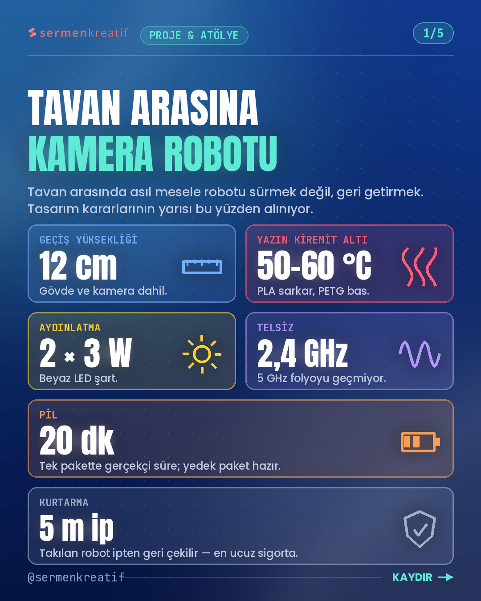</a>

**[2026-10-16-tavan-arasi-kamera-robotu](https://github.com/sedatisc/instagram-gorseller/tree/main/2026-10-16-tavan-arasi-kamera-robotu)** · 5 kare · hikaye 09:50

```
Tavan arası kamera robotu yapmanın asıl zorluğu robotu sürmek değil, geri getirmek. Tasarım kararlarının yarısı bu yüzden alınıyor.

Ölçüyü boşluk belirliyor. Tavan arasında yol yok; mertek arası boşluk var, tipik 40-60 cm. Gövde ve kamera dahil 12 cm'nin altında kalmayan robot bir yerde takılıyor. Tekerlek cam yününe gömüldüğü için paletli ve geniş gövde kazanıyor, ağırlık 1 kg altında tutuluyor.

Yazın tavan arası fırın gibi. Kiremit altı sıcaklık 50-60 °C'yi buluyor; PLA gövde bu sıcaklıkta kendi ağırlığıyla sarkıyor. Gövde PETG ya da ASA basılıyor, LiPo paket 45 °C üstünde şişme riskine girdiği için gölgede kalan yüze yerleşiyor ve tur kısa tutuluyor.

Işık çözünürlükten önemli. Tavan arası zifiri karanlık: 2 × 3 W beyaz LED, 4K kameradan daha çok iş görüyor. IR aydınlatma görüntüyü yalnız siyah-beyaz veriyor, nem lekesiyle küf lekesini ayırt edemiyorsun.

Telsizi yalıtım seçiyor. Cam yünü ve folyo kaplı şilte 5 GHz'i birkaç metrede kesiyor; 2,4 GHz hem daha çok geçiyor hem daha uzun menzil veriyor. Paket gelmeyince motor duracak — 500 ms zaman aşımı yoksa sinyalsiz robot yoluna devam edip iyice uzaklaşıyor.

En ucuz sigorta 5 metrelik ip. Gövdeye iki noktadan bağlanıp ucu kapakta bırakılıyor; takılan robot elle geri çekiliyor. Tavan arasında kaybolan robot tavan arasında kalıyor.

Evinin tavan arasına bakmak isteyip de kafasını sokamayan bir arkadaşın varsa bu gönderiyi ona yolla.

#sermenkreatif #maker #robotik #kamerarobotu
```

## 12:38 · BASKI ÜRÜNLERİ

<a href="https://github.com/sedatisc/instagram-gorseller/tree/main/2026-10-29-vidali-yapim-tahtasi">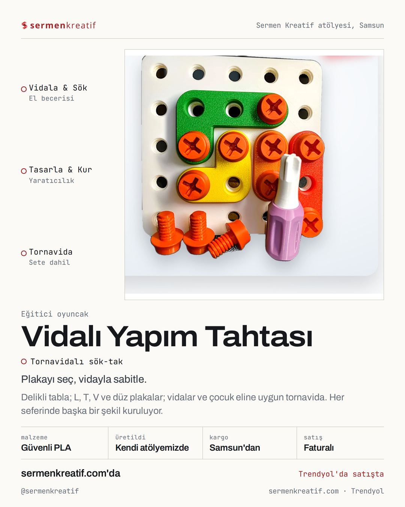</a>

**[2026-10-29-vidali-yapim-tahtasi](https://github.com/sedatisc/instagram-gorseller/tree/main/2026-10-29-vidali-yapim-tahtasi)** · 5 kare · hikaye 13:18

```
Vidalı yapım tahtası. Delikli tabla, L, T, V ve düz plakalar, vidalar ve çocuk eline uygun tornavida.

Üç adımda oynanıyor » plakayı seç, vidayı deliğinden geçir, tornavidayla sık. Sonra sök, başka bir şekil kur.

Aynı parçalardan her seferinde başka bir tasarım çıkıyor. Bitmiş bir oyuncak değil, kurulacak bir oyuncak.

Vida çevirmek el-göz koordinasyonunu ve parmak gücünü çalıştırıyor; tasarımı kendi kurmak da planlama tarafını.

Kendi atölyemizde, güvenli PLA ile basılıyor. Faturalı, Samsun'dan kargo.

Bağlantı ilk yorumda.

Küçük çocuğu olan bir arkadaşın varsa bu gönderiyi ona yolla.

#sermenkreatif #3dbaski #vidalioyuncak #yapimseti #egiticioyuncak
```

## 16:40 · BASKI ÜRÜNLERİ

<a href="https://github.com/sedatisc/instagram-gorseller/tree/main/2026-10-30-alyan-vida-oyuncagi">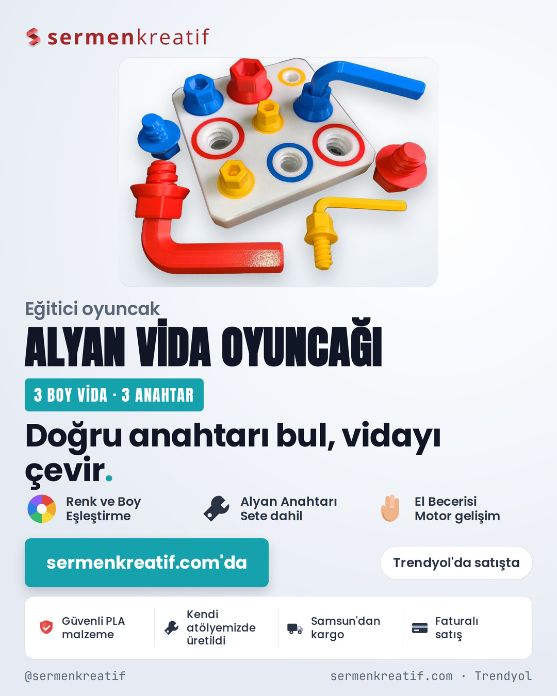</a>

**[2026-10-30-alyan-vida-oyuncagi](https://github.com/sedatisc/instagram-gorseller/tree/main/2026-10-30-alyan-vida-oyuncagi)** · 4 kare · hikaye 17:20

```
Alyan anahtarlı vida oyuncağı. Üç boy vida, üç alyan anahtarı ve renk halkalı bir tabla.

Her vidanın kendi boyu ve kendi rengi var » kırmızı büyük, mavi orta, sarı küçük. Tablada da her deliğin etrafında aynı renkte bir halka duruyor.

Çocuk önce vidayı seçiyor, sonra ona ait halkayı buluyor, sonra aynı renk anahtarla sıkıyor. Üç ayrı karar, tek harekette.

Alyan çevirmek bilek dönüşünü ve parmak gücünü çalıştırıyor; renk ve boy eşleştirmesi de sınıflandırma becerisini.

Söküp baştan kurmak oyunun kendisi, bir kere bitip kalmıyor.

Kendi atölyemizde, güvenli PLA ile basılıyor. Faturalı, Samsun'dan kargo.

Bağlantı ilk yorumda.

Vida çevirmeyi seven bir çocuk tanıyorsan bu gönderiyi ona yolla.

#sermenkreatif #3dbaski #alyanvida #vidalioyuncak #egiticioyuncak
```

---

# 2026-11-07 · Cumartesi

## 11:10 · AYAR & REHBER

<a href="https://github.com/sedatisc/instagram-gorseller/tree/main/2026-10-18-sert-nozul">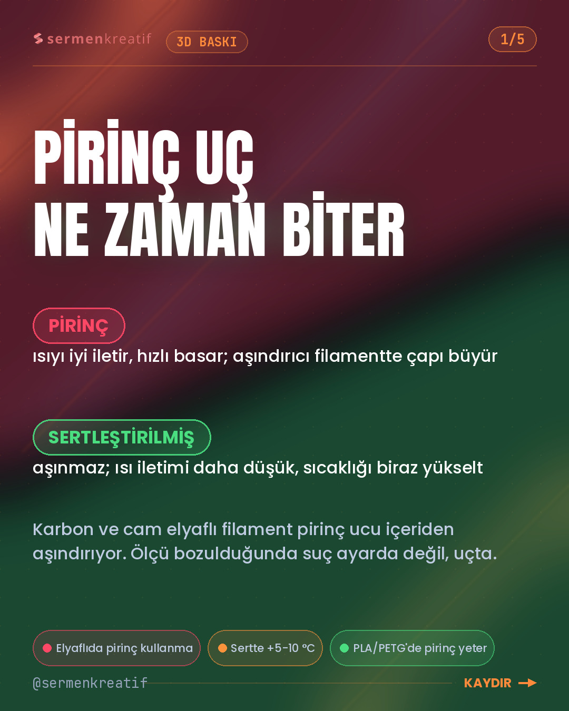</a>

**[2026-10-18-sert-nozul](https://github.com/sedatisc/instagram-gorseller/tree/main/2026-10-18-sert-nozul)** · 5 kare · hikaye 11:50

```
Karbon elyaflı filamente geçtikten sonra baskıların bozulmaya başladıysa önce ayarları kurcalama, nozula bak.

Pirinç yumuşak bir malzeme. Isıyı çok iyi ilettiği için standart uç pirinçten yapılıyor, PLA ve PETG'de yıllarca sorun çıkarmıyor. Ama içinden karbon elyaf, cam elyaf, ahşap tozu, metal tozu ya da karanlıkta parlayan filamentin fosfor taneleri geçmeye başladığında delik yavaşça büyüyor.

Sorun şu: dilimleyici hâlâ 0,4 mm varsayıp malzeme hesaplıyor. Delik 0,45 olduğunda duvar inceliyor, köşelerde boşluk açılıyor, üst yüzey kapanmıyor. Sen sıcaklıkla, akışla, retraction'la uğraşıyorsun; sebep eline aldığın parçada değil, ucun içinde.

Aşındıranlar: karbon elyaf, cam elyaf, ahşap dolgulu, metal dolgulu, karanlıkta parlayan filamentler.
Aşındırmayanlar: düz PLA, PETG, ABS, ASA, TPU. Bunlarda pirinç uç yeterli.

Sert uca geçerken bilmen gereken bir ayrıntı var: sertleştirilmiş çelik pirinç kadar iyi ısı iletmiyor. Aynı sıcaklık ayarıyla basınca malzeme yeterince erimeyebiliyor. Nozul sıcaklığını 5-10 °C yükselt, ilk baskıda akışı gözle. Pirinç kadar iyi ileten sert seçenek arıyorsan tungsten karbür ya da yakut uçlu modellere bakacaksın.

Elyaflı filamente geçmeyi düşünüyorsan ucu önceden değiştir. Uç ucuz, bozuk baskı pahalı.

Karbon katkılı filamente geçmeyi düşünen bir arkadaşına yolla.

#sermenkreatif #3dbaski #nozzle #karbonfiber #filament
```

## 13:20 · BASKI ÜRÜNLERİ

<a href="https://github.com/sedatisc/instagram-gorseller/tree/main/2026-10-31-halka-dizme-kulesi">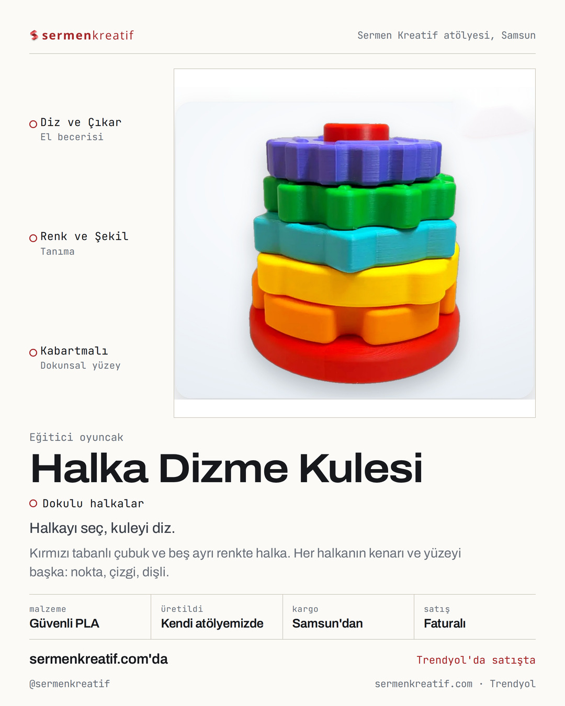</a>

**[2026-10-31-halka-dizme-kulesi](https://github.com/sedatisc/instagram-gorseller/tree/main/2026-10-31-halka-dizme-kulesi)** · 5 kare · hikaye 14:00

```
Halka dizme kulesi. Kırmızı tabanlı çubuk ve her biri farklı biçimde beş renkli halka.

Klasik halka kulesinden farkı yüzeylerinde » her halkada ayrı doku var: nokta, çizgi, dişli kenar. Çocuk rengiyle ayırmayı öğrenirken parmak ucuyla da ayırmayı öğreniyor.

Doğru bir sıra yok. İstediği sırayla dizer, bozar, yeniden kurar; oyun her seferinde baştan başlıyor.

Halkaları çubuğa geçirmek el-göz koordinasyonunu, çıkarmak da parmak kavrayışını çalıştırıyor.

Kendi atölyemizde, güvenli PLA ile basılıyor. Faturalı, Samsun'dan kargo.

Bağlantı ilk yorumda.

Okul öncesi çocuğu olan bir arkadaşın varsa bu gönderiyi ona yolla.

#sermenkreatif #3dbaski #halkadizme #istifoyuncagi #egiticioyuncak
```

## 17:10 · BASKI ÜRÜNLERİ

<a href="https://github.com/sedatisc/instagram-gorseller/tree/main/2026-11-01-rakam-yapbozu">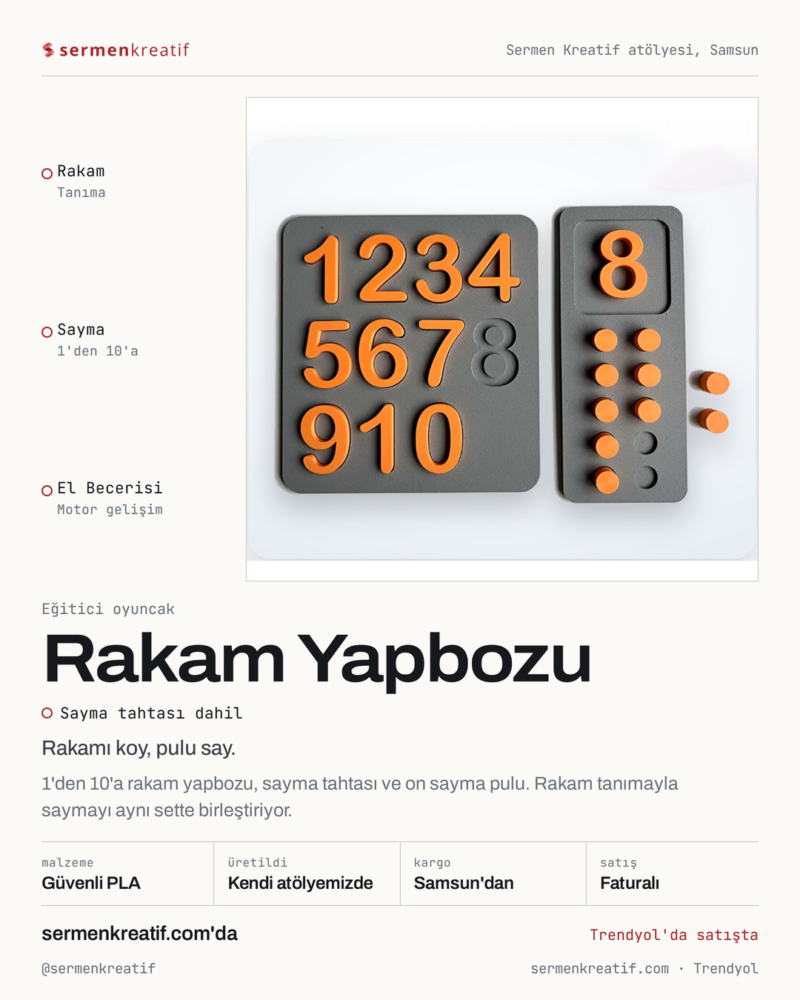</a>

**[2026-11-01-rakam-yapbozu](https://github.com/sedatisc/instagram-gorseller/tree/main/2026-11-01-rakam-yapbozu)** · 5 kare · hikaye 17:50

```
Rakam yapbozu ve sayma tahtası. İki tabla bir arada: rakamların yuvasına oturduğu yapboz ve pulların dizildiği sayma tahtası.

1'den 10'a bütün rakamlar çıkarılabiliyor. Çocuk önce rakamın şeklini tanıyor, sonra kendi yuvasına oturtuyor.

Asıl iş ikinci tablada » üst yuvaya hangi rakamı koyduysa, aşağıdaki deliklere o kadar pul yerleştiriyor. Sayı soyut kalmıyor, elle sayılıyor.

Rakam tanıma ve sayma aynı sette; biri olmadan diğeri eksik kalmıyor.

Kendi atölyemizde, güvenli PLA ile basılıyor. Faturalı, Samsun'dan kargo.

Bağlantı ilk yorumda.

Okul öncesi çocuğu olan bir arkadaşın varsa bu gönderiyi ona yolla.

#sermenkreatif #3dbaski #rakamyapbozu #saymatahtasi #egiticioyuncak
```

---

# 2026-11-08 · Pazar

## 11:10 · ÜRÜN & MAĞAZA

<a href="https://github.com/sedatisc/instagram-gorseller/tree/main/2026-10-17-polymaker-ht-pla"></a>

**[2026-10-17-polymaker-ht-pla](https://github.com/sedatisc/instagram-gorseller/tree/main/2026-10-17-polymaker-ht-pla)** · 5 kare · hikaye 11:50

```
Polymaker HT-PLA serisi yüksek sıcaklığa dayanıklı PLA diye satılıyor ve bu doğru — ama bir şartı var, onu söylemeyen satıcıdan almayın.

Isı dayanımı kutudan çıkmıyor, tavlamayla geliyor.

Rakamlar, Polymaker'ın kendi teknik veri sayfasından, tavlama öncesi → sonrası:

HT-PLA, 0,45 MPa yük altında 61,4 → 107,2 °C. Aynı malzeme 1,8 MPa altında 58,6 → 71,7 °C.
HT-PLA-GF, 0,45 MPa altında 75,5 → 114,7 °C. 1,8 MPa altında 59,7 → 84 °C.

Tavlamadan basarsan elinde normal PLA'dan belirgin farkı olmayan, daha pahalı bir makara kalıyor. 58 °C ile 61 °C arasındaki fark için para vermeye değmez.

İyi haber → tavlama zor değil. 80-90 °C'de 3 dakika. Fırın, kurutucu ya da ısıtmalı tabla yeter. İnce cidarlı parçalarda aralığın alt ucunu kullanın, yoksa çarpılıyor.

Üç çeşit, üç ayrı iş → HT-PLA düz sürüm, fonksiyonel parçanın geneli için. HT-PLA Gradient aynı ısı dayanımını renk geçişiyle veriyor, dekoratif iş için. HT-PLA-GF cam elyaf takviyeli; ailenin en yüksek HDT'si ve en rijit olanı, araç içinde kalacak parça varsa bu.

Baskı ayarı üçünde de aynı: nozul 230 °C, tabla 50 °C.

Yazın araçta bıraktığı telefon tutucusu eğilen bir arkadaşın varsa bu gönderiyi ona yolla.

#sermenkreatif #3dbaski #polymaker #htpla #filament
```

## 13:20 · BASKI ÜRÜNLERİ

<a href="https://github.com/sedatisc/instagram-gorseller/tree/main/2026-11-02-kesir-daireleri">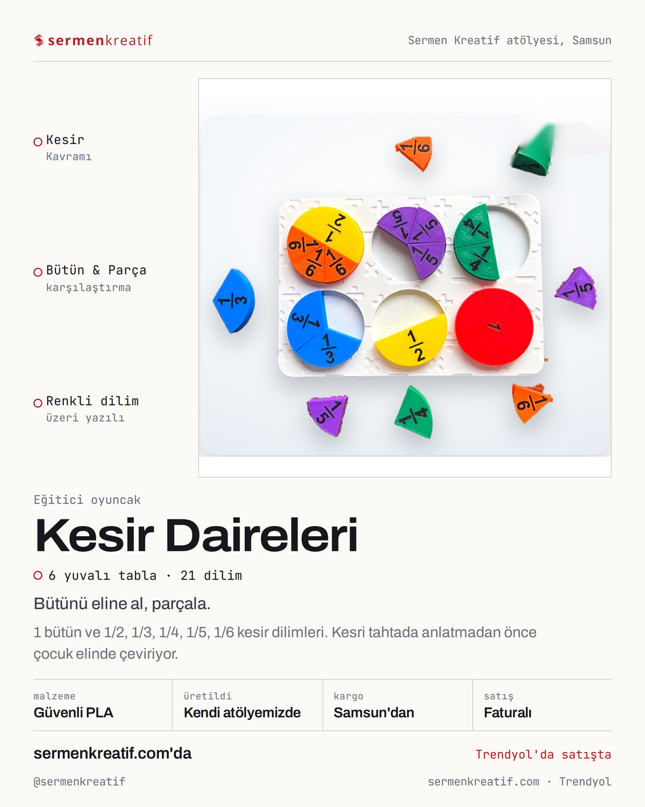</a>

**[2026-11-02-kesir-daireleri](https://github.com/sedatisc/instagram-gorseller/tree/main/2026-11-02-kesir-daireleri)** · 4 kare · hikaye 14:00

```
Kesir daireleri. Altı yuvalı tabla, toplam 21 dilim: bir bütün ve 1/2, 1/3, 1/4, 1/5, 1/6 kesirlerinin dilimleri.

Kesir tahtada anlatılınca soyut kalıyor. Burada çocuk bütünü eline alıyor, ikiye bölünmüşünü yanına koyuyor, farkı gözüyle görüyor.

Her dilimin üzerinde değeri yazılı » çocuk hangi parçayı tuttuğunu okuyabiliyor. Renk hangi kesir olduğunu, yazı kaçta kaç olduğunu söylüyor.

Asıl soru üçüncü adımda geliyor: iki tane 1/4 bir araya gelince 1/2 eder mi? Çocuk üst üste koyup kendi görüyor. Cevabı siz vermiyorsunuz.

Okul öncesinde renk ve şekil eşleme, ilkokulda kesir dersinin somut hali.

Kendi atölyemizde, güvenli PLA ile basılıyor. Faturalı, Samsun'dan kargo.

Bağlantı ilk yorumda.

Kesirlerle boğuşan bir öğrenci tanıyorsanız bu gönderiyi ona yollayın.

#sermenkreatif #3dbaski #kesirdaireleri #kesirler #egiticioyuncak
```

## 17:10 · PROJE & ATÖLYE

<a href="https://github.com/sedatisc/instagram-gorseller/tree/main/2026-10-17-rc-tank"></a>

**[2026-10-17-rc-tank](https://github.com/sedatisc/instagram-gorseller/tree/main/2026-10-17-rc-tank)** · 6 kare · hikaye 17:50

```
RC tank gibi büyük bir baskı projesinde işi bitiren şey baskı değil, parçaya bölme ve birleştirme kararları. Tabladan büyük parça basılmıyor; bölünüyor.

Bölme hattı düz yüzeyden ve görünmeyen kenardan geçiyor. Yük taşıyan kesit bölünmüyor — oradaki kayıp sonradan yapıştırmayla geri gelmiyor. Hizalama için pim yuvası modeldeyken açılıyor, geçme 0,2-0,4 mm boşlukla çiziliyor. Parça sökülecekse vida ve heat-set insert, kalıcı birleşecekse epoksi; CA yapıştırıcı bu boyutta kırılgan kalıyor.

Dayanımı duvar veriyor, dolgu değil. Büyük gövdede 3-4 duvar sırası, %10-15 dolgu ve 5 üst-alt katman yetiyor. Dolguyu yükseltmek süreyi ve ağırlığı büyütüyor, burulmayı çözmüyor. 0,6 mm nozul ve 0,24-0,28 mm katman bu ölçekte günler kazandırıyor.

En çok zorlanan parça palet. Sürekli esniyor ve aşınıyor; tek parça basılan palet koptuğunda iş bitiyor, segmentli palet tamir edilebiliyor. Segmentler pimle birleşiyor, %10 fazla basılıyor, gergi tekerleği ayarlanabilir olacak şekilde çiziliyor.

Ağırlık motoru seçiyor. Gövde ağırlaştıkça redüktör oranı büyüyor, paletli araçta dönüş torku düz gitmenin 2-3 katı. Motoru en sona bırakırsan tank yürümüyor.

Fire payını baştan yaz. Büyük parçada %10 başarısızlık normal; kritik parça iki kez basılıyor, kuyruk sıraya koyuluyor.

Masasında yarım kalmış büyük bir baskı projesi olan bir arkadaşın varsa bu gönderiyi ona yolla.

#sermenkreatif #maker #3dbaski #rctank
```

## 19:50 · REELS — [2026-10-17-polymaker-ht-pla/reels.mp4](https://github.com/sedatisc/instagram-gorseller/tree/main/2026-10-17-polymaker-ht-pla)

Açıklama gönderi metniyle aynı.

---

# 2026-11-09 · Pazartesi

## 09:10 · AYAR & REHBER

<a href="https://github.com/sedatisc/instagram-gorseller/tree/main/2026-10-19-bambu-a-serisi-pano">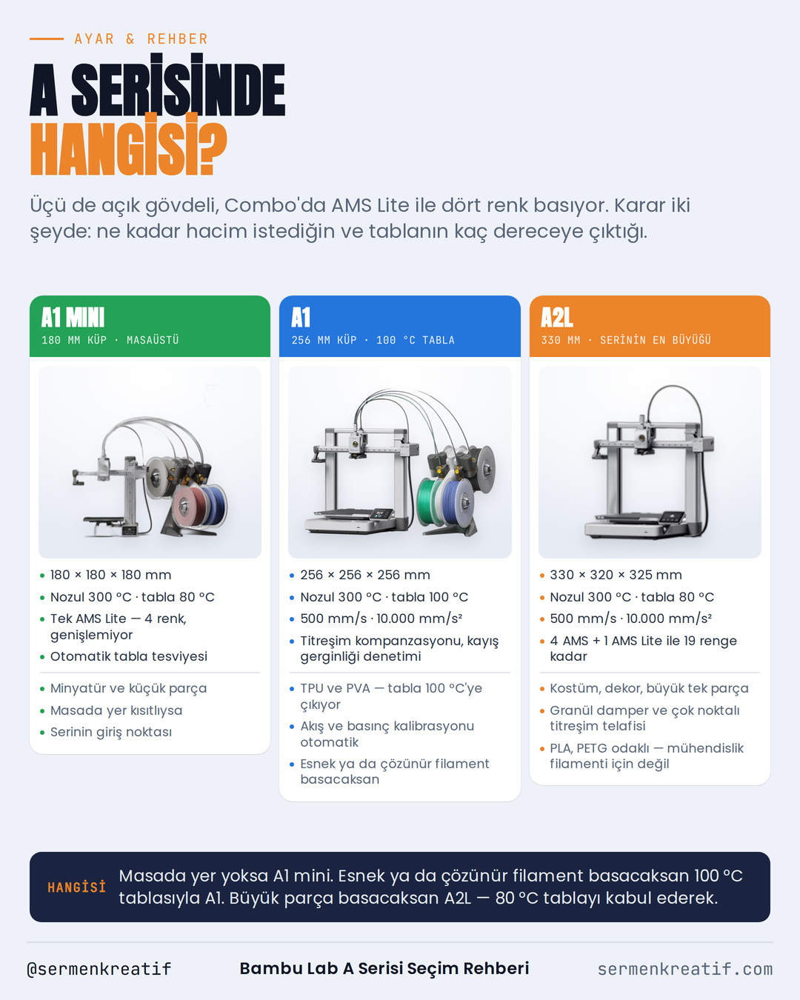</a>

**[2026-10-19-bambu-a-serisi-pano](https://github.com/sedatisc/instagram-gorseller/tree/main/2026-10-19-bambu-a-serisi-pano)** · 1 kare · hikaye 09:50

```
A serisinde üç makine var ve üçü de aynı temeli paylaşıyor: açık gövdeli bed-slinger, 300 °C nozul, Combo paketinde AMS Lite ile dört renk. Karar iki şeye iniyor — ne kadar hacim istediğin ve tablanın kaç dereceye çıktığı.

**A1 mini » 180 × 180 × 180 mm.** Nozul 300 °C, tabla 80 °C. Tek AMS Lite alıyor, dört renkle sınırlı ve genişlemiyor. Otomatik tabla tesviyesi var, elle ayar gerekmiyor.

Kime: minyatür ve küçük parça basan, masasında yer kısıtlı olan.

**A1 » 256 × 256 × 256 mm.** Nozul 300 °C, **tabla 100 °C** — serinin tek 100 °C'lik tablası, asıl fark burada. Bambu A1 için TPU ve PVA'yı ideal malzeme sayıyor; diğer ikisi 80 °C'de kalıyor. 500 mm/s, 10.000 mm/s². Her baskı öncesi otomatik titreşim kompanzasyonu yapıyor, kayış gerginliğini titreşim frekansından denetleyip gevşekse uyarıyor. Akış ve basınç kalibrasyonu da otomatik.

Kime: esnek (TPU) ya da suda çözünen (PVA) filamentle çalışacak olan.

**A2L » 330 × 320 × 325 mm.** Serinin en büyüğü, Haziran 2026'da çıktı. 500 mm/s, 10.000 mm/s², tabla 80 °C. Gövdesinde iki granül damper ve çok noktalı uyarlanabilir titreşim telafisi var; Bambu bunu "aslında bir H2S Lite" diye tanımlıyor. Genişlemede önde: 4 AMS + 1 AMS Lite ile 19 renge kadar çıkıyor.

Dikkat » A2L açık gövdeli ve Bambu onu "PLA, PETG ve diğer mühendislik dışı filamentler" için konumluyor. Güvenlik gerekçesiyle lazer modülü desteklemiyor. Büyük hacmi 80 °C tablayı kabul ederek alıyorsun.

A2L, A1'in yerine geçmedi — seriye eklenen büyük formatlı model, diğer ikisi satışta.

Karar kısaca: masada yer yoksa A1 mini. Esnek ya da çözünür filament basacaksan A1. Büyük parça basacaksan A2L.

Hangi Bambu'yu alacağına karar veremeyen bir arkadaşın varsa bu gönderiyi ona yolla.

#sermenkreatif #3dbaski #bambulab #3dyazici
```

## 12:38 · ÜRÜN & MAĞAZA

<a href="https://github.com/sedatisc/instagram-gorseller/tree/main/2026-10-18-ender-3-v4-combo"></a>

**[2026-10-18-ender-3-v4-combo](https://github.com/sedatisc/instagram-gorseller/tree/main/2026-10-18-ender-3-v4-combo)** · 5 kare · hikaye 13:18

```
Ender serisi, hobi masasındaki en bilinen isim. Bu kuşakta artık rakamlar da ona göre: 500 mm/s azami hız, 12.000 mm/s² ivme, 300 °C nozul.

Baskı alanı 220 × 220 × 235 mm. Bu sınıf, ilk ciddi makine arayan için doğru yer: küçük parça, fonksiyonel parça, oyuncak, aparat, yedek parça. 220 mm küpü aşan işler basıyorsan bu makine dar gelir, onu baştan söyleyelim.

Combo adı CFS'li paketi anlatıyor. CFS dört makara taşıyor, dört CFS'e kadar bağlanabiliyor — Creality üst sınırı 16 renk diye veriyor. Makara bitince sıradakine kendisi geçiyor, dolaşma algılaması CFS ile birlikte çalışıyor.

Zamanı yiyen iki işi de kısaltmışlar: tabla ayarı tam otomatik, nozul kapağı mıknatıslı — elle çekip alıyorsun. Titreşim tarafında input shaping var, hızı yükseltince köşelerde iz bırakmasın diye.

Bağlantı: USB bellek, Wi-Fi ve Creality Cloud. Birden fazla makineyi Creality Print üzerinden aynı ağdan yönetebiliyorsun.

Kapalı kabini yok. PLA, PETG ve TPU tarafında rahat; ABS ve ASA basacaksan bu makine o iş için değil.

Ender-3 V4 Combo sermenkreatif.com'da.

İlk yazıcısını arayan bir arkadaşın varsa bu gönderiyi ona yolla.

#sermenkreatif #3dbaski #creality #ender3 #cokrenklibaski
```

## 17:24 · PROJE & ATÖLYE

<a href="https://github.com/sedatisc/instagram-gorseller/tree/main/2026-10-18-toplulukta-ariza"></a>

**[2026-10-18-toplulukta-ariza](https://github.com/sedatisc/instagram-gorseller/tree/main/2026-10-18-toplulukta-ariza)** · 5 kare · hikaye 18:04

```
Baskı bozuk çıktığında çoğu kişi saatlerce tek başına ayar kurcalıyor. Oysa aynı arıza o gün başka birinin de başına gelmiş ve çözülmüş oluyor.

SK 3D Topluluğu bunun için var: ücretsiz, herkese açık bir WhatsApp grubu.

Grupta işleyiş basit. "Baskım bozuk çıkıyor" cümlesi kimseye bir şey anlatmıyor; parçanın fotoğrafını atıyorsun. Fotoğraf bir bakışta söylüyor — stringing mi, katman ayrışması mı, ilk katman mı.

En çok gelen beş arıza hep aynı: ilk katmanın tutmaması, stringing, katmanların ayrışması, ölçünün tutmaması, ortada tıkanma. İlk üçünün cevabı belli. Son ikisi daha sinsi: sebep çoğu zaman ayar değil, büzülme payı, aşınmış nozul ya da nem çekmiş filament oluyor. Bunlar deneyimle ayıklanıyor.

Arıza dışında da işliyor: çizdiğin parçayı paylaşıyorsun, başkasının denediği ayarı öğreniyorsun, yazıcı ya da filament lazımsa aynı yerden hallediliyor.

Katılmak için profildeki linke dokunman yeterli. Ücretsiz, istediğin an çıkabilirsin.

#sermenkreatif #3dbaski #3dbaskiturkiye #topluluk
```

## 19:40 · REELS — [2026-10-18-ender-3-v4-combo/reels.mp4](https://github.com/sedatisc/instagram-gorseller/tree/main/2026-10-18-ender-3-v4-combo)

Açıklama gönderi metniyle aynı.

---

# 2026-11-10 · Salı

## 09:10 · AYAR & REHBER

<a href="https://github.com/sedatisc/instagram-gorseller/tree/main/2026-10-19-heat-set-insert">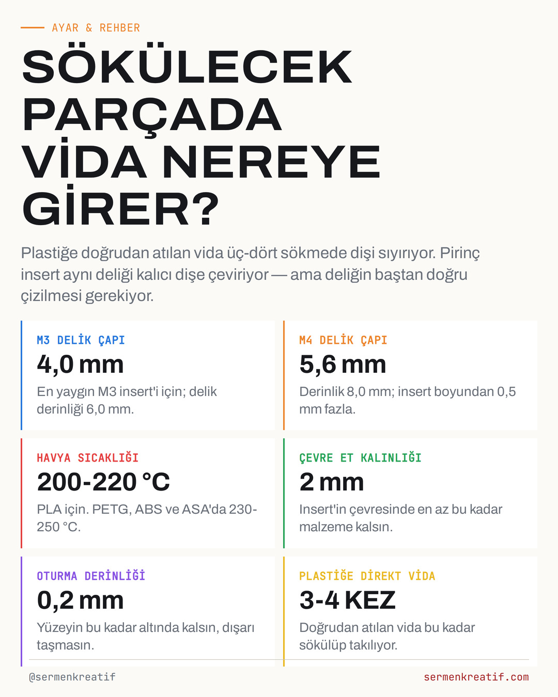</a>

**[2026-10-19-heat-set-insert](https://github.com/sedatisc/instagram-gorseller/tree/main/2026-10-19-heat-set-insert)** · 4 kare · hikaye 09:50

```
3D baskıda vidalı birleşim için heat-set insert kullanmak, plastiğe doğrudan vida atmaktan farklı bir iş. Doğrudan atılan vida üç-dört sökmede dişi sıyırıyor; pirinç insert aynı deliği kalıcı dişe çeviriyor. Ama işi bitiren şey insert değil, deliğin baştan doğru çizilmesi.

Delik çapı insert'in dış çapından küçük olacak. Eriyen plastiğin tırtılların arasına dolup kilitlenmesi buna bağlı. M3'te 4,0 mm, M4'te 5,6 mm yaygın ölçü — ama her markanın tırtıl çapı aynı değil, eldeki insert'i kumpasla ölçmek on saniye sürüyor. Derinlik insert boyundan 0,5 mm fazla olsun; taşan erimiş plastiğin gidecek yeri kalsın.

Havyayı ısıt, bastırma. PLA'da 200-220 °C, PETG ve ABS'de 230-250 °C iş görüyor. Insert kendi ağırlığıyla insin; kuvvet uygulamak onu yan yatırıyor ve eğik oturan insert'te vida dişi tutmuyor, parça sökülürken insert içeriden dönüyor. Gönye kaçtıysa plastik sıcakken geri çıkar, soğumasını bekleyip yeniden dene.

Çevresinde en az 2 mm malzeme kalsın. İnce cidarda sıcak pirinç duvarı şişiriyor ve dış yüzeyde kabarma çıkıyor. Oturma yüzeyin 0,2 mm altında bitsin — taşan insert iki parçayı birbirine oturtmuyor.

Her yere insert gerekmiyor: bir kez monte edilip bir daha sökülmeyecek bir yerde doğrudan vida ya da kendinden kılavuzlu plastik vida yeterli. Insert sökülüp takılacak kapaklarda, pil bölmelerinde ve montaj yüzeylerinde kazandırıyor.

Bastığı kutunun kapağını üçüncü açışta dişi sıyıran bir arkadaşın varsa bu gönderiyi ona yolla.

#sermenkreatif #3dbaski #3dprinting #heatsetinsert #3dbaskiturkiye
```

## 12:38 · ÜRÜN & MAĞAZA

<a href="https://github.com/sedatisc/instagram-gorseller/tree/main/2026-10-20-sparkx-i7-i8-pano"></a>

**[2026-10-20-sparkx-i7-i8-pano](https://github.com/sedatisc/instagram-gorseller/tree/main/2026-10-20-sparkx-i7-i8-pano)** · 1 kare · hikaye 13:18

```
Creality tarafında iki SparkX aynı haberlerde dolaşıyor. Gövde ve hız aynı; ayrım çok renk mekanizmasında ve ikisi farklı yol tutuyor.

SPARKX i7 » bugün rafta. 260 × 260 × 255 mm, 500 mm/s, 10.000 mm/s², nozul 300 °C, tabla 100 °C. Çok renk için yanına harici CFS Lite ünitesi geliyor: 4 slot, nem alıcıyla kurutma, RFID tanıma. 720p AI kamerası spagetti ve dolaşma algılıyor. Açık gövde, kabin ısıtması yok. Desteklediği filament PLA, PETG, PLA-CF ve TPU ile sınırlı.

SPARKX i8 » kampanyası sürüyor. Teknik verisi yayınlandı: aynı 260 × 260 × 255 mm alan, 500 mm/s, 10.000 mm/s², 81 noktadan otomatik kalibrasyon. Çok renk sistemi QuarTeks — CFS değil, nozula gömülü 4 kanallı bir yapı; purge kulesi olmadan 4 renk basıyor ve kanal değişimi bir saniyenin altında.

i8 şu an Indiegogo kampanyasında; ön sipariş açıldığında buradan duyuracağız.

K3 bu karşılaştırmaya girmiyor: farklı sınıf, farklı mekanizma. Onu Snapmaker U1 ile karşılaştırdığım ayrı bir gönderide ele aldım.

Kısaca: bugün kurup basmaya başlamak istiyorsan i7. Purge kulesinden tamamen kurtulmak istiyorsan i8'i bekle — ikisinin de bayisiyiz, i8 çıktığında aynı yerde olacak.

Çok renkli baskıya geçmeyi düşünen bir arkadaşın varsa bu gönderiyi ona yolla.

#sermenkreatif #3dbaski #creality #3dyazici
```

## 17:24 · PROJE & ATÖLYE

<a href="https://github.com/sedatisc/instagram-gorseller/tree/main/2026-10-19-oyuncak-yol-seti"></a>

**[2026-10-19-oyuncak-yol-seti](https://github.com/sedatisc/instagram-gorseller/tree/main/2026-10-19-oyuncak-yol-seti)** · 5 kare · hikaye 18:04

```
Modüler oyuncak yol seti tasarımında işi bitiren şey parçaların şekli değil; tek bir ızgara ölçüsü ve tek bir geçme boşluğu. Her parça her parçaya oturacaksa bu iki sayı baştan sabitleniyor.

Önce ızgara adımı seçiliyor. 80 mm seçildiyse düz yol 80, viraj 80, kavşak 160 mm oluyor; her parçanın kenarı aynı noktaya denk geldiği için aylar sonra eklenen parça da sete uyuyor. Adımı baskı tablasına göre seç — tablaya tam sığmayan modül bütün seti bölmeye zorluyor.

Geçme boşluğu bir kere belirleniyor. Elle takılıp çıkarılacak bir birleşimde kenar başına 0,3 mm iyi bir başlangıç, ama bu sayı yazıcıya, nozul çapına ve malzemeye göre kayıyor. 24 parçayı basmadan önce yalnız iki uçlu bir test parçası bas ve elinde dene: sıkıysa 0,05 mm adımlarla aç, gevşekse kapat. Oturan değer bütün sette aynı kalacak.

Bağlantı tek tip ve simetrik olacak. Her kenarda aynı pim çapı, aynı yuva, aynı konum dursun. Bir ucu erkek bir ucu dişi yaparsan kombinasyon sayısı yarıya düşüyor ve çocuk parçayı ters çevirince takamıyor. Pimi parçanın gövdesinden çıkarmak yerine ayrı basılan 6 mm pim kullanmak, kırılanı değiştirmeyi kolaylaştırıyor.

Oyuncak olduğunu tasarımda hatırla: keskin köşe bırakma, kenarlara 1 mm pah ver, üç yaş altı için kopup ağza girebilecek küçük parça ve ince pim tasarlama. Malzeme PLA ya da PETG; PETG düşmeye daha dayanıklı, PLA daha ölçülü çıkıyor. Yatay basılan ince plaka katman arasından kırılıyor — plakayı 4 mm'den ince yapma, dolguyu %25'in altına indirme.

Çocuğuna oyuncak basmak isteyip nereden başlayacağını bilmeyen bir arkadaşın varsa bu gönderiyi ona yolla.

#sermenkreatif #maker #3dbaski #oyuncaktasarimi
```

---

# 2026-11-11 · Çarşamba

## 09:10 · AYAR & REHBER

<a href="https://github.com/sedatisc/instagram-gorseller/tree/main/2026-10-21-ams-israf">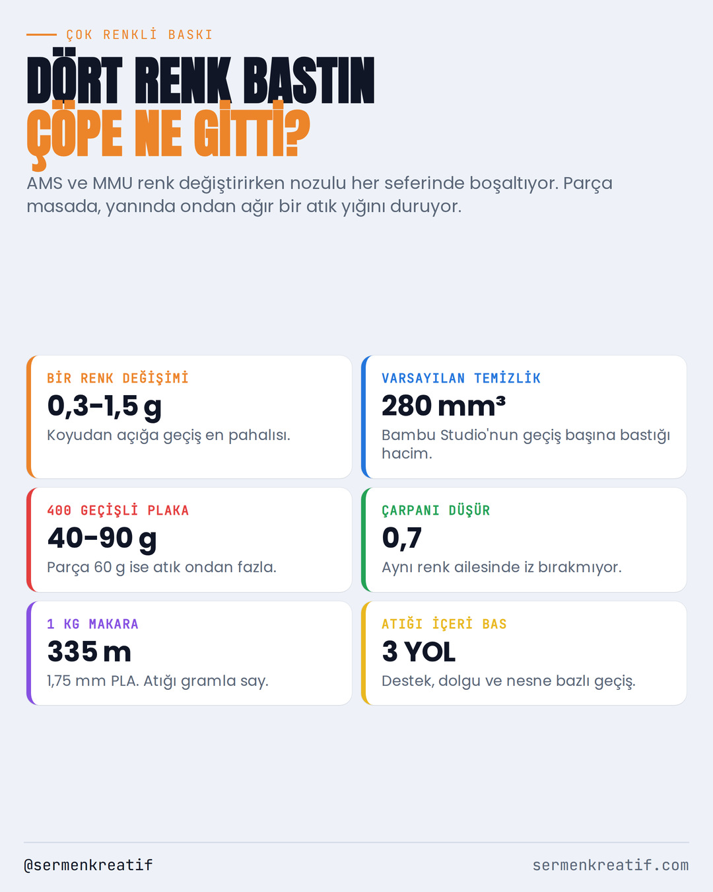</a>

**[2026-10-21-ams-israf](https://github.com/sedatisc/instagram-gorseller/tree/main/2026-10-21-ams-israf)** · 4 kare · hikaye 09:50

```
AMS ve MMU'da renk değişimi israfı, çok renkli baskıda çoğu zaman parçanın kendisinden pahalıya geliyor.

Her renk geçişinde nozul boşaltılıyor: geçiş başına 0,3-1,5 g, dilimleyicinin varsayılan ayarıyla 280 mm³. 400 geçişli bir plakada 40-90 g temizlik atığı çıkıyor — parça 60 g ise çöpe giden ondan fazla.

Maliyeti belirleyen şey parça sayısı değil geçiş sayısı; aynı plakada dokuz kopya da bassan geçişler ortak.

Aynı renk ailesinde temizlik çarpanını 0,7'ye indirmek iz bırakmadan %20-30 kazandırıyor. Asıl kazanç ise atığı modelin içine basmakta: desteğe, dolguya ya da rengi görünmeyen bir nesneye. Üçü de temizlik kulesi açıkken çalışıyor.

Siyahtan beyaza geçişte ve saydam filamentte çarpana dokunma; eski renk yeni katmanda gri bir leke olarak çıkıyor.

@bambulab · @prusa3d

Temizlik kulesini çöpe atarken içi sızlayan bir arkadaşın varsa ona yolla.

#sermenkreatif #3dbaski #3dprinting #ams #3dbaskiturkiye
```

## 12:10 · ÜRÜN & MAĞAZA

<a href="https://github.com/sedatisc/instagram-gorseller/tree/main/2026-10-21-filament-cesitleri"></a>

**[2026-10-21-filament-cesitleri](https://github.com/sedatisc/instagram-gorseller/tree/main/2026-10-21-filament-cesitleri)** · 8 kare · hikaye 12:50

```
"PLA aldım" demek artık tek bir şey anlatmıyor. Aynı rafta duran altı makara birbirinden bambaşka iş yapıyor.

CR-PLA Silk Rainbow » Tek makarada renk geçişi. Vazo modunda basılan parça boydan boya renk değiştiriyor; ikinci filamente gerek yok.

Hyper PLA Rainbow — Spring Lake » Uzun aralıklı renk geçişi, mat yüzey. Silk'in parlaklığını istemeyen ama tek renk de istemeyen için.

Hyper Luminous PLA — Yeşil » Karanlıkta parlıyor: gündüz ışığı topluyor, gece veriyor. Anahtarlık, gece lambası ve oyuncakta işe yarıyor.

Hyper PETG CF — Siyah » Karbon elyaf katkılı PETG: sert, az esneyen, mat dokulu parça. Sertleştirilmiş nozul şart, pirinç nozulu yiyor.

Hyper Foam PLA — Beyaz » Basarken köpürüyor: aynı hacimde çok daha hafif parça çıkıyor. Maket, uçak gövdesi ve taşınacak parçalar için.

Panchroma PLA Saten — Mavi » Saten yüzey: ne tam mat ne parlak. Katman izini yumuşatıyor, fotoğrafta en iyi çıkan seri bu.

Hepsi 1,75 mm ve 1 kg. Nozul ve tabla değerleri makaranın etiketinde yazıyor; seri değiştirince dilimleyicideki profili de değiştir.

Hepsi sermenkreatif.com'da; güncel fiyat ve renk seçenekleri orada.

Hangisini denedin, yoruma yaz.

Hangi filamenti alacağını soran arkadaşına bu gönderiyi yolla.

#sermenkreatif #3dbaski #filament #pla #petg
```

## 17:24 · PROJE & ATÖLYE

<a href="https://github.com/sedatisc/instagram-gorseller/tree/main/2026-10-21-pi5-ekran-standi"></a>

**[2026-10-21-pi5-ekran-standi](https://github.com/sedatisc/instagram-gorseller/tree/main/2026-10-21-pi5-ekran-standi)** · 4 kare · hikaye 18:04

```
Raspberry Pi 5 ekran standı tasarlarken model çizmeden önce ölçülerin kumpasla doğrulanması gerekiyor; kartı tutmayan standın sorunu tasarım değil, ölçü.

Pi 5 kartı 85 × 56 mm. Dört vida deliği 58 × 49 mm aralıkta ve delikler 2,9 mm, yani M2.5. Resmî Touch Display 2'nin dış ölçüsü 189 × 120 mm, aktif alanı 88 × 155 mm, çözünürlüğü 720 × 1280 ve kutudan dikey çıkıyor.

İkinci karar ısı: Pi 5 resmî beslemede 5,1 V 5 A, yani 27 W USB-C istiyor ve aktif soğutucuyla geliyor. Kapalı gövdede fan sıcak havayı kendi içinde dolaştırıyor — alt yüzeye giriş, üst arkaya çıkış aç.

Gövdeyi PLA'dan değil PETG'den bas; PLA güneş gören masada yumuşuyor.

Ekran karta tek DSI şeridi ve GPIO'dan besleme ile bağlanıyor, şeridi gerdirme. microSD yuvasını da kapatma — kart değiştirmek için standı sökmek istemezsin. Ekranı 60-70° eğimle oturt.

@raspberrypi

Pi'sini kitap yığınına yaslayarak kullanan bir arkadaşın varsa ona yolla.

#sermenkreatif #maker #raspberrypi #pi5
```

## 19:40 · REELS — [2026-10-21-ams-israf/reels.mp4](https://github.com/sedatisc/instagram-gorseller/tree/main/2026-10-21-ams-israf)

Açıklama gönderi metniyle aynı.

---

# 2026-11-12 · Perşembe

## 09:05 · AYAR & REHBER

<a href="https://github.com/sedatisc/instagram-gorseller/tree/main/2026-10-22-yuksek-akisli-nozzle">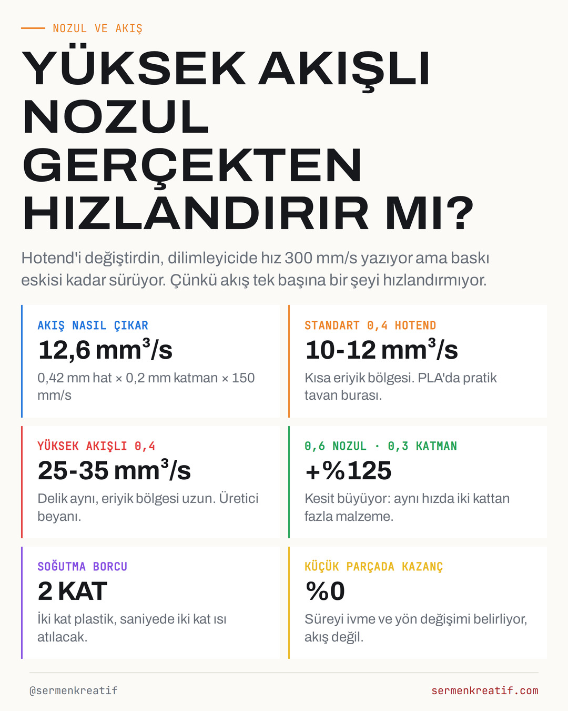</a>

**[2026-10-22-yuksek-akisli-nozzle](https://github.com/sedatisc/instagram-gorseller/tree/main/2026-10-22-yuksek-akisli-nozzle)** · 4 kare · hikaye 09:45

```
Yüksek akışlı nozzle gerçekten hızlandırıyor mu? Hotend'i değiştirip dilimleyicide hızı 300 mm/s'ye çeken herkesin baskısı kısalmıyor, çünkü akış tek başına süreyi belirlemiyor.

Nozuldan saniyede çıkan hacim üç sayının çarpımı: hat genişliği × katman yüksekliği × hız. 0,42 mm hat, 0,2 mm katman ve 150 mm/s birlikte 12,6 mm³/s ediyor. Standart 0,4 pirinç hotend bu civarda, 10-12 mm³/s'de tıkanıyor; yüksek akışlı sürümler 25-35 mm³/s iddia ediyor. Sınırı koyan deliğin çapı değil, filamentin erimeye vakit bulduğu eriyik bölgesi.

Tavanı yükseltmenin ucuz yolu hotend değil: 0,4 nozul ve 0,2 mm katmandan 0,6 nozul ve 0,3 mm katmana geçmek kesiti %125 büyütüyor. Bedeli çözünürlük — 0,6 mm'den ince duvar artık basılmıyor.

Akış tavanı yükselince sıra bir sonraki darboğaza geliyor. Katman 8-10 saniyenin altına inerse soğutma yetişmiyor, köşeler sarkıyor; nozul sıcaklığı 10-15 °C yukarı çıkıyor. Küçük ve detaylı parçada ise kafa hiçbir doğruyu tam hızda gitmiyor: orada süreyi ivme belirliyor, akış hiç devreye girmiyor.

Kısacası kazanç dolgu ve duvarda, yani büyük yüzeylerde. Küçük parçada sıfır.

Hotend değiştirip "niye hızlanmadı" diyen bir arkadaşın varsa bu gönderiyi ona yolla.

#sermenkreatif #3dbaski #3dprinting #hotend #3dbaskiturkiye
```

## 12:38 · ÜRÜN & MAĞAZA

<a href="https://github.com/sedatisc/instagram-gorseller/tree/main/2026-10-22-creality-k2-plus"></a>

**[2026-10-22-creality-k2-plus](https://github.com/sedatisc/instagram-gorseller/tree/main/2026-10-22-creality-k2-plus)** · 6 kare · hikaye 13:18

```
Creality K2 Plus Combo, 350 mm küp baskı alanı ve aktif ısıtmalı kapalı kabiniyle serinin amiral gemisi. Kapalı kabin çoğu makinede pasif, yani yalnız sıcağı içeride tutuyor; burada kabinin kendi ısıtıcısı var ve 60 °C'ye kadar çıkıyor.

Rakamlar » 350 × 350 × 350 mm alan, 600 mm/s hız, 30.000 mm/s² ivme, 40 mm³/s akış. Nozul 350 °C, tabla 120 °C. Apus çift dişli direct drive ve sertleştirilmiş çelik nozul standart geliyor. Hepsi üretici beyanı; bağımsız hız ve ivme testi henüz yayınlanmadı.

Ne işe yarıyor » ortam sıcaklığı düşmediği için ABS, ASA, PA-CF ve PPA-CF çekmeden basılıyor. CFS ile dört makara, dört üniteyle on altı renk. Kabin ve nozul kamerası akış kalibrasyonunu ve hatayı takip ediyor.

Dikkat » 33,5 kg ve 495 × 515 × 640 mm; iki kişi taşıyor, sağlam bir tezgâh şart. TPU önerilmiyor, esnek filament CFS'ten geçmiyor. CFS'te aktif kurutma yok, renk değişiminde purge atığı var. 300 mm/s üstünde köşelerde ringing bildiriliyor.

Kime uyar » mühendislik filamentiyle büyük parça basan atölye. Kime uymaz » TPU ağırlıklı ve küçük masa işi yapan.

Güncel durumu ve seçenekleri sermenkreatif.com'da görebilirsin. @creality3dofficial

Kapalı kabinli büyük bir makine arayan bir arkadaşın varsa bu gönderiyi ona yolla.

#sermenkreatif #3dbaski #creality #3dyazici
```

## 17:24 · PROJE & ATÖLYE

<a href="https://github.com/sedatisc/instagram-gorseller/tree/main/2026-10-20-fpv-drone-cinelog20"></a>

**[2026-10-20-fpv-drone-cinelog20](https://github.com/sedatisc/instagram-gorseller/tree/main/2026-10-20-fpv-drone-cinelog20)** · 5 kare · hikaye 18:04

```
FPV drone kurulumu GEPRC CineLog20'de üç ayrı işe bölünüyor: gövde uçmaya hazır geliyor, eksik olan batarya, alıcı ve gözlük eşleşmesi.

Gövde → 100 mm aks açıklığı, 2 inç dört kanatlı pervane, GR1303.5 5500KV motor. Taker G4 AIO kart 35 A ESC ile geliyor.

Alıcı → BNF sürümlerde ELRS 2,4 GHz, TBS Nano RX ya da R-XSR takılı. PNP sürümde alıcı yok, onu sen lehimliyorsun.

Video → DJI O3 Air Unit gözlükle kendi arasında eşleşiyor. Kumanda bağı ile video bağı ayrı kuruluyor; biri çalışırken diğeri kurulmamış olabiliyor.

Batarya hiçbir sürümde kutudan çıkmıyor: 4S LiHV, 450-660 mAh. 660 mAh ile uçuş süresi 4-6 dakika. LiHV hücre başına 4,35 V'a şarj oluyor, normal LiPo şarjında uçak eksik dolu kalkıyor.

İlk uçuştan önce failsafe'i pervaneler sökülüyken dene: kumandayı kapat, motorların kesildiğini gör. Batarya ile toplam ağırlığı da tart — kayıt ve izin şartı ağırlığa bağlı, güncelini SHGM'den doğrula.

FPV'ye yeni başlayan bir arkadaşın varsa bu gönderiyi ona yolla.

#sermenkreatif #maker #fpv #cinewhoop
```

## 19:40 · REELS — [2026-10-20-fpv-drone-cinelog20/reels.mp4](https://github.com/sedatisc/instagram-gorseller/tree/main/2026-10-20-fpv-drone-cinelog20)

Açıklama gönderi metniyle aynı.

